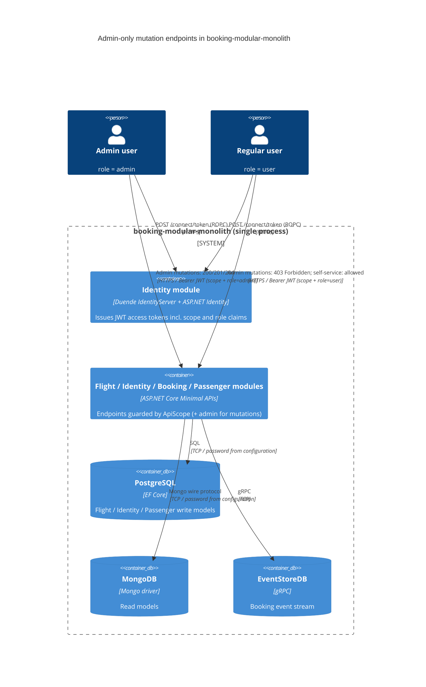

# 0001. Enforce the `admin` role policy on administrative API endpoints

- **Status:** Proposed
- **Date:** 2026-10-13
- **ARB ticket:** TO BE CREATED
- **Authors:** Devin (automated remediation of code-scan finding `sfind-b722bf41d8a34f3ba1e878a07df41944`)
- **Owning team:** booking-modular-monolith maintainers (TBD — owner to confirm before ARB)
- **Related ADRs:** none (first ADR in this repository)

## Context

`BuildingBlocks.Jwt.JwtExtensions.AddJwt` registers three authorization policies: `ApiScope`
(requires an authenticated user with `scope == booking-modular-monolith`), `admin`
(`RequireRole("admin")`) and `user` (`RequireRole("user")`). Before this change every Minimal API
endpoint — including the administrative mutations `CreateFlight`, `UpdateFlight`, `DeleteFlight`,
`CreateAircraft`, `CreateAirport`, `CreateSeat` and `RegisterNewUser` — was guarded only by
`RequireAuthorization(nameof(ApiScope))`. The role policies were never referenced by any endpoint.

Because the public ROPC client (`client`) is allowed the `booking-modular-monolith` scope and the
seeder creates a plain `user`-role account, any authenticated user could create, update and delete
flights, aircraft, airports and seats, and could register additional accounts. This is a
privilege-escalation / broken-access-control vulnerability (CWE-285 / OWASP A01).

ARB triggers: T6 (authorization change — existing endpoints now additionally require the `admin`
role; non-admin callers receive `403 Forbidden`). The heuristic detector reported no triggers; T6 is
added from manual review of the diff. No new service, data store, vendor, infrastructure or
cross-domain contract is introduced.

## Decision

We will require **both** the existing `ApiScope` policy and the existing `admin` role policy
(`.RequireAuthorization(nameof(ApiScope), IdentityConstant.Role.Admin)`) on the administrative
mutation endpoints `CreateFlight`, `UpdateFlight`, `DeleteFlight`, `CreateAircraft`,
`CreateAirport`, `CreateSeat` and `RegisterNewUser`. Read endpoints and user self-service endpoints
(`ReserveSeat`, `CreateBooking`, `CompleteRegisterPassenger`, `GetFlightById`, etc.) keep
`ApiScope` only. To make the role claim available to the API, the `booking-modular-monolith`
`ApiResource` in `Identity.Configurations.Config` declares `UserClaims = { role }`, so Duende
IdentityServer emits the `role` claim in access tokens for that audience. The test harness
(`BuildingBlocks.TestBase`) mirrors the `admin`/`user` policies on the fake JWT scheme and exposes
`UserHttpClient` for negative-authorization tests.

## Alternatives considered

| Alternative | Pros | Cons | Why rejected |
| --- | --- | --- | --- |
| Do nothing | No change | Any scoped token can perform admin mutations; finding stays open | Unacceptable security risk |
| Replace `ApiScope` with `admin` on these endpoints | Simpler single policy | Drops the audience/scope check; a token for another API with an `admin` role could be accepted | Weaker than combining both policies |
| Introduce a new fine-grained permission/claims model (e.g. per-operation permissions) | Future flexibility | New identity model, migration of seeded users, larger blast radius | Out of scope for a security fix; can be a follow-up ADR |
| Enforce role checks inside the MediatR handlers | Works for non-HTTP callers | Duplicated logic per handler, easy to forget, no 403 at the edge | Endpoint-level policy is the existing convention in this codebase |

## Architecture

## Non-functional requirements

| NFR | Target | How met |
| --- | --- | --- |
| Availability SLO | Unchanged (TBD — owner to confirm before ARB) | No new components; in-process policy evaluation |
| p95 latency | Unchanged | `RequireRole` is an in-memory claim check, negligible overhead |
| RPO / RTO | Unchanged | No data model change |
| Peak load | Unchanged | N/A — no new traffic path |
| Scaling model | Unchanged | N/A |
| Data retention | Unchanged | N/A |

## Security & compliance

- **Data classification:** Unchanged — flight/aircraft/airport/seat reference data and user accounts (PII) already stored.
- **Encryption at rest:** N/A — no new data store.
- **Encryption in transit:** Unchanged — HTTPS listener on 3000; JWT bearer tokens.
- **AuthN / AuthZ:** AuthN unchanged (JWT bearer issued by in-process Duende IdentityServer). AuthZ tightened: admin mutations require `ApiScope` AND `admin` role; `role` claim is now emitted for the `booking-modular-monolith` audience.
- **Secrets:** None added. Note: the repository still contains a public ROPC client secret and seeded demo credentials; these are tracked as separate findings and are out of scope here.
- **Audit logging:** Unchanged — ASP.NET Core authorization failures are logged by the framework; no new audit sink.
- **Data residency / regions:** N/A — no infrastructure change.
- **Policy sections satisfied:** No CDK/infra touched; `policy/approved-infra.yaml` not applicable.
- **Threats considered:** Privilege escalation by low-privilege users (mitigated); token minted for another audience with `admin` role (mitigated by retaining `ApiScope`); forged tokens via committed dev signing key (separate finding, not addressed here).

## Cost

| Item | Assumption | Monthly estimate |
| --- | --- | --- |
| None | Code-only change, no new resources | $0 |
| **Total** | | $0 |

## Operations

- **On-call rotation:** Unchanged (TBD — owner to confirm before ARB).
- **Runbook:** N/A — no new operational procedure. Admin users are created by `IdentityDataSeeder` (first seeded user gets the `admin` role).
- **Dashboards / alarms:** Unchanged. A spike in `403` responses on `/api/v1/flight*` after rollout would indicate clients using non-admin accounts for admin operations.
- **Rollback plan:** Revert the PR; endpoints fall back to `ApiScope`-only (reintroduces the vulnerability).
- **Migration / cut-over plan:** None. Existing admin tokens issued before the change that lack a `role` claim must be re-issued (tokens expire after 3600 s).

## Policy exceptions requested

| Rule | Resource | Justification | Compensating control | Expiry |
| --- | --- | --- | --- | --- |
| none | | | | |

## Consequences

- Positive: closes the broken-access-control finding; role policies registered in `AddJwt` are now actually enforced; negative-authorization test coverage added.
- Negative / risks: clients that performed admin operations with `user`-role accounts will now receive `403`. `RegisterNewUser` becomes admin-only, so self-sign-up (if it was relied upon) is no longer possible with a plain user token.
- Follow-ups: ownership checks on user self-service endpoints (`ReserveSeat`, `CreateBooking`); rotate/remove the committed ROPC client secret, seeded credentials and `tempkey.jwk` (separate findings).

## Open questions

- Should `RegisterNewUser` remain admin-only, or should an anonymous self-registration flow be introduced instead? (Product decision.)
- Owning team / on-call rotation for this repository — TBD before ARB.
