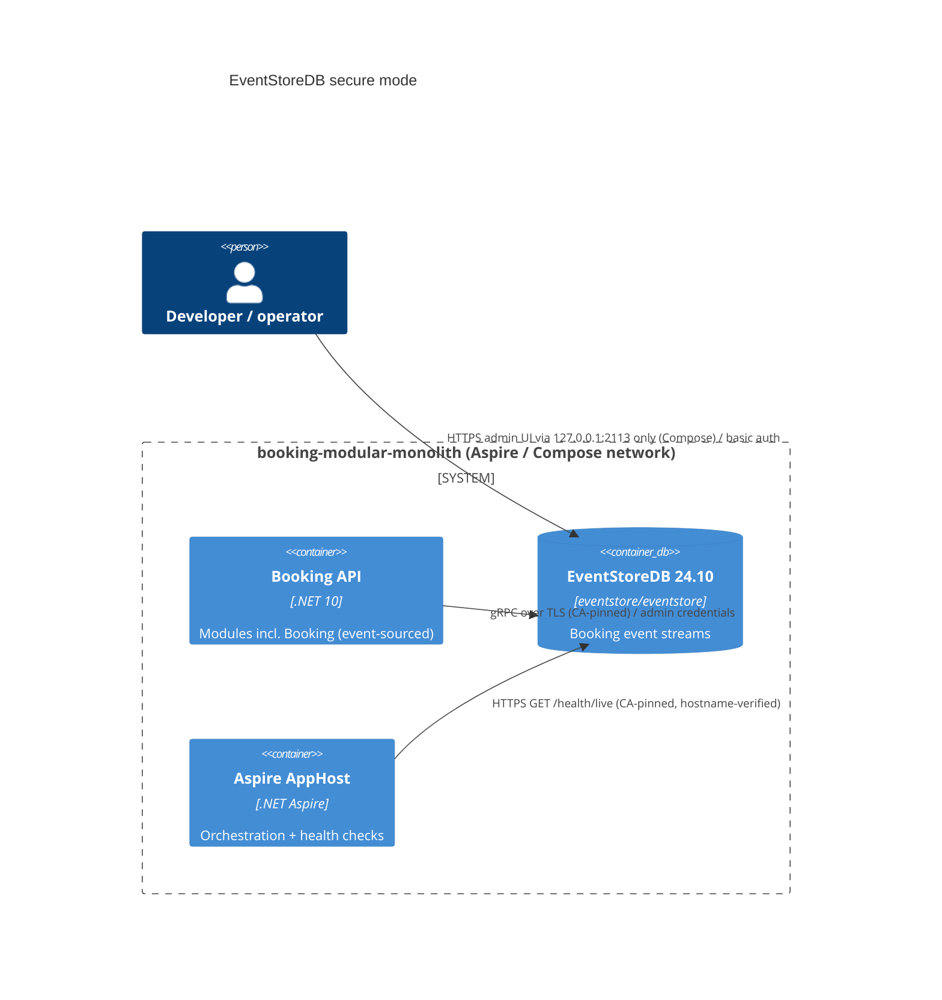

# 0001. Run EventStoreDB in secure mode (TLS + authentication) and keep it off the external network

- **Status:** Proposed
- **Date:** 2026-11-18
- **ARB ticket:** TO BE CREATED
- **Authors:** Devin (on behalf of @abhay-codeium)
- **Owning team:** TBD — owner to confirm before ARB
- **Related ADRs:** none

## Context

The Booking module event-sources reservations into EventStoreDB, which is the system of record for booking events. Before this change, both the Aspire AppHost and the Docker Compose files started EventStoreDB with `EVENTSTORE_INSECURE=True`, which turns off authentication and TLS. The Aspire 2113 endpoint (HTTP/gRPC/admin UI) was marked `IsExternal = true`, so publish mode mapped it to the host. Compose published it on all interfaces. Anyone who could reach port 2113 could read, append (forge) or delete every booking stream without credentials. The Booking read side then deserializes and projects those forged events. A code scan flagged this as finding `sfind-d5a431c46474485fb398b862776ea0b8`.

Constraint: `CommunityToolkit.Aspire.Hosting.EventStore` 9.9.0 hardcodes `EVENTSTORE_INSECURE=true` and a `tls=false` connection string, so secure mode cannot be done through that integration.

ARB triggers: T6 (authentication / network-boundary change). The change only tightens the boundary. It adds no new service, data store, vendor or cloud resource.

## Decision

We will run EventStoreDB in secure mode everywhere outside of integration tests:
- **TLS** uses a locally generated CA and node certificate from `deployments/configs/eventstore/generate-certs.sh`.
- **Credentials:** the built-in `admin`/`ops` users get non-default passwords. Aspire generates them as persisted secret parameters `eventstore-admin-password` and `eventstore-ops-password`. Compose requires the `EVENTSTORE_ADMIN_PASSWORD` and `EVENTSTORE_OPS_PASSWORD` env vars.
- **Network exposure:** the 2113 endpoint is internal in Aspire (`IsExternal = false`) and bound to `127.0.0.1` in Compose.
- **API connection:** the API connects with `esdb://admin:<password>@<host>:2113?tls=true&tlsCaFile=<ca.crt>`. Only the CA certificate is mounted into the API.
- **Image:** EventStoreDB is pinned to `eventstore/eventstore:24.10` and hosted as a plain Aspire container resource instead of the toolkit integration.

## Alternatives considered

| Alternative | Pros | Cons | Why rejected |
| --- | --- | --- | --- |
| Do nothing | No dev-setup change | Unauthenticated read/forge/delete of all booking events by anyone who can reach 2113 | Leaves an open, scanner-reported vulnerability |
| Only set `IsExternal = false` / bind to loopback, keep insecure mode | Minimal change | Any process or container on the same network still has full unauthenticated access, and traffic is plaintext | Network restriction alone is not defence in depth for the system of record |
| Keep the CommunityToolkit integration and patch around it | Less AppHost code | The integration forces `EVENTSTORE_INSECURE=true` and `tls=false` | Not configurable to secure mode |
| Dedicated least-privilege ESDB user for the API instead of `admin` | Smaller blast radius if API creds leak | Needs user provisioning on first start (ESDB has no env-based user bootstrap) | Deferred as a follow-up; out of scope for this remediation |

## Architecture

## Non-functional requirements

| NFR | Target | How met |
| --- | --- | --- |
| Availability SLO | Unchanged | Single-node ESDB, same as before |
| p95 latency | Unchanged (TLS handshake amortised over persistent gRPC channel) | Long-lived `EventStoreClient` |
| RPO / RTO | Unchanged | Persistent volume as before |
| Peak load | Unchanged | No topology change |
| Scaling model | Unchanged (cluster size 1) | — |
| Data retention | Unchanged | — |

## Security & compliance

- **Data classification:** Booking events contain passenger/booking data (treat as Confidential).
- **Encryption at rest:** Unchanged (host volume). N/A for this change.
- **Encryption in transit:** TLS on all ESDB traffic (gRPC and HTTP). Clients verify the server against the generated CA.
- **AuthN / AuthZ:** ESDB built-in auth is on and the default `changeit` passwords are replaced. The API uses `admin`; a least-privilege user is a follow-up.
- **Secrets:** Aspire uses generated secret parameters persisted to AppHost user-secrets. Compose takes passwords from env/`.env` (gitignored) and fails fast if they are unset. Certificates and the CA key are generated locally and gitignored. The CA private key stays outside every container mount.
- **Audit logging:** ESDB auth failures appear in ESDB server logs.
- **Data residency / regions:** N/A — local/dev orchestration only.
- **Policy sections satisfied:** Encryption in transit, no default credentials, no externally exposed data store admin port.
- **Threats considered:** Unauthenticated event read/forgery/deletion via 2113. Plaintext sniffing on the container network. A compromised API reading the CA signing key (mitigated by mounting only `ca.crt`). Health-probe MITM (mitigated by CA pinning plus hostname verification).

## Cost

| Item | Assumption | Monthly estimate |
| --- | --- | --- |
| None | No new resources | $0 |
| **Total** | | $0 |

## Operations

- **On-call rotation:** TBD — owner to confirm before ARB
- **Runbook:** README sections "Aspire" and "Docker Compose" (cert generation, password setup)
- **Dashboards / alarms:** Aspire dashboard health for the `eventstore` resource (`/health/live`)
- **Rollback plan:** Revert the PR. Stream data in the volume is unaffected by the security mode.
- **Migration / cut-over plan:** Developers run `generate-certs.sh` and set the passwords. Existing dev volumes initialised under insecure mode should be recreated so the new default passwords apply.

## Policy exceptions requested

| Rule | Resource | Justification | Compensating control | Expiry |
| --- | --- | --- | --- | --- |
| none | | | | |

## Consequences

- Positive: The scanner-reported unauthenticated access path is closed, booking events are encrypted in transit, and the admin UI is no longer exposed beyond loopback.
- Negative / risks: Local setup needs one extra step (cert generation and passwords). Self-signed certs expire after 365 days and must be regenerated with `--force`.
- Follow-ups: Least-privilege ESDB user for the API. Cert rotation guidance for non-dev deployments.

## Open questions

- Owning team and on-call rotation for EventStoreDB.
- Whether non-local deployments should source certificates from a managed PKI instead of `generate-certs.sh`.
