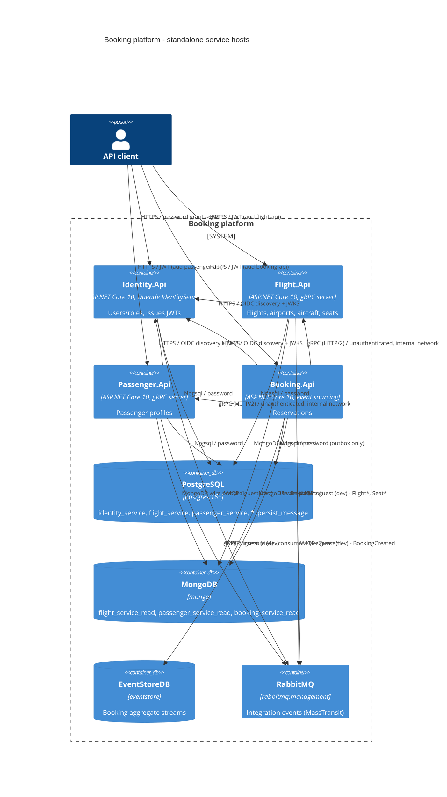

# 0001. Extract the Identity, Flight, Passenger and Booking modules into standalone service hosts

- **Status:** Proposed
- **Date:** 2026-10-13
- **ARB ticket:** TO BE CREATED
- **Authors:** Devin (requested by Abhay Aggarwal)
- **Owning team:** Booking platform team (owners of `src/Api` and `src/Modules/*`)
- **Related ADRs:** none (first ADR in this repository)

## Context

`src/Api` hosts the four business modules (`Identity`, `Flight`, `Passenger`, `Booking`) in one process. They
already have strict logical boundaries (separate EF Core contexts, Mongo read models, MassTransit integration
events, gRPC calls from Booking to Flight/Passenger), but they share one deployment unit, one in-memory bus,
one Mongo database (`booking_modular_monolith_read`) and one outbox table (`persist_message`). The business
wants to scale and release the modules independently without a big-bang rewrite, while the monolith keeps
working for existing environments.

This change adds four independently deployable ASP.NET Core hosts under `src/Services/` that compose the
*existing* module assemblies, a configurable MassTransit transport (in-memory for the monolith, RabbitMQ for
the hosts), shared gRPC contracts in `BuildingBlocks`, per-service data stores, and orchestration for both
Aspire and docker-compose. The monolith is unchanged apart from the shared contract/transport refactoring.

ARB triggers: T1 (four new containers / compose services, Dockerfiles), T2 (seven new PostgreSQL databases and
three new MongoDB databases per service, outbox/inbox tables per service), T4 (gRPC contracts moved to a shared
package; wire package names unified to `flight`/`passenger`), T6 (RabbitMQ becomes a production dependency and
cross-service integration path; auth boundary moves to per-service JWT validation against `Identity.Api`).
Detector hits for T3 (`$schema` URLs in launchSettings, existing Kibana container) and T7 (`sdk:10.0` base
image already used by `src/Api/Dockerfile`) are false positives: no new vendor, runtime or language version.

## Decision

We will extract each module into its own minimal-API host (`src/Services/<Module>.Api`) that references only
`BuildingBlocks`, `ServiceDefaults` and its own module project, with `Identity.Api` as the sole Duende
IdentityServer token issuer and the other hosts validating JWTs through `BuildingBlocks/Jwt` against it.
Services exchange integration events over RabbitMQ (MassTransit, transport selected by
`MessageBrokerOptions:TransportType`, per-service queue prefix, outbox + inbox via `PersistMessageProcessor`
on a per-service `*_persist_message` database), Booking calls Flight/Passenger over gRPC using contracts
compiled from `src/BuildingBlocks/Contracts/Grpc/Protos` and addressed through configuration / Aspire service
discovery, and every service owns its PostgreSQL database (`<module>_service`), its MongoDB database
(`<module>_service_read`) and — for Booking only — the EventStoreDB stream store. The Aspire AppHost and
`deployments/docker-compose/docker-compose.yaml` orchestrate the four services plus Postgres, MongoDB,
EventStoreDB and RabbitMQ; the monolith stays buildable and runnable (in-memory transport, unchanged DBs).

## Alternatives considered

| Alternative | Pros | Cons | Why rejected |
| --- | --- | --- | --- |
| Do nothing (keep the modular monolith) | Zero migration cost, simplest ops | No independent scaling/deploys; one failure domain; one shared outbox and read DB | Does not meet the goal of independently deployable services |
| Copy module code into new service repos | Full autonomy per team | Duplicates ~all business code; monolith and services drift immediately | Violates "monolith keeps working unchanged"; high maintenance |
| Azure Service Bus instead of RabbitMQ | Managed, no broker to operate | New external vendor dependency; not available in local compose/Aspire today | RabbitMQ is already in the compose/Aspire stack and MassTransit abstracts the transport, so ASB can be added later without code changes |
| One shared PostgreSQL/Mongo database for all services | Fewer databases to manage | Two outbox pollers on one table; cross-service schema coupling | Breaks data ownership; per-service databases on shared servers keep cost low while isolating schemas |

## Architecture

## Non-functional requirements

| NFR | Target | How met |
| --- | --- | --- |
| Availability SLO | TBD — owner to confirm before ARB (monolith has no published SLO) | Each host is stateless and horizontally scalable; broker buffers events while a consumer is down |
| p95 latency | TBD — owner to confirm before ARB | Booking→Flight/Passenger gRPC adds one network hop; resilience handler (retry/circuit breaker/timeout) already configured in `GrpcClientExtensions` |
| RPO / RTO | TBD — owner to confirm before ARB | Outbox/inbox tables make event delivery at-least-once and idempotent; data stores are the same engines as today |
| Peak load | TBD — owner to confirm before ARB | Per-service scaling instead of scaling the whole monolith |
| Scaling model | Horizontal per service (container replicas) | Hosts share nothing but the broker and their own databases; MassTransit queues are per service (`<service>-` prefix) |
| Data retention | Same as monolith (no change) | Same schemas, migrated by each host on start-up |

## Security & compliance

- **Data classification:** Internal / PII (passenger names, passport numbers, user accounts) — unchanged from the monolith.
- **Encryption at rest:** N/A — relies on the hosting platform's volume encryption; no new store engines introduced.
- **Encryption in transit:** HTTPS between clients and hosts (Kestrel dev certs locally); AMQP, Npgsql, Mongo and EventStoreDB connections are plain inside the compose/Aspire network in development. Production must enable TLS on the broker and databases (follow-up).
- **AuthN / AuthZ:** `Identity.Api` issues JWTs (Duende IdentityServer, password grant); every other host validates them with `AddJwt()` (`Jwt:Authority` = Identity host, per-service `Jwt:Audience` = `flight-api` / `passenger-api` / `booking-api`, `ApiScope` + role policies unchanged). Service-to-service gRPC is unauthenticated on the internal network — ARB follow-up.
- **Secrets:** development credentials (`postgres/postgres`, `guest/guest`, client `secret`) stay in appsettings as today; production values come from environment variables / Aspire parameters.
- **Audit logging:** unchanged (Duende event raising, OpenTelemetry traces per host with `ObservabilityOptions:ServiceName`).
- **Data residency / regions:** N/A — single-region self-hosted containers.
- **Policy sections satisfied:** no `policy/approved-infra.yaml` exists in this repository; no cloud resources are declared.
- **Threats considered:** token replay across services (mitigated by per-service audience), duplicate event processing (inbox filter), broker outage (outbox retries), rogue internal caller on gRPC (not mitigated — follow-up).

## Cost

| Item | Assumption | Monthly estimate |
| --- | --- | --- |
| 4 service containers | replaces 1 monolith container; ~0.5 vCPU / 512 MB each | TBD — owner to confirm before ARB |
| RabbitMQ | 1 node, already part of the compose stack | TBD — owner to confirm before ARB |
| Additional databases | same PostgreSQL/Mongo servers, extra databases only | ~0 |
| **Total** | | TBD (expected < $2k/mo for a single environment) |

## Operations

- **On-call rotation:** Booking platform team (same as the monolith).
- **Runbook:** `README.md` → "Standalone services" section (Aspire and docker-compose run instructions).
- **Dashboards / alarms:** existing Grafana/Prometheus/Tempo stack; each host exports with its own `ObservabilityOptions:ServiceName`; `/health` and `/alive` endpoints in Development.
- **Rollback plan:** stop the four hosts and run `src/Api` again — the monolith still builds and uses its own databases and the in-memory transport. No shared schema is modified.
- **Migration / cut-over plan:** phase 1 (this change) runs the services on fresh databases side by side with the monolith; data migration and routing cut-over are follow-up work.

## Policy exceptions requested

| Rule | Resource | Justification | Compensating control | Expiry |
| --- | --- | --- | --- | --- |
| none | | | | |

## Consequences

- Positive: independent deploy/scale per module; explicit contracts (`BuildingBlocks/Contracts`); outbox/inbox per service; the gRPC package mismatch between Booking's client protos and the Flight/Passenger servers is removed.
- Negative / risks: four hosts to operate instead of one; eventual consistency between Identity→Passenger via the broker; development credentials still in appsettings; gRPC between services is unauthenticated.
- Follow-ups: service-to-service gRPC authentication, TLS for broker/databases, data migration from `*_modular_monolith` databases, API gateway / routing cut-over.

## Open questions

- SLO, latency, RPO/RTO and cost targets (owner to confirm before ARB).
- Whether Azure Service Bus should replace RabbitMQ in cloud environments (MassTransit keeps this a configuration change).
