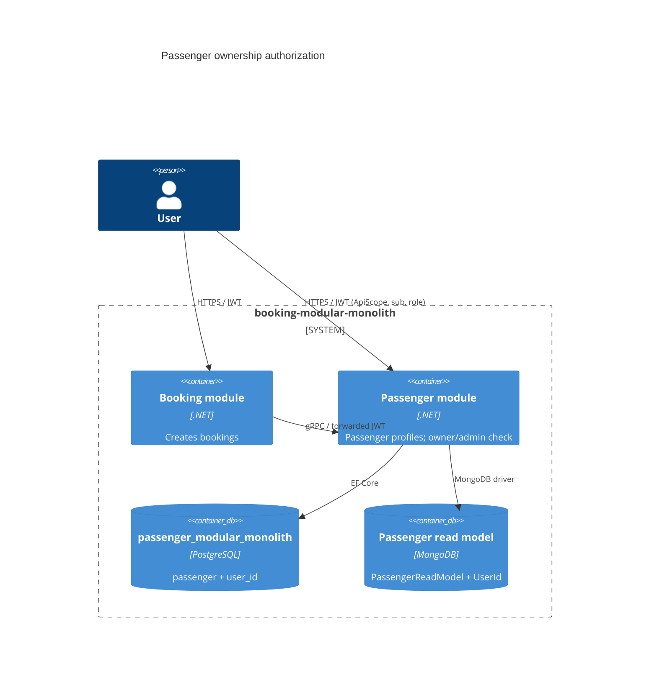

# 0001. Passenger ownership authorization

- **Status:** Proposed
- **Date:** 2026-11-18
- **ARB ticket:** TO BE CREATED
- **Authors:** Devin (code scan remediation)
- **Owning team:** TBD — owner to confirm before ARB
- **Related ADRs:** none

## Context

Code scan finding: `GET /api/v1/passenger/{id}` and the Passenger gRPC `GetById` return any passenger
(name, passport number, age) to any caller. The HTTP route only checks the `ApiScope` policy, and the gRPC
service was mapped with no authorization at all. Passenger records had no link to the identity user that owns them.

ARB triggers: T6 (authorization change: owner/admin check, gRPC service now requires `ApiScope`),
T4 (Booking -> Passenger gRPC call now forwards the caller's bearer token), T2 (new nullable `user_id`
column on Postgres `passenger` and `UserId` field on the Mongo read model; no new data classification).

## Decision

We will store the identity user id (`UserCreated.Id`) on each passenger, return a passenger only when the
token's `sub` matches that id or the caller has the `admin` role (otherwise 404), require the `ApiScope`
policy on the Passenger gRPC service, and have the Booking module forward the incoming `Authorization`
header on its Passenger gRPC calls.

## Alternatives considered

| Alternative | Pros | Cons | Why rejected |
| --- | --- | --- | --- |
| Do nothing | No change | Passport numbers readable by any user (IDOR) | Security finding stays open |
| Admin-only route | Simple | Users can no longer read their own record; breaks booking for non-admins | Removes legitimate use |
| Resolve owner via Identity module at request time | No schema change | New cross-module call on every read; Identity DB is separate | More coupling than storing the id once |

## Architecture

## Non-functional requirements

| NFR | Target | How met |
| --- | --- | --- |
| Availability SLO | Unchanged | No new components |
| p95 latency | Unchanged | One in-memory comparison per read |
| RPO / RTO | Unchanged | Existing stores |
| Peak load | Unchanged | — |
| Scaling model | Unchanged | — |
| Data retention | Unchanged | — |

## Security & compliance

- **Data classification:** Unchanged (passenger PII already stored); adds identity user id.
- **Encryption at rest:** Unchanged.
- **Encryption in transit:** Unchanged.
- **AuthN / AuthZ:** Owner (`sub`) or `admin` role required for passenger reads; gRPC requires `ApiScope`.
- **Secrets:** None added.
- **Audit logging:** Unchanged.
- **Data residency / regions:** Unchanged.
- **Policy sections satisfied:** N/A — no infrastructure changes.
- **Threats considered:** IDOR on passenger id; unauthenticated gRPC access; existence oracle (non-owners get 404).

## Cost

| Item | Assumption | Monthly estimate |
| --- | --- | --- |
| None | No new resources | $0 |
| **Total** | | $0 |

## Operations

- **On-call rotation:** TBD — owner to confirm before ARB
- **Runbook:** N/A
- **Dashboards / alarms:** Watch 404 rate on `GET /api/v1/passenger/{id}` after rollout.
- **Rollback plan:** Revert the PR; the nullable column can stay.
- **Migration / cut-over plan:** EF migration `add_passenger_user_id` runs on startup. Existing passengers
  have no `user_id` and are admin-only until backfilled.

## Policy exceptions requested

| Rule | Resource | Justification | Compensating control | Expiry |
| --- | --- | --- | --- | --- |
| none | | | | |

## Consequences

- Positive: Closes the passenger IDOR on HTTP and gRPC; booking for another user's passenger is also blocked.
- Negative / risks: Pre-existing passengers are not readable by their owners until `user_id` is backfilled.
- Follow-ups: Backfill `user_id` from Identity (match on passport number); review
  `POST /passenger/complete-registration`, which still lets any user act on a passport number they know.

## Open questions

- Owning team and on-call rotation.
- Whether to backfill existing passengers and how.
