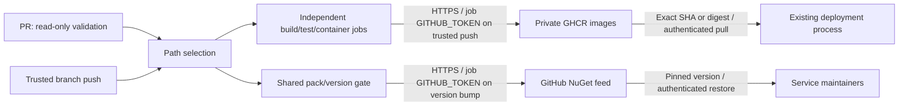

# 0001. Independent service CI and GitHub Packages publishing

- **Status:** Proposed
- **Date:** 2026-10-29
- **ARB ticket:** TO BE CREATED
- **Authors:** AB-490 implementation
- **Owning team:** Booking platform maintainers (named owner to confirm)
- **Related ADRs:** AB-499 migration decisions (forthcoming)

## Context

The existing CI serially tests modules, swallows test-process failures, and has an
unused Docker Hub action restricted to main. Independent deployable hosts need
isolated validation and traceable images; shared contracts and BuildingBlocks need
versioned distribution without changing CLR namespaces or message URNs.

ARB triggers: T6 (new workflow package-write authorization) and T8 (shared-library
distribution across bounded-context owners). No runtime network/auth boundary,
service, business data store or cloud resource is introduced by this ticket.

## Decision

We will select service jobs by changed paths, reuse build/test and Docker composite
actions, and publish SHA-versioned private images and SemVer shared packages to
GitHub Packages using short-lived workflow credentials on trusted branch pushes.
PRs build/test/pack without publishing. Existing modules continue validating while
sibling tickets add hosts. Optional cluster deployment is deferred rather than
granting cluster credentials to CI.

## Alternatives considered

| Alternative | Pros | Cons | Why rejected |
| --- | --- | --- | --- |
| Do nothing | No change | No host images; unrelated failures block all modules | Does not support independent release |
| Copy one workflow per service | Simple individual files | Drift and duplicate security/version rules | Reusable workflow gives isolated jobs without drift |
| Docker Hub plus external NuGet server | Independent registry providers | Long-lived secrets, extra ownership and vendor setup | GitHub Packages uses existing repository trust and token |

## Architecture

## Non-functional requirements

| NFR | Target | How met |
| --- | --- | --- |
| Availability SLO | TBD — owner to confirm before ARB | GitHub Actions/Packages dependency; no runtime SLO change |
| p95 latency | N/A for application requests | CI does not enter request path |
| RPO / RTO | TBD — owner to confirm registry recovery/retention | Source rebuild and immutable SHA references |
| Peak load | Up to five service jobs per commit | Path selection; no fail-fast coupling |
| Scaling model | GitHub-hosted jobs | PR cancellation; trusted pushes finish publication |
| Data retention | Owner to set artifact/image retention | No destructive cleanup workflow introduced |

## Security & compliance

- **Data classification:** private source/build artifacts; no customer data intentionally published.
- **Encryption at rest:** GitHub-managed; no new customer-managed keys.
- **Encryption in transit:** HTTPS registry APIs; Docker layer transport uses registry TLS.
- **AuthN / AuthZ:** read-only contents; package writes only in publisher/shared-pack jobs.
- **Secrets:** short-lived `GITHUB_TOKEN`; no external PAT, plaintext credential file or cluster credential.
- **Audit logging:** GitHub Actions run logs and package history; source/revision OCI labels.
- **Data residency / regions:** existing GitHub account policy; owner to confirm before ARB.
- **Policy sections satisfied:** no Terraform/CDK/CloudFormation resource added; approved-infra resource policy not applicable.
- **Threats considered:** untrusted PR publication (blocked by event/ref gates), mutable release tags
  (no latest), silent test failure (propagated), stale NuGet overwrite (new versions only).

## Cost

| Item | Assumption | Monthly estimate |
| --- | --- | --- |
| Actions runners / artifacts | Path-filtered Linux jobs; no new runner pool | TBD — owner to confirm based on commit volume |
| GHCR / NuGet storage | Retained SHA images and shared versions | TBD — owner to confirm retention and package size |
| **Total** | No provisioned cloud infrastructure | TBD — owner to confirm before ARB; no claim of zero cost |

## Operations

- **On-call rotation:** Booking platform maintainers; named rotation TBD.
- **Runbook:** `docs/runbooks/service-ci.md`.
- **Dashboards / alarms:** Actions CI result and package publish logs.
- **Rollback plan:** redeploy previous image SHA/digest; pin prior shared NuGet version.
- **Migration / cut-over plan:** host Dockerfiles activate image publishing as siblings merge;
  production rollout/rollback is owned by AB-505, not automatic in CI.

## Policy exceptions requested

None. ARB approval remains required before the epic merges to main; integration
branch merges are allowed by the epic's delivery instructions.

## Consequences

- Positive: isolated feedback and publication, reusable logic, traceable artifact versions.
- Negative / risks: shared changes rebuild all; centralized shared versions publish all shared packages;
  legacy monolith-referencing tests still compile unrelated projects.
- Follow-ups: named ownership/retention/cost/residency confirmation; registry permissions;
  environment-gated deployment in a later ticket.

## Open questions

- Who owns package retention and on-call? What recovery target and monthly budget apply?
- Does the organization permit this repository to create private GHCR and NuGet packages?
