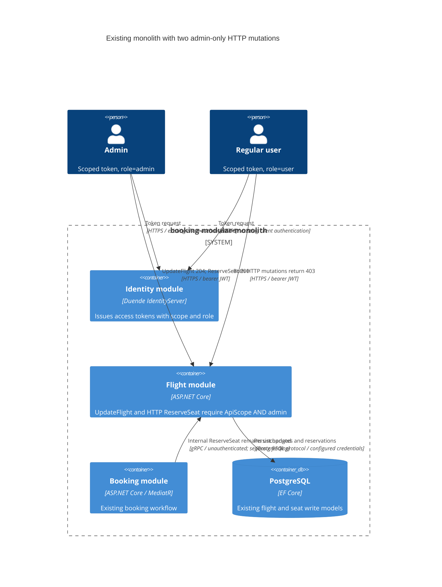

# 0001. Require admin role for UpdateFlight and ReserveSeat HTTP endpoints

- **Status:** Proposed
- **Date:** 2026-11-18
- **ARB ticket:** TO BE CREATED
- **Authors:** Devin
- **Owning team:** booking-modular-monolith maintainers (TBD — owner to confirm before ARB)
- **Related ADRs:** None on main. Adapted and rescoped from the proposed ADR in PR #152; that PR is not modified or superseded by this proposal.

## Context

`BuildingBlocks.Jwt.JwtExtensions.AddJwt` registers `ApiScope` (authenticated bearer token
with the configured audience scope), `admin` and `user` role policies. The HTTP endpoints
`PUT /api/v1/flight` (`UpdateFlight`) and `POST /api/v1/flight/reserve-seat` (`ReserveSeat`)
previously required only `ApiScope`, allowing a scoped regular user to perform these mutations.
The monolith API resource also needs to request the role claim for access tokens. Separately,
`UpdateFlightValidator` was incorrectly bound to `CreateFlight`, leaving updates without their
intended validation and without a non-empty ID rule.

ARB triage: **ARB_REQUIRED — T6 (authorization boundary change)**, from manual review.
The detector invocation was blocked by the execution guardrail; no detector result is claimed.
No new service, store, vendor, infrastructure, dependency or cross-domain message is introduced.

## Decision

We will require both `ApiScope` and `IdentityConstant.Role.Admin` using
`.RequireAuthorization(nameof(ApiScope), IdentityConstant.Role.Admin)` on only the two HTTP
endpoints above. The `booking-modular-monolith` `ApiResource` declares
`UserClaims = { JwtClaimTypes.Role }` so its access tokens carry roles. We bind
`UpdateFlightValidator` to `UpdateFlight` and reject empty IDs, retaining the other validation
rules. The test fixture mirrors the admin/user policies with FakeJwtBearer and exposes
`CreateHttpClient(role)`; its existing `HttpClient` remains admin.

Other HTTP endpoints are unchanged. In particular, the gRPC
`FlightGrpcServices.ReserveSeat` operation remains unauthenticated as the internal
Booking-to-Flight path: `CreateBookingHandler` calls the gRPC client, which dispatches the
same `ReserveSeat` command through MediatR. Internal intent is not an authentication control;
gRPC authentication and reachability are a **separate security finding**, not mitigated here.
Endpoint authorization is deliberately not added to the shared command handler.

## Alternatives considered

| Alternative | Pros | Cons | Why rejected |
| --- | --- | --- | --- |
| Do nothing | No client change | Scoped users retain administrative mutation access | Broken access control remains |
| Replace ApiScope with admin | One policy | Removes the explicit scope requirement | Both checks must remain |
| Authorize inside shared handlers | Covers multiple entry points | Changes the internal Booking path and requires a service identity design | Separate finding and scope |
| Introduce per-operation permissions | Fine-grained authorization | New identity model and migration | Unnecessary for this focused remediation |

## Architecture

## Non-functional requirements

| NFR | Target | How met |
| --- | --- | --- |
| Availability SLO | Unchanged; numeric target TBD — owner to confirm before ARB | No new runtime component |
| p95 latency | No material regression; numeric budget TBD — owner to confirm | In-process role-claim check; no new network call |
| RPO / RTO | Unchanged; values TBD — owner to confirm | No schema or storage change |
| Peak load | Unchanged; measured target TBD — owner to confirm | Existing request paths |
| Scaling model | Unchanged | Existing monolith deployment |
| Data retention | Unchanged | No new persisted data |

## Security & compliance

- **Data classification:** Unchanged; existing flight/seat business data and identity role claims. No new PII category or store.
- **Encryption at rest:** Unchanged; no new store or encryption configuration. Existing controls are not assessed by this change.
- **Encryption in transit:** Existing transport configuration is unchanged; diagram HTTPS paths describe intended HTTP client access, not a new enforcement mechanism.
- **AuthN / AuthZ:** JWT authentication remains unchanged. Both affected HTTP endpoints require scope AND admin; absent credentials receive 401 and regular scoped users receive 403. Role issuance is added only to the monolith API resource.
- **Secrets:** None added or rotated. Existing demo credentials and signing-key concerns are separate findings.
- **Audit logging:** No new audit sink; existing framework authorization logging remains unchanged.
- **Data residency / regions:** Unchanged; no infrastructure change.
- **Policy sections satisfied:** T6 review requested. CDK approved-infrastructure policy is not applicable because no infrastructure is changed. ARB approval is required before merge.
- **Threats considered:** Scoped non-admin HTTP mutations are denied; missing API scope remains denied even for admins. Unauthenticated gRPC access is explicitly not addressed.
- **Validation:** Update requests now receive their intended validation, including non-empty ID; invalid updates must not mutate persisted state.

## Cost

| Item | Assumption | Monthly estimate |
| --- | --- | --- |
| Authorization and validation | Existing process and stores; no provisioned resources or external calls | $0 incremental infrastructure |
| **Total** | No new capacity assumed | **$0 incremental infrastructure** |

## Operations

- **Owning team / on-call:** Existing maintainers; named team and rotation TBD — owner to confirm before ARB.
- **Runbook:** No new runbook. Existing identity administration supplies admin-role users; operational ownership needs confirmation.
- **Dashboards / alarms:** No new alarms. Monitor 401/403 responses on the two affected HTTP routes after rollout.
- **Rollback plan:** Revert the implementation commit if necessary, recognizing that this restores the authorization weakness and validator defect; security approval is required for that tradeoff.
- **Migration / cut-over plan:** No schema migration. Admin clients must obtain new access tokens if their existing tokens lack role claims. Non-admin HTTP clients must stop using these operations. The internal Booking gRPC flow is unchanged.
- **Verification:** Flight validator/pipeline unit tests pass (23 total Flight unit tests). Flight E2E and Identity integration runs were blocked by Docker Hub rate limiting during container initialization; runtime verification must complete before merge. Identity configuration tests passed (3).

## Policy exceptions requested

| Rule | Resource | Justification | Compensating control | Expiry |
| --- | --- | --- | --- | --- |
| none | | | | |

## Consequences

- Positive: the two HTTP mutations enforce admin authorization while preserving scope checks, and update validation targets the correct command.
- Negative / risks: non-admin callers now receive 403; admins with old tokens missing role claims need fresh tokens. Previously accepted invalid updates now fail validation.
- Follow-ups: separately remediate unauthenticated gRPC ReserveSeat and assess deployment reachability; address unrelated identity secret/signing findings independently. No claim is made that the internal path is secure merely because it is intended for Booking.

## Open questions

- Confirm owning team, on-call rotation and numeric NFR baselines before ARB approval.
- Create the ARB ticket and obtain Security review before merge.
- Complete container-backed runtime checks when images are available; track gRPC authentication under its separate finding.
