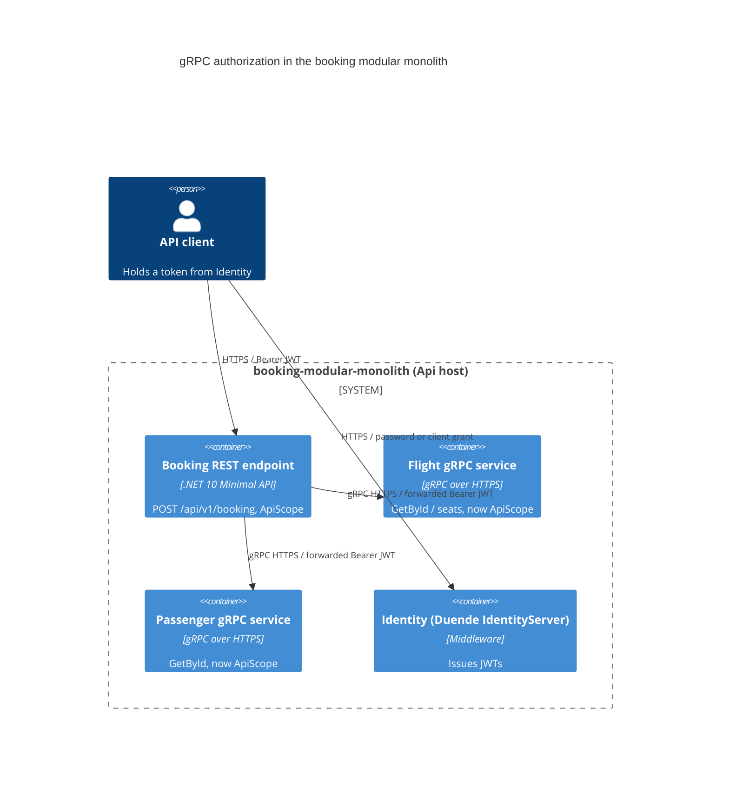

# 0001. Require authorization on the monolith's gRPC services

- **Status:** Proposed
- **Date:** 2026-11-18
- **ARB ticket:** TO BE CREATED
- **Authors:** Devin (for Abhay Aggarwal)
- **Owning team:** TBD — owner to confirm before ARB (no CODEOWNERS in repo)
- **Related ADRs:** none in repo. Related decision: the microservices-split work keeps service-to-service gRPC between split hosts unauthenticated as an ARB follow-up.

## Context

The API host maps `PassengerGrpcServices` and `FlightGrpcServices` on the same public HTTPS listener as the REST API. Neither mapping had authorization metadata. `AddJwt` registers only named policies and no fallback policy, so anonymous callers could reach these routes. Anyone who knew a passenger ID could call `passenger.PassengerGrpcService/GetById` without a token and read the passenger's name, passport number and age. The REST route for the same lookup requires a token. Flight's `GetById`, `GetAvailableSeats` and `ReserveSeat` gRPC methods were open in the same way, which also put seat integrity at risk.

In the monolith, gRPC is used for internal calls: Booking's `CreateBooking` handler calls Flight and Passenger through `AddGrpcClient` channels that point back at the same host. Those clients sent no credentials.

ARB triggers: T6 (change to authorization on existing endpoints). It also tightens the contract for internal callers (they must now present a token), which is relevant to T4.

## Decision

We will require the existing `ApiScope` policy on both gRPC service mappings (`MapGrpcService<...>().RequireAuthorization(nameof(ApiScope))`). Booking's gRPC clients will use the existing `AuthHeaderHandler` to forward the caller's bearer token, so create-booking keeps working under the end user's identity. `AuthHeaderHandler` will only set `Authorization` when the incoming request has a valid header, instead of always sending `Bearer <null>`.

## Alternatives considered

| Alternative | Pros | Cons | Why rejected |
| --- | --- | --- | --- |
| Do nothing | No change | Passenger PII and seat reservation stay open to anonymous callers | Leaves a confirmed PII exposure |
| Global `FallbackPolicy` requiring an authenticated user | Closes new routes by default | ASP.NET Core also applies the fallback to requests handled by middleware after `UseAuthorization`. `UseIdentityServer` and Swagger UI run there, so `/connect/token` and OIDC discovery would require a token and login would break | Breaks authentication. Revisit after the pipeline order is changed (follow-up) |
| Serve gRPC on a separate internal-only listener/port | Network isolation, no token plumbing | Needs Kestrel endpoint, compose/k8s port and ingress changes, and doesn't help the split-service hosts | Bigger infra change. Can be added later as defence in depth |
| Service-to-service credentials (client-credentials token or mTLS) | Works for background callers without a user | New client registration and secrets | Not needed while the only caller runs in a user request. Belongs to the microservices ARB follow-up |

## Architecture

## Non-functional requirements

| NFR | Target | How met |
| --- | --- | --- |
| Availability SLO | TBD — owner to confirm before ARB | Unchanged. No new components |
| p95 latency | TBD — owner to confirm before ARB | JWT validation per gRPC call. The signing keys are cached, so the extra cost should be small (not measured) |
| RPO / RTO | N/A — no data store change | — |
| Peak load | TBD — owner to confirm before ARB | Unchanged |
| Scaling model | Unchanged | — |
| Data retention | N/A — no data change | — |

## Security & compliance

- **Data classification:** Passenger PII (name, passport number, age) and booking/seat data. Exposure is reduced; nothing new is stored.
- **Encryption at rest:** N/A — unchanged.
- **Encryption in transit:** Unchanged (HTTPS listener).
- **AuthN / AuthZ:** gRPC routes now need a JWT from Identity with the `ApiScope` scope claim, the same as the REST API. Booking forwards the end user's token, so downstream calls run as the user.
- **Secrets:** None added.
- **Audit logging:** Unchanged. A 401/`Unauthenticated` from a gRPC route now shows up in the normal request logs.
- **Data residency / regions:** N/A.
- **Policy sections satisfied:** No infrastructure changes. `approved-infra.yaml` is not affected.
- **Threats considered:** Unauthenticated PII read by passenger ID, and unauthenticated seat reservation through Flight gRPC. Still open: an authenticated user can read any passenger by ID, same as the REST route. That is a separate authorization (IDOR) question.

## Cost

| Item | Assumption | Monthly estimate |
| --- | --- | --- |
| None | Code-only change | $0 |
| **Total** | | $0 |

## Operations

- **On-call rotation:** TBD — owner to confirm before ARB.
- **Runbook:** N/A. If gRPC callers start getting `Unauthenticated` errors, check that they send a bearer token with the `ApiScope` scope.
- **Dashboards / alarms:** Existing OpenTelemetry/LGTM stack. Watch for 401s on `/passenger.PassengerGrpcService/*` and `/flight.FlightGrpcService/*`.
- **Rollback plan:** Revert the PR.
- **Migration / cut-over plan:** Any external gRPC client of the monolith must start sending a bearer token. The repo has no such client besides Booking.

## Policy exceptions requested

| Rule | Resource | Justification | Compensating control | Expiry |
| --- | --- | --- | --- | --- |
| none | | | | |

## Consequences

- Positive: Passenger PII and seat operations can no longer be reached anonymously over gRPC. gRPC and REST now have the same authorization.
- Negative / risks: gRPC calls made outside an HTTP request (background consumers, jobs) would have no token to forward and would fail. No such caller exists today.
- Follow-ups: (1) Microservices split: once Flight/Passenger run as separate hosts, the hosts will enforce this policy too. The decision to keep service-to-service gRPC unauthenticated must then be settled with token forwarding (which this ADR adds for Booking), client credentials or mTLS. Hosts that call without a token will get `Unauthenticated`. (2) Move `UseIdentityServer` ahead of `UseAuthorization` and then add a fallback policy so new routes are closed by default.

## Open questions

- Owning team, on-call rotation and NFR targets (TBD above).
- Should the split-service hosts adopt token forwarding or client credentials for internal gRPC?
