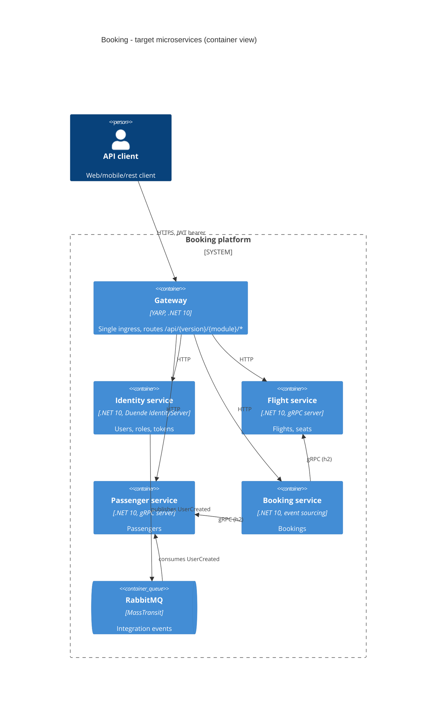

# 0001. Service boundaries: one service per existing module

- **Status:** Proposed
- **Date:** 2026-10-13
- **ARB ticket:** TO BE CREATED
- **Authors:** Devin (for AB-499)
- **Owning team:** Booking platform team
- **Related ADRs:** [0002](0002-strangler-fig-migration-behind-gateway.md),
  [0003](0003-inter-service-communication.md), [0004](0004-data-ownership-database-per-service.md),
  [0008](0008-service-host-layout-and-ports.md)

## Context

The system is a .NET 10 modular monolith: a single host (`src/Api`) composes four modules under
`src/Modules` - **Identity**, **Flight**, **Passenger**, **Booking** - that share
`src/BuildingBlocks`. The modules are already bounded contexts:

- each has its own EF Core `DbContext` and its own Postgres database
  (`identity_modular_monolith`, `flight_modular_monolith`, `passenger_modular_monolith`);
- Booking is event-sourced on EventStoreDB and Flight/Passenger/Booking project read models to
  MongoDB;
- Booking calls Flight and Passenger synchronously over gRPC (`src/Modules/Booking/src/GrpcClient`),
  even in-process;
- modules exchange integration events (`UserCreated`, `PassengerCreated`, `FlightCreated`,
  `SeatReserved`, `BookingCreated`, ...) through MassTransit's in-memory transport and a Postgres
  outbox (`persist_message`).

The modules need to scale, deploy and fail independently, which a single host cannot provide.

ARB triggers: T1 (new deployable services), T2 (new per-service data stores), T4 (cross-process
contracts), T6 (new ingress/gateway, service-to-service traffic), T8 (shared contract packages).

## Decision

We will split the monolith into **exactly four services, one per existing module**, keeping the
module boundaries that already exist in code:

| Service | Owns | Exposes |
| --- | --- | --- |
| Identity | users, roles, IdentityServer clients/keys | OIDC/token endpoints, user REST API; publishes `UserCreated` |
| Flight | airports, aircraft, flights, seats | REST API; gRPC `FlightGrpcService`; publishes flight/seat events |
| Passenger | passenger profiles | REST API; gRPC `PassengerGrpcService`; consumes `UserCreated`, publishes `PassengerCreated`/`PassengerRegistrationCompleted` |
| Booking | bookings (event-sourced) | REST API; calls Flight + Passenger over gRPC; publishes `BookingCreated` |

- No new bounded contexts are introduced and no module is merged or split during the migration.
- Every service is reached by clients only through the gateway ([0002](0002-strangler-fig-migration-behind-gateway.md)).
- Code shared between services is limited to `BuildingBlocks` libraries (split by AB-500) and
  versioned contract packages ([0006](0006-contract-and-proto-versioning.md)); services never
  reference each other's module projects.
- Each module project stays reusable: the monolith (`src/Api`) and the new service host compose the
  same module code, so the monolith keeps building and running unchanged during the transition.

## Alternatives considered

| Alternative | Pros | Cons | Why rejected |
| --- | --- | --- | --- |
| Do nothing (stay a modular monolith) | Simplest ops, no network hops | No independent scaling/deploys; one failure domain | Does not meet the epic goal |
| Finer-grained services (e.g. split Flight into Airport/Aircraft/Flight/Seat) | Smaller units | Splits aggregates that share transactions (seat reservation); many more contracts | No business driver; boundaries not validated |
| Fewer services (Identity + one "core" service) | Fewer moving parts | Keeps Booking/Flight/Passenger coupled in one deployable | Loses most of the benefit |

## Architecture

Full target-state and transition diagrams:
[docs/architecture/target-architecture.md](../architecture/target-architecture.md).

## Non-functional requirements

| NFR | Target | How met |
| --- | --- | --- |
| Availability SLO | 99.5% per service (demo/reference system) | Independent deploys; gateway health checks; broker decouples Identity from Passenger |
| p95 latency | Booking create < 500 ms incl. 2 gRPC calls | gRPC h2 on dedicated ports, Polly retries already in BuildingBlocks |
| RPO / RTO | RPO 15 min / RTO 1 h | Per-service Postgres/Mongo/ESDB backups; outbox guarantees no lost events |
| Peak load | Same as monolith today; scale Flight/Booking horizontally | Stateless hosts, per-service queues |
| Scaling model | Horizontal per service (containers, AB-491 Helm) | One image per service (AB-503) |
| Data retention | Unchanged from monolith | Same schemas, new databases |

## Security & compliance

- **Data classification:** passenger name and passport number (PII) stay in Identity/Passenger
  stores only; Booking holds a passenger snapshot as today.
- **Encryption in transit:** TLS at the gateway; internal HTTP/gRPC plain-text inside the
  container network for now ([0007](0007-unauthenticated-internal-grpc-accepted-risk.md)).
- **AuthN / AuthZ:** JWT bearer tokens issued by the Identity service, validated by every service
  (unchanged policies). Service-to-service gRPC is unauthenticated - accepted risk, ARB follow-up.
- **Secrets:** connection strings, broker credentials and the IdentityServer client secret come
  from configuration/environment, never source control.
- **Audit logging:** OpenTelemetry traces/logs per service (AB-495) into the existing LGTM stack.
- **Threats considered:** lateral movement inside the cluster (mitigated by network policy,
  follow-up for mTLS); message spoofing on the broker (per-service broker credentials).

## Cost

| Item | Assumption | Monthly estimate |
| --- | --- | --- |
| 4 service containers + gateway | Small containers, same total load as the monolith | ~ +$100 vs single host |
| RabbitMQ | Single small node (self-hosted container) | ~ $30 |
| Extra databases | New logical DBs on existing Postgres/Mongo/ESDB servers | ~ $0 |
| **Total** | | **< $500/month (below ARB_LIGHT threshold)** |

## Operations

- **On-call rotation:** Booking platform team owns all four services.
- **Runbook:** cutover/rollback runbook authored by AB-505.
- **Dashboards / alarms:** per-service health (`/health`, `/alive`) and Grafana dashboards (AB-495).
- **Rollback plan:** repoint the gateway cluster back to the `monolith` destination
  ([0002](0002-strangler-fig-migration-behind-gateway.md)) and re-enable the module's background
  processing in the monolith ([0005](0005-side-by-side-background-processing-switch.md)).
- **Migration / cut-over plan:** strangler-fig, one module at a time; data migration at cutover (AB-505).

## Policy exceptions requested

| Rule | Resource | Justification | Compensating control | Expiry |
| --- | --- | --- | --- | --- |
| none | | | | |

## Consequences

- Positive: independent deploy/scale/failure per module; boundaries already proven in code, so
  extraction is mostly hosting work, not domain redesign.
- Negative / risks: network calls replace in-process calls (latency, partial failure); eventual
  consistency between Identity and Passenger becomes visible; more pipelines and images to run.
- Follow-ups: AB-489..AB-506 implement the decisions in ADRs 0001-0008.
