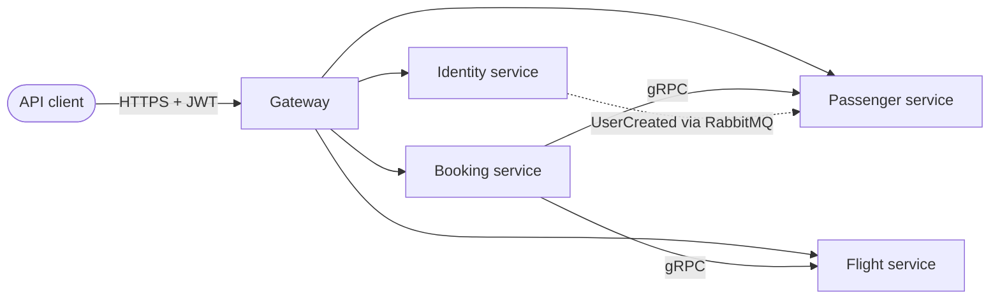

# 0001. One service per existing module: Identity, Flight, Passenger, Booking

- **Status:** Proposed
- **Date:** 2026-10-28
- **ARB ticket:** TO BE CREATED
- **Authors:** AB-499 (epic AB-488)
- **Owning team:** TBD — owner to confirm before ARB
- **Related ADRs:** [0002](0002-strangler-fig-migration-behind-yarp-gateway.md), [0004](0004-database-per-service-and-per-service-outbox-inbox.md), [0006](0006-repository-layout-for-hosts-and-contracts.md)

## Context

The system is a modular monolith. `src/Api/src/Program.cs` calls `AddFlightModules`,
`AddIdentityModules`, `AddPassengerModules` and `AddBookingModules` and runs all four in one
process. Each module under `src/Modules/<Module>` is already a bounded context with its own
project, its own EF Core `DbContext` (Booking uses EventStoreDB instead) and its own endpoints:

| Module | Owns | Write store today | Talks to other modules |
| --- | --- | --- | --- |
| Identity | users, roles, Duende IdentityServer (tokens) | Postgres `identity_modular_monolith` | publishes `UserCreated` |
| Flight | aircraft, airports, flights, seats | Postgres `flight_modular_monolith` | gRPC server `flight.FlightGrpcService` |
| Passenger | passenger profiles | Postgres `passenger_modular_monolith` | consumes `UserCreated`; gRPC server `passenger.PassengerGrpcService` |
| Booking | bookings (event sourced) | EventStoreDB | gRPC client of Flight and Passenger |

The single process means a fault or a deploy in one module affects all of them, and the modules
cannot be scaled or released on their own. The epic needs to fix the service boundaries before any
code moves.

ARB triggers: T1 (four new deployable services), T8 (boundaries span module ownership).

## Decision

We will extract exactly four services, one per existing module: **Identity**, **Flight**,
**Passenger** and **Booking**. A service owns everything that lives in its module folder today —
domain model, features (vertical slices), endpoints, write store and read models. Module
boundaries are not redrawn during the migration: no module is split, merged or renamed, and no
feature moves between modules. Each service runs in its own host (`src/Services/<Module>.Host`,
see [0006](0006-repository-layout-for-hosts-and-contracts.md)) that composes the unchanged
module project.

## Alternatives considered

| Alternative | Pros | Cons | Why rejected |
| --- | --- | --- | --- |
| Do nothing (stay a modular monolith) | No distributed-systems cost | One blast radius, one release train, no independent scaling | Does not meet the epic goal |
| Finer services (e.g. split Flight into Flight + Seat inventory) | Smaller units | Redraws boundaries and moves the `ReserveSeat` transaction across a network hop while also changing hosting | Two changes at once; can be a later ADR |
| Coarser split (Identity + one "Booking platform" service) | Fewer deployables | Keeps Flight/Passenger/Booking coupled in one process | Little gain over the monolith |

## Architecture

The full target-state diagram is in [docs/architecture/target-architecture.md](../architecture/target-architecture.md).

## Non-functional requirements

| NFR | Target | How met |
| --- | --- | --- |
| Availability SLO | TBD — owner to confirm before ARB | Per-service health endpoints (`/health/live`, `/health/ready`) and independent restarts |
| p95 latency | TBD — owner to confirm before ARB | Booking's synchronous path adds gRPC hops; measured once hosts exist |
| RPO / RTO | TBD — owner to confirm before ARB | Per-service stores ([0004](0004-database-per-service-and-per-service-outbox-inbox.md)) |
| Peak load | TBD — owner to confirm before ARB | |
| Scaling model | Horizontal, per service | Stateless hosts; state lives in each service's stores |
| Data retention | Unchanged from the monolith | |

## Security & compliance

- **Data classification:** Identity and Passenger hold personal data (names, passport numbers). The
  split does not add new data; it confines each class of data to its owning service.
- **Encryption at rest:** Unchanged; set by the deployment platform.
- **Encryption in transit:** TLS at the gateway; internal traffic per [0008](0008-defer-service-to-service-grpc-authentication.md).
- **AuthN / AuthZ:** Identity remains the only token issuer (Duende IdentityServer).
- **Secrets:** Per-service connection strings and credentials, injected by configuration.
- **Audit logging:** Unchanged.
- **Data residency / regions:** Unchanged.
- **Policy sections satisfied:** N/A — this ADR adds no infrastructure by itself.
- **Threats considered:** A larger network surface between services; addressed in [0002](0002-strangler-fig-migration-behind-yarp-gateway.md) and [0008](0008-defer-service-to-service-grpc-authentication.md).

## Cost

| Item | Assumption | Monthly estimate |
| --- | --- | --- |
| Four service hosts instead of one | Same total load | TBD — owner to confirm before ARB |
| **Total** | | TBD |

## Operations

- **On-call rotation:** TBD — owner to confirm before ARB.
- **Runbook:** `docs/runbooks/` (added by the cut-over work).
- **Dashboards / alarms:** OpenTelemetry with one `service.name` per host.
- **Rollback plan:** Gateway routes point back at the monolith ([0002](0002-strangler-fig-migration-behind-yarp-gateway.md)).
- **Migration / cut-over plan:** [0007](0007-extraction-order.md).

## Policy exceptions requested

| Rule | Resource | Justification | Compensating control | Expiry |
| --- | --- | --- | --- | --- |
| none | | | | |

## Consequences

- Positive: Boundaries already exist in code, so extraction is mostly hosting and wiring work.
- Negative / risks: Booking's create flow becomes a distributed call chain (Flight, Passenger).
  `ReserveSeat` is not compensated if the booking write fails afterwards — this exists today and
  becomes more visible over the network.
- Follow-ups: A saga or compensation for `ReserveSeat` is out of scope for AB-488.

## Open questions

- Availability, latency, load and cost targets (all TBD above).
- Owning team and on-call rotation per service.
