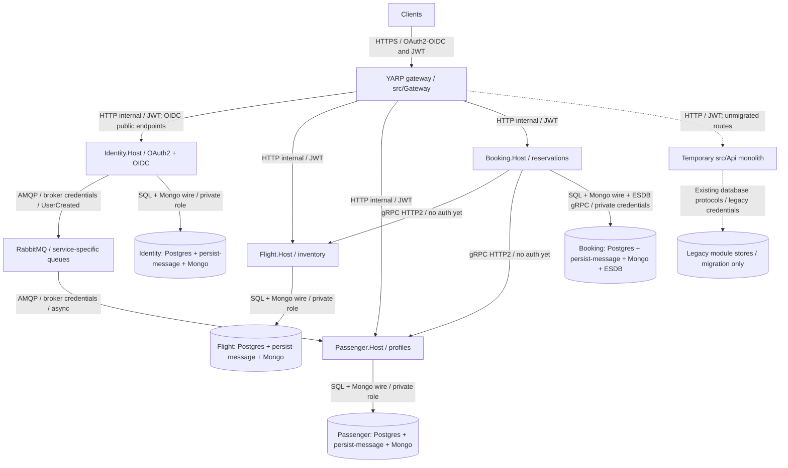

# 0001. Target service boundaries and strangler migration

- **Status:** Proposed
- **Date:** 2026-10-29
- **Ticket:** AB-499 (epic AB-488)
- **ARB ticket:** TO BE CREATED
- **Authors:** AB-488 implementation contributors
- **Owning team:** Booking platform; named domain/platform owners and on-call rotations TBD before ARB
- **Related ADRs:** [0002](0002-synchronous-grpc-and-asynchronous-rabbitmq.md), [0003](0003-service-owned-data-and-background-processing.md), [0004](0004-contract-versioning-and-compatibility.md)

## Context

[`src/Api/src/Program.cs`](../../src/Api/src/Program.cs) currently composes Identity, Flight, Passenger, and Booking in one .NET 10 process. They already express the business bounded contexts. Extracting all modules in one release would combine deployment, database, and routing risk. We need independent deployment without rewriting domain logic or changing client endpoints in the same step.

ARB triggers: T1 (new deployables), T4 (cross-process integration), T6 (ingress/network boundary), T8 (shared platform libraries). These are design triggers; this ADR does not deploy services.

## Decision

We will preserve one service per existing module and migrate incrementally behind a single YARP ingress (`src/Gateway`). `src/Api` remains running while a service is extracted; a context's gateway destination changes only after its data, background-processing ownership, contracts, and rollback checks pass. Each .NET 10 `src/Services/<Module>.Host` self-composes its module without a shared ServiceHost library, has its own Dockerfile, and keeps host tests under `src/Modules/<Module>/tests/`. BuildingBlocks becomes independently consumable projects with a thin aggregate `BuildingBlocks.csproj`, without CLR namespace changes.

| Boundary | Owns | Does not own |
| --- | --- | --- |
| Identity | Accounts, credentials, roles, OAuth2/OIDC issuance, user lifecycle events | Passenger profile completion or reservations |
| Flight | Flights, airports, aircraft, seat inventory and seat reservation decisions | Passenger records or booking aggregate history |
| Passenger | Passenger profiles and read projections; consumes Identity user creation | Authentication credentials or flight inventory |
| Booking | Reservation workflow, booking aggregates and EventStoreDB history; calls Flight/Passenger | Flight seats or passenger database tables |
| Gateway | Routing and edge concerns; preserves external URLs and identity metadata host | Domain logic, business data, background workers |

### Routing and coexistence contract

- Clusters are `identity`, `flight`, `passenger`, `booking`, `monolith`. Each has destination `primary`; addresses use `ReverseProxy__Clusters__<c>__Destinations__primary__Address` (environment form). Configure a context's cluster destination to the monolith or its service without rebuilding. The monolith cluster handles remaining routes.
- Explicit identity discovery, token, and account routes must take precedence over any monolith catch-all. Preserve the externally visible issuer/host so issued tokens and discovery URLs remain usable through the gateway. Do not assume a token-issuer move is safe without signing-key/issuer compatibility evidence.
- All hosts and the gateway use `Jwt:Audience=booking-modular-monolith`; services still authorize their endpoints. Internal gRPC authentication is deferred, not implicitly supplied by the gateway (ADR 0002).
- Move one context at a time after its dependencies are reachable. Disable that module's monolith background work using `Modules:<Module>:BackgroundProcessingEnabled=false`; the switch defaults to `true`. This gates outbox processing, subscriptions (including Booking ESDB), and consumers, not just HTTP routing.
- Do not let monolith and service accept concurrent writes for the migrated context. Route rollback alone cannot undo new data; AB-505 owns data sync, reconciliation, rollback windows and final removal of `src/Api`. A live fallback process is not permission to dual-write.

## Alternatives considered

| Alternative | Pros | Cons | Why rejected |
| --- | --- | --- | --- |
| Do nothing: retain monolith only | Lowest immediate operational cost | Shared deployment cadence and failure domain | Does not deliver independent deployments |
| Big-bang rewrite/split | One clean final topology | Simultaneous routing, data and protocol risk | Removes incremental verification and rollback |
| Split by technical layer or share host composition | Less apparent bootstrapping duplication | Cross-domain coupling and synchronized releases | Boundaries must follow existing modules; small explicit hosts are intentional |

## Architecture

**Target**, except the dashed monolith fallback which exists only during migration. Store boxes are service-private groups, not shared databases. The SVG in [`assets`](../../assets/target-microservices.svg) is the README rendering of this container view.

Internal HTTP/AMQP labels describe local scaffolding, not a production TLS decision. TLS for service/broker/database traffic must be selected and verified before production; the unauthenticated gRPC gap remains explicit even with encryption.

## Non-functional requirements

| NFR | Target | How met / approval input |
| --- | --- | --- |
| Availability SLO | TBD — owner to confirm before ARB | Per-host readiness, dependency checks, routing rollback; no uptime claim yet |
| p95 latency | TBD — owner to baseline before ARB | Measure gateway overhead, Booking gRPC fan-out and projections |
| RPO / RTO | TBD — Data/Platform before ARB | Backup/restore and cutover/reverse-sync drills in AB-505 |
| Peak load | TBD — owner to measure before ARB | Use observed request/event rates to size gateway, services and broker |
| Scaling model | One background-processing instance per service | Outbox lacks row locking; Booking subscription is single-consumer; no unrestricted host HPA |
| Data retention | TBD — Data/Security before ARB | Include PII, event history, inbox/outbox, logs and backups |

## Security & compliance

- **Data classification:** Identity and Passenger carry PII, including passport data; tokens, credentials and signing keys are sensitive. Booking history may contain PII snapshots.
- **Encryption at rest:** Required for production databases, volumes, backups and signing keys; provider/KMS selection TBD.
- **Encryption in transit:** Public HTTPS required. Internal TLS and certificate lifecycle TBD; local HTTP is not a production exception.
- **AuthN / AuthZ:** OAuth2/OIDC and common JWT audience retained; services enforce authorization. Internal gRPC remains unauthenticated per the migration constraint, subject to Security disposition before production.
- **Secrets:** External secret injection for production; never copy local broker credentials into production or logs. Coordinate Identity signing keys during coexistence.
- **Audit logging:** Correlation across gateway, gRPC and events; audit route/ownership changes. Exclude raw tokens, passport data and passwords from telemetry.
- **Data residency / regions:** TBD before ARB; this design selects no cloud region.
- **Policy sections satisfied:** No cloud IaC/policy selection made here; platform must validate deployment choices against approved infrastructure policy. No blanket compliance claim.
- **Threats considered:** Backend bypass, duplicate processors, mixed signing keys, accidental dual-writes, token/PII leakage, failed partial cutover. Keep internal hosts off public ingress and test these boundaries.

## Cost

| Item | Assumption | Monthly estimate |
| --- | --- | --- |
| Compute + ingress | Four hosts, gateway and temporary monolith; resource limits/traffic TBD | TBD — Platform sizing before ARB |
| Stores, broker, monitoring | Per-service logical stores may share physical servers with access isolation; HA/backups/retention TBD | TBD — Data/Platform before ARB |
| **Total** | No provider, region or capacity selected | **TBD; cannot rule out > $2k/month (T9)** |

## Operations

- **On-call rotation:** Named domain and platform rotations TBD before ARB; the coordinating owner assigns them.
- **Runbook:** AB-505 will provide the executable cutover/rollback runbook; ADR 0003 defines processor/data ownership prerequisites.
- **Dashboards / alarms:** Plan gateway/backend error rate and latency, dependency readiness, outbox age, consumer lag/retries, dead letters and projection lag; actual thresholds TBD from baseline.
- **Rollback plan:** Stop writes, reconcile/reverse-sync if needed, transfer background ownership, then restore the context destination to the monolith and probe through the gateway. Never route to stale data.
- **Migration / cut-over plan:** Extract libraries/contracts, introduce gateway, create isolated hosts/stores, validate real sync/async paths, cut over per context, then decommission only after AB-505 evidence.

## Policy exceptions requested

| Rule | Resource | Justification | Compensating control | Expiry |
| --- | --- | --- | --- | --- |
| Internal service authentication (Security review required) | Booking-to-Flight/Passenger gRPC | Authentication intentionally deferred for scaffolding | Private network, no public gRPC ingress; not equivalent to authentication | TBD by Security before production; not approved by this ADR |

## Consequences

- **Positive:** Independent deployments follow existing domain boundaries; reversible routing limits migration blast radius.
- **Negative / risks:** More deployables, secrets and stores; network failures and eventual consistency replace in-process assumptions. Routing rollback depends on data compatibility.
- **Follow-ups:** Implementation tickets must preserve these paths/config keys; AB-505 handles migration/decommission. ARB approval and measured operational/security inputs remain mandatory.

## Open questions

- Who owns each on-call rotation, production TLS/key management, SLO/load/retention targets and cost approval?
- What authentication mechanism and expiry will Security require for the internal gRPC follow-up?
