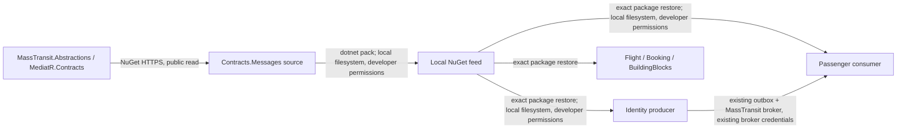

# 0001. Versioned integration-event contracts

- **Status:** Proposed
- **Date:** 2026-11-03
- **ARB ticket:** TO BE CREATED
- **Authors:** AB-506 implementation
- **Owning team:** Booking maintainers; platform reviewer required for shared library
- **Related ADRs:** AB-499 architecture work (not present on main)

## Context

The four modules currently obtain integration messages from the infrastructure-heavy
BuildingBlocks assembly. Independent service releases need a pinned artifact without
module code or database/transport implementations. Existing MassTransit names and
persisted outbox type names must remain readable.

ARB triggers: T8 (new shared library); existing cross-domain message schemas remain
unchanged. No new service, data store, vendor, auth or network boundary is introduced.

## Decision

We will publish BookingModularMonolith.Contracts.Messages to a local NuGet feed,
move the message records and their two lightweight event interfaces into it, preserve
their namespaces and payloads, and pin all module references to an exact SemVer release.
Only MassTransit.Abstractions and MediatR.Contracts are runtime dependencies.
BuildingBlocks forwards the moved types. Breaking schemas get a new message version;
the [package guide](../../src/Contracts.Messages/README.md) defines rollout policy.

## Alternatives considered

| Alternative | Pros | Cons | Why rejected |
| --- | --- | --- | --- |
| Do nothing | No migration | Consumers depend on all infrastructure | Prevents independent releases |
| Project references only | Easy local edits | Cannot pin independently shipped artifacts | Does not meet distribution requirement |
| Remove all event interfaces | Zero third-party dependencies | Breaks dispatcher/outbox and MediatR contracts | Unnecessary behavioral change |

## Architecture

## Non-functional requirements

| NFR | Target | How met |
| --- | --- | --- |
| Availability SLO | No runtime feed dependency; application SLO TBD by owner | Package restored during build |
| p95 latency | No new network hop; baseline target TBD by owner | Same payloads and dispatch path |
| RPO / RTO | No data migration; existing targets TBD by owner | Preserved outbox type names |
| Peak load | Existing traffic; numeric target TBD by owner | No extra messages |
| Scaling model | N/A — no new runtime workload | Library loaded in current process |
| Data retention | Existing outbox/inbox retention unchanged | No new storage |

## Security & compliance

- **Data classification:** Messages contain existing passenger names and passport numbers (PII).
  Packages contain definitions only, never production payloads.
- **Encryption at rest:** No new business-data store. Existing DB encryption remains unchanged;
  details must be confirmed by deployment owner.
- **Encryption in transit:** Public NuGet restore uses HTTPS; local feed is filesystem-only.
  Existing broker transport/TLS settings remain unchanged.
- **AuthN / AuthZ:** No new endpoint or privilege. Local feed uses developer/CI filesystem access.
- **Secrets:** None added; existing application/broker credentials unchanged.
- **Audit logging:** Existing messaging/outbox logs unchanged; no new payload logging.
- **Data residency / regions:** No new region or external business-data flow.
- **Policy sections satisfied:** No infrastructure resources added; approved-infra policy N/A.
- **Threats considered:** Package substitution from public feeds is prevented by source mapping
  for the internal package ID. Exact pins limit accidental contract drift.

## Cost

| Item | Assumption | Monthly estimate |
| --- | --- | --- |
| Runtime infrastructure | No new services or stores | No incremental infrastructure charge |
| CI and package disk | Existing CI/local storage; volume unknown | TBD — owner to confirm |
| **Total** | No new recurring service | CI/storage only; TBD |

## Operations

- **On-call rotation:** Existing booking ownership; named rotation TBD by owner.
- **Runbook:** `src/Contracts.Messages/README.md` (pack, restore, release, migration).
- **Dashboards / alarms:** Existing broker/outbox health; no new runtime metrics.
- **Rollback plan:** Revert consumer pins/deployment together; retain compatible schemas and
  published versions until all queued messages drain. Do not overwrite a published package.
- **Migration / cut-over plan:** Pack first, restore/build/test pinned consumers, deploy compatible
  consumers before producers. No schema or database migration in this extraction.

## Policy exceptions requested

None.

## Consequences

- Positive: Small independently versioned artifact; preserved wire identities and old type resolution.
- Negative / risks: Local development must pack before first restore. Published versions are immutable.
- Follow-ups: Approve ARB before merge; choose authenticated artifact hosting when services ship.

## Open questions

- ARB ticket/reviewer assignment and named shared-library owner.
- Confirm existing SLO, latency, RPO/RTO, peak load, on-call rotation and CI/storage cost.
