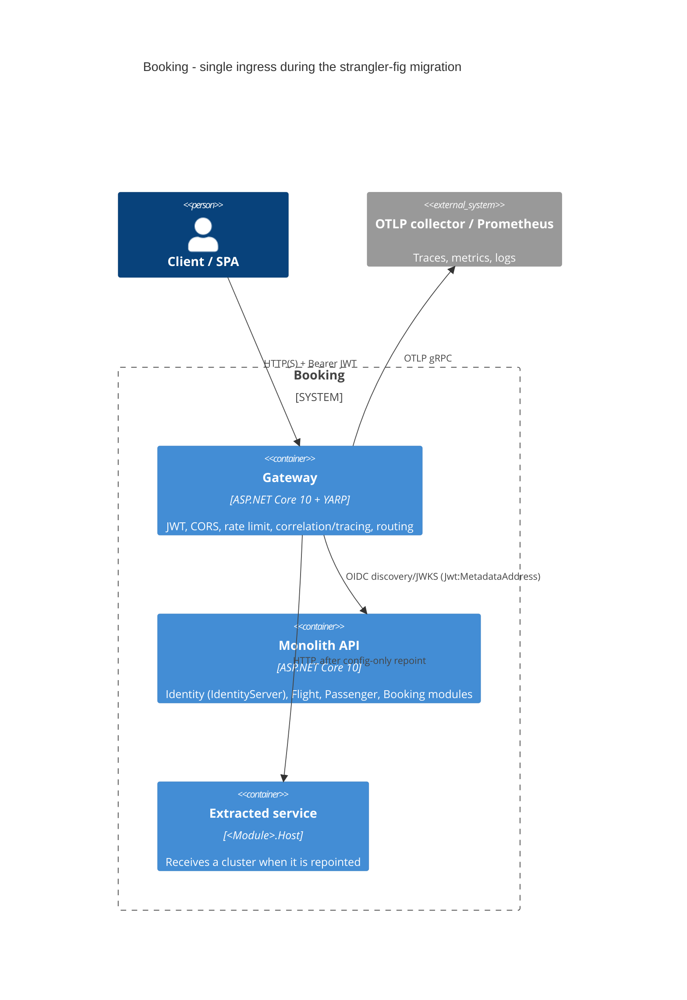

# 0001. YARP API gateway as the single ingress

- **Status:** Proposed
- **Date:** 2026-10-29
- **ARB ticket:** TO BE CREATED
- **Authors:** Devin (AB-489)
- **Owning team:** Booking platform team
- **Related ADRs:** strangler-fig migration decisions (AB-499)

## Context

`src/Api` composes the Identity, Flight, Passenger and Booking modules into one host. Epic AB-488 splits it into
services with a strangler fig: clients must keep one stable endpoint while routes move, one prefix at a time,
from the monolith to `src/Services/<Module>.Host`. Today clients call the monolith directly, every host does its
own CORS/auth, there is no rate limiting, and the `Yarp.ReverseProxy` package referenced by `BuildingBlocks` is unused.

ARB triggers: **T1** new deployable service (`src/Gateway`, own Dockerfile, Compose service, Aspire resource);
**T6** network/auth boundary change (new public ingress that validates JWTs, terminates CORS and rate limits).

## Decision

We will add an ASP.NET Core + YARP host at `src/Gateway/src` as the only public ingress:

- Routes per module prefix (`/api/{version}/identity|flight|passenger|booking/**`), IdentityServer routes
  (`/connect/**`, `/.well-known/**`, original `Host` preserved) and `/api/**` + `/**` fallbacks.
- Clusters `identity`, `flight`, `passenger`, `booking`, `monolith`, each with one destination `primary`. All start
  on the monolith. Moving a module is the override
  `ReverseProxy__Clusters__<cluster>__Destinations__primary__Address=<service url>` - no code or image change.
- JWT validation reuses `BuildingBlocks.Jwt` (`ApiScope` policy on `/api/**`, `Jwt:Audience=booking-modular-monolith`).
  `Jwt:MetadataAddress` (new, optional) lets a host fetch discovery/JWKS internally while validating the public
  issuer. The monolith issues tokens with the gateway URL as issuer (`AuthOptions__IssuerUri`), so a token is
  valid at the gateway and at every backend. Backends keep their own authorization (defence in depth).
- CORS (`Cors:AllowedOrigins`) and fixed-window rate limiting (`RateLimiting:*`, partitioned by `sub` or client IP)
  are enforced at the gateway.
- Every request carries a GUID `correlationId` (the header and format `BuildingBlocks.Web.UseCorrelationId` expects;
  invalid values are replaced) and W3C `traceparent` is propagated by YARP; one structured log line per request
  records route, cluster, destination, status, latency, correlation and trace id. ServiceDefaults provides OTLP/Prometheus.

## Alternatives considered

| Alternative | Pros | Cons | Why rejected |
| --- | --- | --- | --- |
| Do nothing (clients call monolith/services directly) | No new component | Clients must learn every service URL; no place to move routes transparently | Defeats strangler fig |
| Ocelot | Mature .NET gateway | Less active, slower, own config model | YARP already referenced, Microsoft-supported, config-reloadable |
| Cloud/Ingress gateway (NGINX Ingress, Envoy, APIM) | Off-the-shelf, edge features | Not in local Compose/Aspire; JWT/correlation logic in another language/config | Can front the YARP gateway later; not needed for the split |
| Route inside the monolith (monolith proxies to services) | No new process | Monolith stays on the hot path forever; cannot be decommissioned | Blocks the end state |

## Architecture

## Non-functional requirements

| NFR | Target | How met |
| --- | --- | --- |
| Availability SLO | Same as monolith (99.9 %) | Stateless; run >= 2 replicas behind the platform load balancer; `/health`, `/alive` |
| p95 latency | < 5 ms added | In-process YARP forwarding, pooled HTTP/1.1+2 connections (measured ~1-9 ms locally) |
| RPO / RTO | N/A (stateless) / < 5 min | Redeploy or remove the override |
| Peak load | 100 req / 10 s per client (default) | `RateLimiting:*` configurable; limits are per replica |
| Scaling model | Horizontal, stateless | No session affinity needed |
| Data retention | No data stored | Logs follow the platform log retention |

## Security & compliance

- **Data classification:** Passes through PII (passenger names, passport numbers) and bearer tokens; stores nothing.
- **Encryption at rest:** N/A (no storage).
- **Encryption in transit:** TLS terminated at the platform edge/gateway in deployed environments; local Compose/Aspire use HTTP.
- **AuthN / AuthZ:** JWT bearer via `BuildingBlocks.Jwt`, issuer = gateway public URL, audience `booking-modular-monolith`,
  `ApiScope` policy on `/api/**`; IdentityServer endpoints anonymous by design; backends re-validate.
- **Secrets:** None in the gateway; signing keys stay in IdentityServer.
- **Audit logging:** Per-request log line (no headers/bodies logged, so tokens and PII are not logged).
- **Data residency / regions:** Unchanged.
- **Policy sections satisfied:** Single ingress, central authentication, rate limiting.
- **Threats considered:** Token replay/forgery (signature, issuer, audience, lifetime validated); DoS (rate limit);
  CORS origin abuse (allow-list); header spoofing of `correlationId` (non-GUIDs replaced). Service-to-service gRPC
  remains unauthenticated - accepted shared decision, ARB follow-up.

## Cost

| Item | Assumption | Monthly estimate |
| --- | --- | --- |
| Gateway compute | 2 x 0.25 vCPU / 512 MiB containers | ~$20 |
| **Total** | | **~$20** |

## Operations

- **On-call rotation:** Booking platform team.
- **Runbook:** [docs/runbooks/gateway.md](../runbooks/gateway.md).
- **Dashboards / alarms:** ASP.NET Core / HttpClient OTel metrics; alert on 5xx and 429 rate per cluster.
- **Rollback plan:** Remove a cluster override to send traffic back to the monolith; clients can call the monolith directly as a last resort.
- **Migration / cut-over plan:** Clients switch to the gateway URL first (no behaviour change), then clusters are repointed
  one module at a time (AB-505); the module's background processing is turned off in the monolith at the same time.

## Policy exceptions requested

| Rule | Resource | Justification | Compensating control | Expiry |
| --- | --- | --- | --- | --- |
| none | | | | |

## Consequences

- Positive: one client endpoint for the whole migration; config-only route moves and rollback; consistent auth, CORS,
  rate limiting and correlation for every backend.
- Negative / risks: extra network hop and a component that must be highly available; rate limits are per replica
  (not global); token issuer is now the gateway URL, so clients that call the monolith directly need tokens from the gateway issuer.
- Follow-ups: distributed rate limiting if needed; mTLS/auth for service-to-service gRPC; Helm/Kubernetes manifests for the gateway.

## Open questions

- Should the edge (cloud load balancer) terminate TLS, or the gateway itself?
