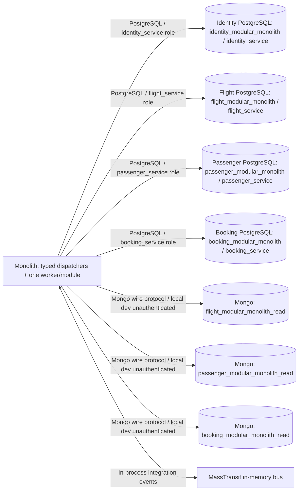

# 0002. Per-service data ownership

- **Status:** Proposed
- **Date:** 2026-10-29
- **ARB ticket:** TO BE CREATED
- **Authors:** Devin (AB-492)
- **Owning team:** Booking platform team
- **Related ADRs:** [0001: single ingress](0001-yarp-api-gateway-single-ingress.md); AB-499 strangler migration; AB-505 cutover

## Context

Identity, Flight, Passenger and Booking run in one process but must own their
data before standalone hosts can replace module routes. A shared outbox/inbox
database and unqualified Mongo registrations permit cross-module interference.
Every context migration previously invoked every module's seeders.

ARB triggers: **T2**, separate module PostgreSQL/Mongo stores; **T6**, database
credential/authorization boundaries. The automated triage detector was blocked
by environment guardrails; this is a manual ARB_REQUIRED assessment, not approval.

## Decision

We use module-marker-typed persistence, dispatch and polling registrations,
module-named Mongo options and context-assembly-scoped seeding. Each module owns
its PostgreSQL database and outbox/inbox table and, where used, its Mongo read
database. The monolith remains one host; this ticket creates no standalone hosts.
Booking's persistence registration stays in the API composition root to preserve
its EF-free dependency surface and existing CLR namespaces.

- `AddPersistMessageProcessor<TModule>("Module")` registers typed context,
  processor, publisher and worker. `IEventDispatcher<TModule>` selects its publisher.
  Untyped contracts remain base interfaces, without unqualified DI registrations.
- PostgreSQL resolution is lazy, in order:
  `ConnectionStrings:<module-kebab>-persist-message` →
  `PersistMessageOptions:ConnectionString:<Module>` →
  `ConnectionStrings:<module-kebab>` →
  `PostgresOptions:ConnectionString:<Module>`. Missing configuration fails clearly.
  By default the outbox/inbox lives in the module's own database; dedicated
  module-owned persistence databases remain configurable.
- `PersistMessageOptions:Interval` is shared. `PersistMessageOptions:Enabled=false`
  disables all polling workers, not storage/enqueueing.
  `Modules:<Module>:BackgroundProcessingEnabled=false` disables just that
  module's worker. Both switches default true and are evaluated at registration.
- Passenger's RegisterNewUser endpoint uses its typed inbox filter, with transport
  MessageId deduplication and serialized consumption in the monolith.
- `AddMongoDbContext<TContext>("Module")` uses named `MongoOptions`.
  `MongoOptions:<Module>:DatabaseName` is required; connection precedence is
  `MongoOptions:<Module>:ConnectionString` → `ConnectionStrings:mongo` →
  `MongoOptions:ConnectionString`. Read databases are
  `flight_modular_monolith_read`, `passenger_modular_monolith_read`, and
  `booking_modular_monolith_read`. Identity has no Mongo context.
  There are no ambiguous unqualified context/repository/UoW registrations.
- `UseMigration<TContext>` runs only seeders from that context's assembly.
- Fresh-volume Compose initialization provisions non-superuser roles
  `identity_service`, `flight_service`, `passenger_service`, `booking_service`.
  Each owns its `<module>_modular_monolith` and future `<module>_service` databases.
  CONNECT is revoked from PUBLIC and granted to the owner; no role receives
  cross-module grants. Cluster administrators are not restricted by this boundary.
  Local-only passwords equal role names. Compose uses PostgreSQL 16 and
  `max_prepared_transactions=100` for Flight's TransactionScope/outbox.

## Alternatives considered

| Alternative | Pros | Cons / why rejected |
| --- | --- | --- |
| Do nothing: shared persistence/read stores | Lowest immediate effort | Cross-module coupling and last-registration-wins DI remain; prevents independent ownership |
| Shared database with per-module schemas | Fewer database resources | Weaker operational ownership, shared migrations/backup boundaries; harder extraction |
| Shared outbox plus module discriminator | One poller/table | Retains shared credentials, lifecycle and deployment coordination |
| Outbox row locking / SKIP LOCKED now | Supports competing polling replicas | Adds concurrency/claim/retry design outside this ticket; defer until multi-replica processing is needed |
| Create standalone hosts now | Immediate process isolation | Sibling tickets own hosts; data isolation must work within the monolith first |

## Architecture

Each PostgreSQL store has its own persist_message table. Future-host databases
are provisioned but unused until cutover. Existing EventStoreDB usage is unchanged.

## Non-functional requirements

| NFR | Target / approach |
| --- | --- |
| Availability SLO | TBD — owning team to confirm before ARB |
| Latency / peak load | TBD — owning team to confirm; polling latency bounded by configured interval plus processing time |
| RPO / RTO | TBD — define module backup/restore objectives before cutover |
| Scaling | One active polling replica per module; no distributed row claiming in this ticket |
| Retention | Existing processed-message retention unchanged; policy TBD before production growth |

## Security & compliance

- **Data classification:** Identity/passenger PII and event payloads; existing classification unchanged.
- **At rest / in transit:** Local Compose is unencrypted development infrastructure; production TLS and encryption/backup settings are deployment responsibilities.
- **AuthN / AuthZ:** HTTP bearer authorization unchanged. PostgreSQL per-module LOGIN roles, ownership and CONNECT ACLs enforce database boundaries. Mongo names isolate routing, not credentials; Mongo role hardening is separate work.
- **Secrets:** Role-name passwords are development-only. Production credentials must come from the deployment secret manager; no production secrets added.
- **Audit:** Existing application/event logging; database access audit/retention requirements TBD before ARB.
- **Residency:** Unchanged, no new external vendor or region.
- **Policy:** No new cloud resource types; no infrastructure-policy exemption requested. Formal security/data review remains required.

## Cost

Local Compose reuses one PostgreSQL and one Mongo container: no additional
container instances. Production backup, connection-pool and storage costs:
TBD — owning team to estimate before ARB; no unsupported monthly figure assumed.

## Operations

- **On-call:** Booking platform team.
- **Runbook:** [Per-service data ownership](../runbooks/per-service-data.md).
- **Dashboards / alarms:** Existing worker logs; add per-module outbox age/backlog/error alerts before production cutover.
- **Rollback:** Before cutover, revert application/config changes only against compatible original stores. After data moves, reconcile writes before rollback; never simply repoint to stale databases.
- **Migration / cutover:** Existing-data migration is deferred to **AB-505**. Drain the existing shared outbox before retiring it; migrate/rebuild module read models. Fresh-volume SQL is not an upgrade mechanism for existing installations.
- **Worker transfer:** Disable a module's monolith worker when enabling its standalone worker. Route ownership and worker ownership must transfer together, never run two pollers for the same module store.

## Policy exceptions requested

None. ARB approval remains pending; this ADR does not authorize deployment.

## Consequences

- Positive: explicit ownership, predictable DI, isolated seeders and independently provisioned databases support later extraction.
- Negative: more databases/pools, separate backups, rollout coordination and development configuration.
- No exactly-once distributed transaction guarantee is introduced; downstream operations must remain idempotent.
- Single-replica polling is an explicit constraint. Multi-replica row locking, leases and poison-message handling are follow-up work.
- Existing outbox drain and production data migration must be completed at AB-505 cutover, not assumed automatic.

## Open questions

- Confirm SLO, peak load, latency, RPO/RTO, retention, production cost and audit requirements before ARB approval.
- Provision production PostgreSQL secrets and Mongo authorization independently of local defaults.
- Create/link the ARB ticket and obtain Data/Security approval before merge.
