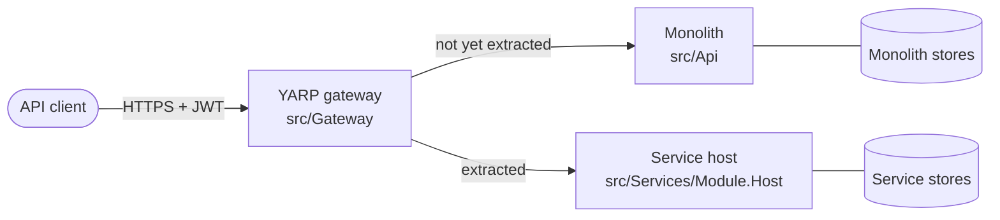

# 0002. Strangler-fig migration behind a YARP gateway

- **Status:** Proposed
- **Date:** 2026-10-28
- **ARB ticket:** TO BE CREATED
- **Authors:** AB-499 (epic AB-488)
- **Owning team:** TBD — owner to confirm before ARB
- **Related ADRs:** [0001](0001-service-boundaries.md), [0007](0007-extraction-order.md)

## Context

Clients call the monolith directly (`src/Api`, ports 3000/3001 locally). Routes are already grouped
by module: `/api/v1/identity/...`, `/api/v1/flight/...`, `/api/v1/passenger/...`,
`/api/v1/booking/...`, plus the IdentityServer endpoints (`/connect/token`, `/.well-known/...`).
A big-bang switch to four services would put every module at risk on one day, with no simple way
back. Clients must keep one base URL while modules move.

ARB triggers: T1 (new gateway deployable), T6 (new public ingress; tokens validated at the edge).

## Decision

We will migrate with the **strangler-fig** pattern. A **YARP reverse-proxy gateway**
(`src/Gateway`) becomes the single public entry point. At first every route goes to the monolith.
Each module is then extracted on its own: its service host is deployed next to the monolith, and
the gateway's cluster for that module's routes is switched from the monolith to the service. The
monolith keeps running, and keeps serving every module that has not moved, until the last module
is extracted; it is then decommissioned. Switching a module back is a gateway configuration
change only while the service's database is not yet the system of record (see
[0004](0004-database-per-service-and-per-service-outbox-inbox.md)); after that, rollback also
needs the data copied back.

The gateway validates the JWT for `/api/*` routes (issuer = Identity, audience
`booking-modular-monolith`) and forwards the `Authorization` header unchanged. Each service also
validates the token itself, so a request that bypasses the gateway is still rejected. Token and
discovery endpoints of Identity are proxied without authentication.

While a module runs in both places, its background work (outbox polling, message consumers,
Booking's EventStoreDB subscription) must run in exactly one process. The monolith gets a
per-module switch to turn that work off for a module once its service is live.

## Alternatives considered

| Alternative | Pros | Cons | Why rejected |
| --- | --- | --- | --- |
| Do nothing (clients call the monolith) | Nothing new to run | No way to move one module at a time | Blocks the epic |
| Big-bang rewrite / cut-over | One switch | All modules at risk at once; long freeze; no partial rollback | Too risky |
| Client-side routing (clients learn four URLs) | No gateway | Breaks every client per extraction; auth and CORS repeated per service | Pushes migration cost onto clients |
| Managed API gateway (cloud vendor) | Less code | New vendor (T3), environment-specific, not runnable in compose/tests | YARP is already a dependency and runs everywhere the app runs |

## Architecture

## Non-functional requirements

| NFR | Target | How met |
| --- | --- | --- |
| Availability SLO | TBD — owner to confirm before ARB | Gateway runs more than one replica; it is stateless |
| p95 latency | Gateway overhead TBD — owner to confirm before ARB | In-process YARP, one hop |
| RPO / RTO | Route rollback: one config change | Clusters selected by configuration |
| Peak load | TBD — owner to confirm before ARB | |
| Scaling model | Horizontal | Stateless gateway |
| Data retention | N/A — the gateway stores no data | |

## Security & compliance

- **Data classification:** The gateway sees all request and response bodies in transit; it does not store them.
- **Encryption at rest:** N/A — no storage.
- **Encryption in transit:** TLS terminates at the gateway; the internal hop to services is on the private network.
- **AuthN / AuthZ:** JWT validated at the gateway and again at each service (defence in depth). Authorization policies stay in the services.
- **Secrets:** None held by the gateway apart from TLS material.
- **Audit logging:** Gateway access logs with correlation id; traces propagated with OpenTelemetry.
- **Data residency / regions:** Unchanged.
- **Policy sections satisfied:** TBD — confirmed against `policy/approved-infra.yaml` when the deployment manifests land.
- **Threats considered:** Gateway bypass (mitigated by service-side token validation); route misconfiguration sending traffic to the wrong upstream (mitigated by smoke checks per flip).

## Cost

| Item | Assumption | Monthly estimate |
| --- | --- | --- |
| Gateway replicas | Small, stateless | TBD — owner to confirm before ARB |
| Monolith and services running side by side | Until the last module is extracted | TBD — owner to confirm before ARB |
| **Total** | | TBD |

## Operations

- **On-call rotation:** TBD — owner to confirm before ARB.
- **Runbook:** `docs/runbooks/` — route flip and rollback per module.
- **Dashboards / alarms:** Gateway request rate and error rate per cluster.
- **Rollback plan:** Point the module's cluster back at the monolith and turn its background work back on there.
- **Migration / cut-over plan:** [0007](0007-extraction-order.md).

## Policy exceptions requested

| Rule | Resource | Justification | Compensating control | Expiry |
| --- | --- | --- | --- | --- |
| none | | | | |

## Consequences

- Positive: One module moves at a time; clients keep one base URL; each move can be undone.
- Negative / risks: Two copies of a module can run at once; double processing must be prevented by the per-module switch. The gateway is a new single point of failure and must run with replicas.
- Follow-ups: Gateway project (AB-489); cut-over and decommission runbooks.

## Open questions

- Gateway latency budget and availability target.
