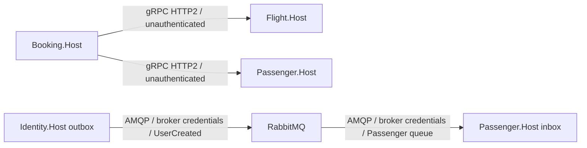

# 0002. Synchronous gRPC and asynchronous RabbitMQ

- **Status:** Proposed
- **Date:** 2026-10-29
- **Ticket:** AB-499 (epic AB-488)
- **ARB ticket:** TO BE CREATED
- **Authors:** AB-488 implementation contributors
- **Owning team:** Booking platform; named domain/platform owners TBD before ARB
- **Related ADRs:** [0001](0001-target-services-and-strangler-migration.md), [0003](0003-service-owned-data-and-background-processing.md), [0004](0004-contract-versioning-and-compatibility.md)

## Context

Booking already has gRPC clients for Flight inventory/seat reservation and Passenger lookup. Identity's `UserCreated` integration event feeds Passenger registration. An in-memory MassTransit bus cannot deliver across processes. The existing RabbitMQ transport can supply real inter-service delivery without selecting a new messaging vendor.

ARB triggers: T4 (cross-process event delivery), T6 (internal gRPC trust boundary); see the [review index](README.md#architecture-review).

## Decision

We will retain gRPC for synchronous Booking-to-Flight/Passenger calls, and use MassTransit over RabbitMQ for Identity-to-Passenger and future asynchronous integration events. In-memory transport is allowed only in tests. Calls use service-owned APIs, never another domain's mediator handlers or database. Internal gRPC remains unauthenticated for scaffolding per the shared migration decision; this is an explicit Security follow-up, not production approval.

- Configure gRPC addresses per environment; keep HTTP/2 reachable on the internal network. A failing dependency must produce a bounded failure, not a database fallback. Choose deadlines and retry budgets from measured latency before production. Do not blindly retry non-idempotent seat reservation.
- Use distinct receive queues per service/consumer so unrelated services cannot compete for one queue. Monolith and host consumer ownership must be transferred, not duplicated (ADR 0003). Preserve contract exchange/message identities when moving assemblies (ADR 0004).
- Publish through the service-owned outbox; consume via its inbox/idempotent handler. Delivery is **at least once**, not exactly once. Persist stable message IDs, tolerate duplicates, and do not assume ordering across different messages or queues.
- Failed delivery must be visible through retry/error queues and outbox/consumer metrics. Configure bounded retries, quarantine poison messages, and make replay an audited operation that retains the original message identity. These are implementation acceptance requirements, not claims about current end-to-end atomicity.
- Local RabbitMQ uses `booking` / `booking` (development only); `guest` is loopback-only and unsuitable for container-to-container connections. Production uses externally injected least-privilege credentials and approved TLS configuration.

## Alternatives considered

| Alternative | Pros | Cons | Why rejected |
| --- | --- | --- | --- |
| Do nothing: in-memory bus | Fast local execution | Events cannot cross service processes; no broker durability | Invalid after extraction |
| Make all communication synchronous | Immediate result | Couples Identity availability to Passenger and loses durable event handoff | User lifecycle is asynchronous |
| Replace gRPC or introduce another broker | Could standardize another stack | Wire changes and new operational cost during extraction | Existing gRPC/RabbitMQ capabilities fit the required flows |

## Architecture

Full containers and stores: [ADR 0001](0001-target-services-and-strangler-migration.md#architecture).

Local protocols are shown; production transport encryption and authentication follow the approval requirements below.

## Non-functional requirements

| NFR | Target | How met / approval input |
| --- | --- | --- |
| Availability SLO / p95 latency | TBD before ARB | Measure gRPC success/latency and event processing lag; broker outages must be observable |
| RPO / RTO | TBD before ARB | Durable broker/stores and replay/restore drills; no zero-loss claim without atomicity verification |
| Peak load | TBD before ARB | Measure requests, messages/sec, backlog and recovery throughput |
| Scaling model | One active background processor per service | Parallel consumers/host replicas require idempotency/concurrency work first |
| Data retention | TBD before ARB | Inbox/outbox and broker error queues contain PII; bound replay and retention windows |

## Security & compliance

- **Data classification:** User events contain names/passport data; restrict event schemas and consumers to required PII.
- **Encryption at rest/in transit:** Production broker storage/backups and AMQP/gRPC transport require approved encryption; keys/certificates TBD. Local HTTP2/AMQP is not a production security baseline.
- **AuthN / AuthZ:** gRPC currently has no service authentication. Keep its ports private; gateway JWT checks do not secure calls that bypass it. Broker access is credential-based with per-service permissions in production.
- **Secrets:** Inject broker/service credentials; `booking/booking` is only a local default. Do not log connection strings or payload PII.
- **Audit logging:** Correlation/message ID, retries, dead letters, replay operator and result; no raw tokens/passport values.
- **Residency / policy:** TBD with deployment selection; no new vendor or cloud region is chosen here. Approved infrastructure policy validation remains a deployment prerequisite.
- **Threats considered:** Message spoofing, duplicate side effects, poisoned messages, gRPC lateral access, unbounded retries and PII retention.

## Cost

RabbitMQ capacity, durable storage, HA, network and telemetry costs are TBD by Platform before ARB. Assume an existing transport implementation, not free production broker capacity; include this in the total estimate in ADR 0001. No new vendor estimate is asserted.

## Operations

- **On-call rotation:** Platform owns broker operations and domain owners handle failed consumers; named rotations TBD.
- **Runbook:** AB-505 owns executable ownership transfer/replay/rollback procedures; prerequisites are in ADR 0003.
- **Dashboards / alarms:** Outbox age, queue depth, retries/error queues, publish failures, projection lag and gRPC failures; thresholds TBD from baseline.
- **Rollback / migration:** Deploy compatible consumers/providers first; preserve IDs and schemas, drain/reconcile in-flight work, transfer consumer ownership, then switch routes. RabbitMQ and gRPC smoke tests must exercise real processes, not only mocks.

## Policy exceptions requested

The unauthenticated gRPC exception requested in [ADR 0001](0001-target-services-and-strangler-migration.md#policy-exceptions-requested) applies here unchanged. Security must set its expiry and required authentication mechanism. No exception has been granted.

## Consequences

- **Positive:** Retains established synchronous APIs while enabling durable cross-process events.
- **Negative / risks:** Broker operations, eventual consistency, retry/idempotency and missing gRPC authentication become explicit responsibilities.
- **Follow-ups:** Verify persistence/publish failure windows, real broker redelivery, gRPC error mapping and mixed-version calls before cutover.

## Open questions

- Security/Platform must confirm internal authentication/TLS, retry/deadline budgets, broker HA and recovery/retention targets before production approval.
