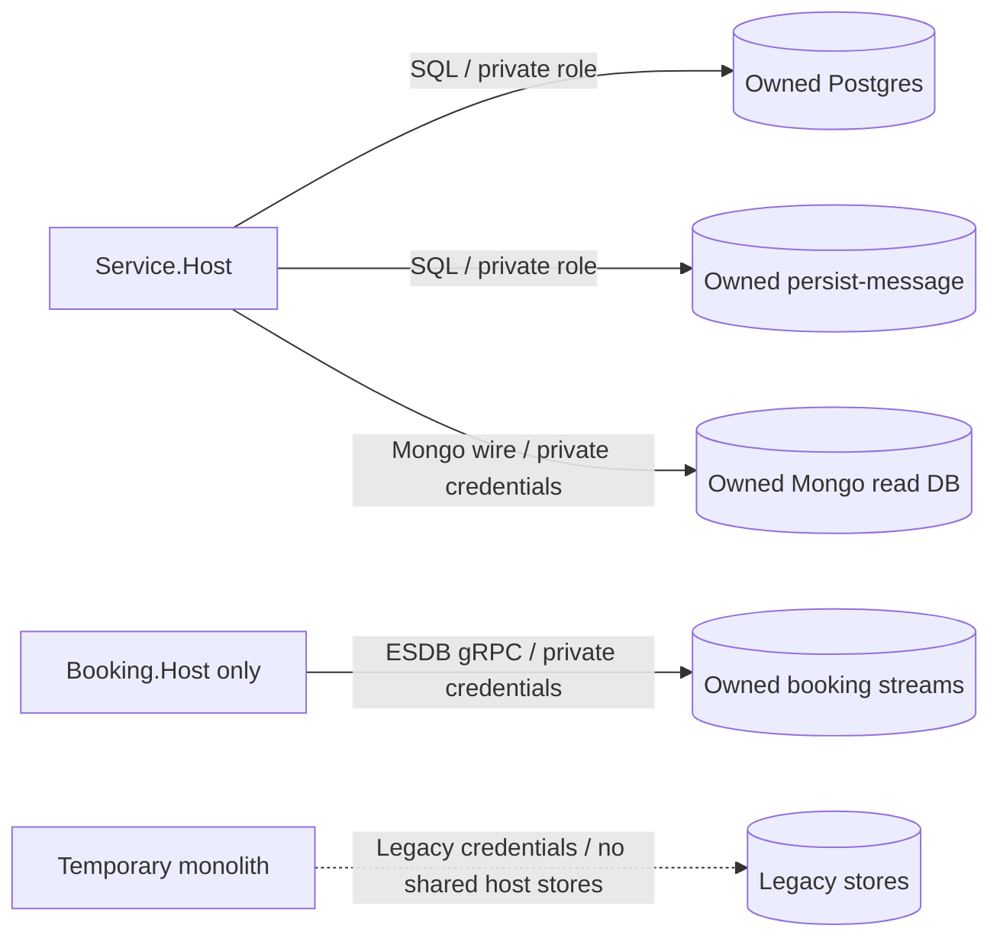

# 0003. Service-owned data and background processing

- **Status:** Proposed
- **Date:** 2026-10-29
- **Ticket:** AB-499 (epic AB-488)
- **ARB ticket:** TO BE CREATED
- **Authors:** AB-488 implementation contributors
- **Owning team:** Booking platform; named Data/domain owners TBD before ARB
- **Related ADRs:** [0001](0001-target-services-and-strangler-migration.md), [0002](0002-synchronous-grpc-and-asynchronous-rabbitmq.md), [0004](0004-contract-versioning-and-compatibility.md)

## Context

The monolith composes modules in one process and uses shared infrastructure, including persisted-message processing. Sharing those stores with new hosts would create duplicate outbox processing and let services bypass domain APIs. Booking additionally projects EventStoreDB events through a single-consumer subscription. The current outbox has no row-locking work-claim protocol.

ARB triggers: T2 (data ownership/isolation), T4 (integration replaces shared access). Physical database servers may be shared; database and credential ownership must not be.

## Decision

We will give each service a private Postgres database and role, private persist-message outbox/inbox store, and private Mongo read database. Booking also exclusively owns its EventStoreDB streams and projection subscription. No service may read/write another service's tables, collections, persisted messages or event streams. Exchange identifiers/contracts through gRPC/events instead. AB-505 owns migration from monolith databases, reconciliation, reverse-sync/rollback, and decommission.

The following names are target naming examples, not existing provisioned resources. A store with no current projection may remain unused; it must never point at another service's read database.

| Service | Postgres DB / role | Persist-message DB (same owning role) | Mongo read DB | Other ownership |
| --- | --- | --- | --- | --- |
| Identity | `identity_service` / `identity_service` | `identity_service_persist_message` | `identity_service_read` | Identity credentials, OAuth configuration/signing lifecycle |
| Flight | `flight_service` / `flight_service` | `flight_service_persist_message` | `flight_service_read` | Flight/seat inventory |
| Passenger | `passenger_service` / `passenger_service` | `passenger_service_persist_message` | `passenger_service_read` | Passenger profiles |
| Booking | `booking_service` / `booking_service` | `booking_service_persist_message` | `booking_service_read` | Booking ESDB streams; ESDB is the aggregate source of truth, not a new Postgres booking model |

### Isolation and processor invariants

- Roles can connect to and mutate only their owned databases. Configure Mongo and ESDB access boundaries equivalently; separate instances are acceptable when the storage platform cannot isolate the required streams. Admin/bootstrap credentials must not be runtime credentials.
- No cross-service joins, foreign keys, shared EF contexts, distributed SQL transactions or reporting bypass. Read models are private projections, eventually consistent with the owning writer; do not promise immediate read-after-write across contexts.
- Monolith stores (including its `persist_message`) remain separate from host stores. Route movement does not transfer data or pending messages automatically.
- At most **one instance of a service may run background processing**. No multi-replica host/HPA with processing enabled until outbox claiming/locking and Booking subscription coordination are implemented and verified. This applies to all outbox workers, not just Booking.
- In `src/Api`, `Modules:<Module>:BackgroundProcessingEnabled` defaults to `true`. Set it to `false` for an extracted module to disable its outbox worker, subscriptions and MassTransit consumers. For Booking this includes the ESDB subscription. A route switch without this ownership transfer is unsafe.
- Persist-message operations and business writes must be verified for their actual transaction boundaries; a separate message store does not magically make cross-store writes atomic. Test crash/retry windows and idempotency; do not advertise exactly-once delivery.

## Alternatives considered

| Alternative | Pros | Cons | Why rejected |
| --- | --- | --- | --- |
| Do nothing: share monolith databases/roles | Minimal provisioning | Duplicate polling, coupled migrations, unauthorized domain access | Violates independent ownership |
| Separate schemas with one privileged runtime role | Easy joins and operations | Services can still mutate each other's data | Isolation must be enforced, not just conventional |
| Add locking/distributed coordination in this ticket | Could support horizontal workers | Broad concurrency change before extraction | Explicit single-processor constraint is safer for scaffolding; later change needs tests/ADR |

## Architecture

This per-service pattern repeats four times in the [target container view](0001-target-services-and-strangler-migration.md#architecture). Protocol encryption is a production approval requirement; local scaffolding defaults are not proof of isolation.

## Non-functional requirements

| NFR | Target | How met / approval input |
| --- | --- | --- |
| Availability / p95 latency | TBD before ARB | Measure per-store health, writes and projection lag; no cross-store fallback |
| RPO / RTO | TBD by Data/Platform before ARB | Consistent backup/restore, pending-message and ESDB projection recovery drills |
| Peak load | TBD before ARB | Baseline write rate, outbox drain rate and read model growth |
| Scaling model | One processor per service | Separate read/HTTP-only scaling needs proven disabled background paths |
| Data retention | TBD by Data/Security before ARB | Align source, read models, events, inbox/outbox and backups |

## Security & compliance

- **Data classification:** PII in Identity/Passenger and copied event/projection fields; minimize snapshots and access.
- **Encryption at rest/in transit:** Production stores and backups require encryption, approved keys and TLS; implementation/provider details TBD before ARB.
- **AuthN / AuthZ:** Least-privilege per-service roles/credentials and denied cross-service access tests; no shared runtime superuser.
- **Secrets:** Inject and rotate per-service credentials; migration/bootstrap access is separately controlled.
- **Audit logging:** Record migrations, reconciliation counts, ownership transfers and privileged access without copying payload PII into logs.
- **Residency / policy:** Data location/retention/legal deletion requirements TBD; check infrastructure policy when resources are selected.
- **Threats considered:** Cross-domain DB access, duplicate publication, replay after rollback, lost projections, divergent dual-writes and inconsistent backups.

## Cost

TBD before ARB: estimate logical database storage, physical servers/replicas, ESDB, backups, I/O and retention. Logical database-per-service does not mandate one physical server per database. Include coexistence storage overhead in ADR 0001's estimate; do not assume free duplicated data.

## Operations

- **On-call rotation:** Domain owners own schemas/projections and Platform/Data own storage/backup operations; named rotations TBD.
- **Runbook:** AB-505 will implement migration and ownership-transfer procedures. Required order: pause writes, account for pending events, copy/reconcile data, disable legacy processors, start one host processor, verify projections, switch routing, and probe end to end.
- **Dashboards / alarms:** Outbox oldest message, publish failures, projection lag, ESDB subscription status, DB connections/storage, duplicate-consumption signals.
- **Rollback:** Quiesce host writes/processors, reverse-sync/reconcile data and messages under AB-505, then reactivate legacy processors and routing. Never run both processors or route writes to stale copies.

## Policy exceptions requested

None for data isolation. The gRPC exception is recorded separately in ADR 0001; this ADR grants no storage-policy exception.

## Consequences

- **Positive:** Enforced ownership supports independent schema/deployment changes and prevents double polling of shared tables.
- **Negative / risks:** More credentials/stores; projections lag, cross-service transactions disappear, cutover needs data reconciliation; one processor limits throughput/availability.
- **Follow-ups:** AB-505 data migration and rollback evidence; later outbox locking/subscription coordination before horizontal background scaling.

## Open questions

- Data/Platform must select ESDB isolation, backups/restore consistency, retention/residency and the permitted rollback window before ARB/cutover.
