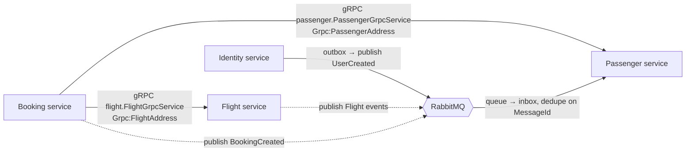

# 0003. gRPC for synchronous calls, RabbitMQ (MassTransit) for integration events

- **Status:** Proposed
- **Date:** 2026-10-28
- **ARB ticket:** TO BE CREATED
- **Authors:** AB-499 (epic AB-488)
- **Owning team:** TBD — owner to confirm before ARB
- **Related ADRs:** [0004](0004-database-per-service-and-per-service-outbox-inbox.md), [0005](0005-contract-and-proto-versioning-policy.md), [0008](0008-defer-service-to-service-grpc-authentication.md)

## Context

Modules talk to each other in two ways today:

- **Synchronous gRPC.** `CreateBookingCommandHandler` (Booking) calls Flight's
  `FlightGrpcService` (`GetById`, `GetAvailableSeats`, `ReserveSeat`) and Passenger's
  `PassengerGrpcService` (`GetById`). The client addresses come from the `Grpc` options section
  (`Grpc:FlightAddress`, `Grpc:PassengerAddress`, bound to `GrpcOptions`). The Booking client
  protos are copies of the server protos with a different package (`bookingFlight` /
  `bookingPassenger` instead of `flight` / `passenger`), so over a real network the calls resolve
  to service names the servers do not expose and fail with `Unimplemented`.
- **Asynchronous events.** Modules publish integration events from the outbox through MassTransit,
  configured with `TransportType.InMemory` in `SharedInfrastructureExtensions`. The in-memory bus
  only reaches consumers in the same process. The one cross-module consumer is Passenger's
  `RegisterNewUserHandler : IConsumer<UserCreated>`, which reacts to Identity creating a user.
  The other events (`FlightCreated`, `SeatReserved`, `PassengerCreated`, `BookingCreated`, ...)
  have no cross-module consumer yet.

Once modules run in separate processes, the in-memory bus no longer works and the gRPC calls cross
the network.

ARB triggers: T4 (cross-domain sync and async contracts), T2/T1 (RabbitMQ as a shared broker).

## Decision

We will keep **gRPC** for synchronous request/response between services (Booking → Flight,
Booking → Passenger) and use **RabbitMQ through MassTransit** for asynchronous integration events
between services (Identity → Passenger `UserCreated` now, and any future event).

- gRPC: one copy of each proto, shared from `src/Contracts/Contracts.Grpc` with the server packages
  `flight` and `passenger`. Clients are addressed by `Grpc:FlightAddress` and
  `Grpc:PassengerAddress`. Only idempotent reads are retried; `ReserveSeat` is not retried
  automatically. Today `GrpcClientExtensions` adds one resilience handler (retry, circuit breaker,
  timeout) per client, so `ReserveSeat` is retried too. The ticket that switches Booking to the
  shared protos must make retries per method (for example, skip the retry when the gRPC method is
  `ReserveSeat`); changing the proto alone does not do this.
- Events: services publish through their own outbox ([0004](0004-database-per-service-and-per-service-outbox-inbox.md))
  to RabbitMQ with MassTransit's default publish topology (one exchange per message type). Each
  consumer gets its own queue. Consumers deduplicate on the MassTransit `MessageId` through their
  inbox. The in-memory transport stays available only for tests and as a local development
  fallback.
- New synchronous dependencies between services need an ADR; prefer events where the caller does
  not need an answer in the same request.

## Alternatives considered

| Alternative | Pros | Cons | Why rejected |
| --- | --- | --- | --- |
| Do nothing (in-memory bus, in-process gRPC) | No new infrastructure | `UserCreated` never reaches a Passenger service in another process | Breaks the first cross-service flow |
| REST/JSON for synchronous calls | Familiar | Rewrites working gRPC clients and servers; loses typed contracts | No benefit over keeping gRPC |
| Kafka for events | Replay, high throughput | New platform; MassTransit rider model differs; volume does not need it | More than the current event volume needs |
| Cloud-managed broker (SNS/SQS, Service Bus) | Managed | Ties local, test and compose runs to a cloud vendor (T3) | RabbitMQ is already in the compose stack and supported by `BuildingBlocks.MassTransit` |
| Events for everything, no gRPC | Looser coupling | Booking needs flight and passenger data inside the create request | Would need local replicas of Flight/Passenger data; separate decision |

## Architecture

## Non-functional requirements

| NFR | Target | How met |
| --- | --- | --- |
| Availability SLO | TBD — owner to confirm before ARB | Booking create depends on Flight and Passenger being up; event consumers tolerate the broker being down (the outbox holds messages) |
| p95 latency | TBD — owner to confirm before ARB | Three gRPC calls on the create path |
| RPO / RTO | No lost events while the outbox row is committed | Outbox + at-least-once delivery + inbox dedupe |
| Peak load | TBD — owner to confirm before ARB | |
| Scaling model | Competing consumers per queue | MassTransit endpoints per service |
| Data retention | Messages are removed once consumed; outbox/inbox retention per [0004](0004-database-per-service-and-per-service-outbox-inbox.md) | |

## Security & compliance

- **Data classification:** `UserCreated` carries a name and passport number (personal data).
- **Encryption at rest:** Broker queues follow the platform default; TBD — owner to confirm before ARB.
- **Encryption in transit:** Private network only for now; TLS on AMQP and gRPC is a follow-up with [0008](0008-defer-service-to-service-grpc-authentication.md).
- **AuthN / AuthZ:** RabbitMQ requires a username/password (not the loopback-only `guest`); gRPC is unauthenticated for now ([0008](0008-defer-service-to-service-grpc-authentication.md)).
- **Secrets:** Broker credentials through configuration (`RabbitMqOptions`), never committed beyond dev defaults.
- **Audit logging:** Message ids and correlation ids are logged and traced.
- **Data residency / regions:** Unchanged.
- **Policy sections satisfied:** TBD — confirmed against `policy/approved-infra.yaml` when deployment manifests land.
- **Threats considered:** Duplicate delivery (inbox); poison messages (MassTransit retry, then error queue); a caller reaching gRPC directly ([0008](0008-defer-service-to-service-grpc-authentication.md)).

## Cost

| Item | Assumption | Monthly estimate |
| --- | --- | --- |
| RabbitMQ (single node or small cluster) | Low event volume | TBD — owner to confirm before ARB |
| **Total** | | TBD |

## Operations

- **On-call rotation:** TBD — owner to confirm before ARB.
- **Runbook:** `docs/runbooks/` — broker outage, error-queue replay.
- **Dashboards / alarms:** RabbitMQ queue depth and error-queue depth; gRPC error rate per method.
- **Rollback plan:** Per module, via the gateway ([0002](0002-strangler-fig-migration-behind-yarp-gateway.md)). While Identity and Passenger run in the monolith, the monolith uses the same transport as any extracted consumer ([0007](0007-extraction-order.md)).
- **Migration / cut-over plan:** [0007](0007-extraction-order.md).

## Policy exceptions requested

| Rule | Resource | Justification | Compensating control | Expiry |
| --- | --- | --- | --- | --- |
| none | | | | |

## Consequences

- Positive: The existing gRPC clients and MassTransit consumers keep working with configuration changes; the proto package mismatch goes away with a single shared proto.
- Negative / risks: The publisher and consumer of `UserCreated` must be on the same transport at every point in the migration. Booking's create path is now only as available as Flight and Passenger.
- Follow-ups: Shared contracts (AB-494 style `Contracts.Grpc` / `Contracts.Messages`); TLS/auth for internal traffic ([0008](0008-defer-service-to-service-grpc-authentication.md)).

## Open questions

- Broker high availability (single node vs. quorum queues) and its cost.
- Latency budget for Booking's create path.
