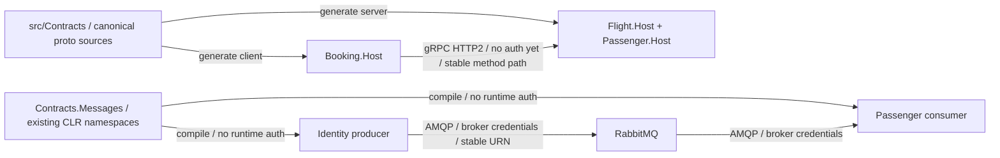

# 0004. Contract versioning and compatibility

- **Status:** Proposed
- **Date:** 2026-10-29
- **Ticket:** AB-499 (epic AB-488)
- **ARB ticket:** TO BE CREATED
- **Authors:** AB-488 implementation contributors
- **Owning team:** Booking platform; provider and consumer domain owners approve contract changes
- **Related ADRs:** [0001](0001-target-services-and-strangler-migration.md), [0002](0002-synchronous-grpc-and-asynchronous-rabbitmq.md), [0003](0003-service-owned-data-and-background-processing.md)

## Context

Separate service releases must coexist with the monolith and queued older events. Events currently live under `src/BuildingBlocks/Contracts/EventBus.Messages`, and gRPC protos are copied between modules. File/project movement must not silently rename MassTransit message URNs, persisted CLR type identities or gRPC method paths.

The base has a concrete mismatch: Booking's client protos declare `bookingFlight`/`bookingPassenger`, while provider protos declare `flight`/`passenger`. gRPC uses `/<package>.<service>/<method>` on the wire, so these are different APIs even if message fields match. This ADR records the corrective policy; it does not edit protos or claim runtime compatibility is fixed.

ARB triggers: T4 (shared sync/async contracts), T8 (independently consumed shared artifacts).

## Decision

We will centralize integration events in target `src/Contracts/Contracts.Messages` and gRPC proto sources under `src/Contracts`, version them independently of host deployment, and preserve existing CLR namespaces and MassTransit URNs. Keep BuildingBlocks namespaces when splitting projects. Providers own contracts, consumers review changes, and mixed-version compatibility is a release gate rather than relying on lockstep builds.

### Wire and package policy

| Surface | Compatible evolution | Breaking evolution / required action |
| --- | --- | --- |
| HTTP | Preserve current versioned routes, request/response meaning, status codes and auth policies; additive optional fields only when old clients tolerate them | New route/API major version; keep old gateway routes during consumer transition |
| gRPC | Preserve canonical provider `package` (`flight`, `passenger`), service/RPC names, field numbers/types and enum numeric values; add fields clients can ignore safely | New explicitly versioned package/service; never silently change a method path, field type or semantics |
| Proto fields/enums | Reserve removed numbers **and names**; never reuse tags/enum numbers; retain unknown/zero defaults and optional-field handling | Do not turn optional data into a required business precondition for old callers |
| Events | Keep namespace/type-derived URN, property names/types and stable event/message IDs; add optional/default-safe fields | Introduce a distinct versioned event identity (for example `UserCreatedV2`) and support both consumers during migration |
| Shared libraries/contracts | SemVer: patch for compatible fixes, minor for additive compatible changes, major for breaking changes; pin reproducible dependency versions | A package-major bump alone does not authorize an incompatible wire change or dropping an old handler |
| Persisted types | Preserve deserialization of historical outbox/inbox and ESDB payloads/type identifiers | Provide explicit mapping/upcasters and replay tests before removing old CLR/assembly identity support |

When centralizing protos, generate Booking clients against the canonical provider packages (`flight`/`passenger`), not the mismatched client copies. Preserve generated CLR namespaces explicitly via `csharp_namespace`/generation configuration where necessary. Validate real provider/client calls; a CLR rename is not a fix for a wire-path mismatch. Assembly moves of persisted types need resolution tests even when namespaces stay the same.

### Rollout / retirement policy

1. Publish additive schemas and compatible providers/consumers first. Test **old consumer + new producer**, **new consumer + old producer**, and replay of persisted events; compile-only checks cannot detect gRPC path mismatch.
2. Deploy readers/consumers before writers start emitting a new event/version. Keep old routes/services/handlers available throughout the migration and rollback window.
3. For a breaking change, introduce parallel versioned contracts/endpoints and an explicit transition plan. If publishing both event versions, prevent duplicate business effects through stable IDs/idempotency or consumer-specific subscriptions; do not blindly process both.
4. Retire an old version only after all consumer owners confirm migration, backlog/error queues and replay requirements are accounted for, usage shows no callers, the rollback window has closed, and the removal is approved/documented. The exact retention/deprecation duration is TBD before ARB, not silently assumed.
5. Require schema review and tests for JSON/URN/type resolution, proto service paths/tags, gRPC calls, RabbitMQ delivery, and previous-version compatibility on every contract change. Extraction tickets implement these gates; this docs-only ticket does not add a working compatibility pipeline.

## Alternatives considered

| Alternative | Pros | Cons | Why rejected |
| --- | --- | --- | --- |
| Do nothing: copy protos/contracts per module | No initial move | Drift already changes gRPC service paths | Not a reliable independent-release contract |
| Rename all namespaces/packages during extraction | Matches new folder layout | Breaks URNs, stored type names and RPC paths | Filesystem refactoring must not change wire identity |
| Deploy every service in lockstep | Simplifies compatibility assumptions | Defeats independent releases and queued-message replay | Expand/contract rollout is required |

## Architecture

Full containers/stores and production encryption requirements: [ADR 0001](0001-target-services-and-strangler-migration.md#architecture).

## Non-functional requirements

| NFR | Target | How met / approval input |
| --- | --- | --- |
| Availability / latency | TBD before ARB; no contract-induced outage | Mixed-version runtime tests plus measured provider/gateway baselines |
| RPO / RTO | TBD before ARB | Preserve historical event deserialization and rollback compatibility |
| Peak load | TBD before ARB | Test message-size/schema growth and overlapping-version overhead |
| Scaling model | Independent releases, one background processor per service | Compatibility must not require synchronized deployment |
| Retention / deprecation | TBD before ARB | Retain old handlers until consumer/replay/rollback conditions above are met |

## Security & compliance

- **Data classification:** Contract additions must not expose credentials or unnecessary passport/profile PII; Data/Security review classification changes.
- **Encryption at rest/in transit:** Runtime contracts inherit ADRs 0001–0003; compile-time dependency arrows are not network flows. Test fixtures must redact sensitive samples.
- **AuthN / AuthZ:** Version changes must preserve existing authorization semantics; internal gRPC auth gap remains explicit under ADR 0001.
- **Secrets:** No secrets in schema examples, packages or test fixtures.
- **Audit logging:** Record contract version/identity and deprecation decisions without full sensitive payloads.
- **Residency / policy:** No new deployment resource/region; new contract fields must respect the owning domain's retention/residency requirements (TBD before ARB).
- **Threats considered:** Type confusion, incompatible replay, PII expansion, authorization weakening and duplicate effects during dual-version publishing.

## Cost

Build/artifact storage and overlapping-version broker/compute overhead are TBD by Platform before ARB. No new vendor is introduced; account for replay and dual-version retention in ADR 0001's total estimate.

## Operations

- **On-call rotation:** Producer/provider domain owns schema and release notes; consumer owners approve compatibility; named rotations TBD.
- **Runbook:** Use the rollout/retirement steps above; AB-505 owns executable cutover and rollback drills.
- **Dashboards / alarms:** RPC `Unimplemented`, deserialization failures, unknown message types, error-queue growth and old-version usage.
- **Rollback / migration:** Retain old handlers and routes; roll writers back before removing new readers. Do not remove schema support while persisted/in-flight messages still require it.

## Policy exceptions requested

None for compatibility/versioning. This ADR does not approve the separate unauthenticated gRPC exception in ADR 0001.

## Consequences

- **Positive:** Stable wire identities and shared source prevent drift while allowing independently deployed hosts.
- **Negative / risks:** Old handlers/versions and historical fixtures increase maintenance; retained CLR namespaces need not match folders.
- **Follow-ups:** Centralization must fix the observed client/provider package mismatch and prove historical persisted-type resolution; later tickets add automated compatibility gates.

## Open questions

- Provider/consumer owners must agree the deprecation window, supported replay history and packaging/release ownership before ARB approval.
