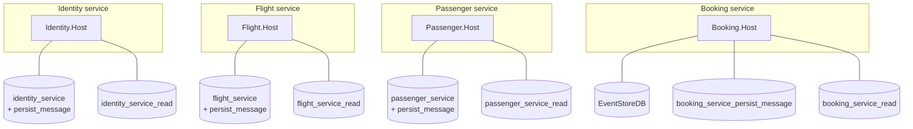

# 0004. Database per service, with a per-service outbox and inbox

- **Status:** Proposed
- **Date:** 2026-10-28
- **ARB ticket:** TO BE CREATED
- **Authors:** AB-499 (epic AB-488)
- **Owning team:** TBD — owner to confirm before ARB
- **Related ADRs:** [0001](0001-service-boundaries.md), [0003](0003-sync-grpc-async-rabbitmq.md), [0007](0007-extraction-order.md)

## Context

Today, on one Postgres server with the `postgres` superuser:

- Write models: `flight_modular_monolith`, `identity_modular_monolith`,
  `passenger_modular_monolith` (one DB per module already, but one login for all).
- Outbox/inbox: a single shared `persist_message` database
  (`PersistMessageOptions:ConnectionString`). `EfTx<Module>Behavior` writes outbox rows in the
  module's transaction, and **one** `PersistMessageBackgroundService` polls the rows of every
  module and publishes them.
- Read models: one MongoDB database, `booking_modular_monolith_read`, shared by all modules.
- Booking's write model: EventStoreDB, with an `$all` subscription that projects into Mongo.

Two processes polling one outbox table would publish the same messages twice, and a shared login
lets any module read or change another's tables.

ARB triggers: T2 (new databases, roles and stores per service).

## Decision

We will give **each service its own data stores**, reachable only by that service:

| Service | Write store | Outbox / inbox | Read store |
| --- | --- | --- | --- |
| Identity | Postgres DB `identity_service`, role `identity_service` | Postgres `identity_service_persist_message` | Mongo DB `identity_service_read` |
| Flight | Postgres DB `flight_service`, role `flight_service` | Postgres `flight_service_persist_message` | Mongo DB `flight_service_read` |
| Passenger | Postgres DB `passenger_service`, role `passenger_service` | Postgres `passenger_service_persist_message` | Mongo DB `passenger_service_read` |
| Booking | EventStoreDB (kept) | Postgres `booking_service_persist_message`, role `booking_service` | Mongo DB `booking_service_read` |

- No service reads or writes another service's store. Data owned by another service is obtained
  through its gRPC API or by consuming its events ([0003](0003-sync-grpc-async-rabbitmq.md)).
- Each service has its own outbox and inbox (its own persist-message store and its own
  background poller), so the outbox poller of one service never sees another's rows. Inbox rows
  are keyed on the MassTransit `MessageId`. Today `PersistMessageProcessor` keys persisted
  messages on `IEvent.EventId` instead, so the consumer-side inbox write and its duplicate check
  have to move to `ConsumeContext.MessageId` when the per-service inbox is built. Outbox rows can
  keep `EventId`.
- The names above are the convention (`<module>_service`, `<module>_service_persist_message`,
  `<module>_service_read`); physical servers may be shared in non-production as long as
  databases and roles are separate.
- Copying data from the monolith databases into the service databases is a cut-over task, not
  part of standing up a host. Until a service's database takes writes, the monolith's database
  stays the system of record for that module.

## Alternatives considered

| Alternative | Pros | Cons | Why rejected |
| --- | --- | --- | --- |
| Do nothing (services connect to the monolith DBs) | No data migration | Hidden coupling through tables; two pollers on one outbox; one superuser login | Not independent services |
| Shared database, schema per service | One server, one backup | Still one failure and scaling unit; cross-schema queries easy to add by accident | Weak isolation |
| One shared outbox with locking (`FOR UPDATE SKIP LOCKED`) | Smaller change | Couples every service to one table and its migrations | Ties all services to one store |

## Architecture

## Non-functional requirements

| NFR | Target | How met |
| --- | --- | --- |
| Availability SLO | TBD — owner to confirm before ARB | A store outage affects only its service |
| p95 latency | Unchanged for single-service queries | |
| RPO / RTO | TBD — owner to confirm before ARB | Backups per database |
| Peak load | TBD — owner to confirm before ARB | |
| Scaling model | Per-service stores scale on their own | |
| Data retention | Outbox/inbox rows: TBD — owner to confirm before ARB (cleanup job is a follow-up) | |

## Security & compliance

- **Data classification:** Personal data stays in Identity and Passenger stores only.
- **Encryption at rest:** Platform default for Postgres, MongoDB and EventStoreDB volumes; TBD — owner to confirm before ARB.
- **Encryption in transit:** TLS to stores in production; TBD — owner to confirm before ARB.
- **AuthN / AuthZ:** One least-privilege role per service, owning only its databases. No service uses the superuser.
- **Secrets:** Connection strings per service through configuration/secret store.
- **Audit logging:** Database audit per platform policy.
- **Data residency / regions:** Unchanged.
- **Policy sections satisfied:** TBD — confirmed against `policy/approved-infra.yaml` when deployment manifests land.
- **Threats considered:** Lateral movement through a shared login (removed); duplicate publishing from a shared outbox (removed).

## Cost

| Item | Assumption | Monthly estimate |
| --- | --- | --- |
| Extra databases (Postgres, Mongo) | Can share servers in non-production | TBD — owner to confirm before ARB |
| **Total** | | TBD |

## Operations

- **On-call rotation:** TBD — owner to confirm before ARB.
- **Runbook:** `docs/runbooks/` — data copy, verification and rollback per module.
- **Dashboards / alarms:** Outbox backlog (rows not yet published) per service.
- **Rollback plan:** Before a service DB takes writes: gateway route back only. After: copy changed data back to the monolith DB as part of the rollback runbook.
- **Migration / cut-over plan:** [0007](0007-extraction-order.md).

## Policy exceptions requested

| Rule | Resource | Justification | Compensating control | Expiry |
| --- | --- | --- | --- | --- |
| none | | | | |

## Consequences

- Positive: Services can deploy, migrate and scale their stores independently; no double publishing.
- Negative / risks: More databases to run and back up. Queries that joined across modules must become API calls or event-fed read models. Data copy at cut-over needs care.
- Follow-ups: Per-module persist-message store in BuildingBlocks; init scripts for databases and roles; outbox/inbox retention.

## Open questions

- RPO/RTO and backup schedule per store.
- Outbox/inbox retention period.
