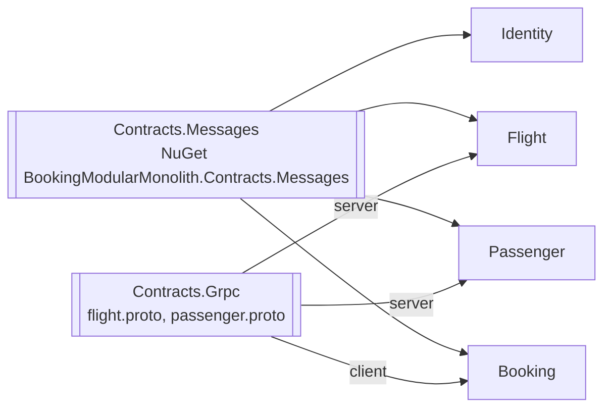

# 0005. Versioning and compatibility policy for integration events and protos

- **Status:** Proposed
- **Date:** 2026-10-28
- **ARB ticket:** TO BE CREATED
- **Authors:** AB-499 (epic AB-488)
- **Owning team:** TBD — owner to confirm before ARB
- **Related ADRs:** [0003](0003-sync-grpc-async-rabbitmq.md), [0006](0006-repository-layout-for-hosts-and-contracts.md)

## Context

In one process, a contract change is a compile error and every module ships together. With
separate services, a publisher and its consumers — or a gRPC server and its clients — are deployed
at different times, and for a while old and new versions run side by side (including the
monolith during the strangler-fig period).

Today:

- Integration events are C# records in `src/BuildingBlocks/Contracts/EventBus.Messages`, namespace
  `BuildingBlocks.Contracts.EventBus.Messages` (e.g. `UserCreated(Guid Id, string Name, string
  PassportNumber)`). MassTransit names messages by CLR namespace and type
  (`urn:message:BuildingBlocks.Contracts.EventBus.Messages:UserCreated`), so moving or renaming a
  type changes the exchange name and silently disconnects consumers.
- Protos exist twice (server copies in Flight/Passenger, client copies in Booking) with different
  packages, which already breaks the calls on the wire ([0003](0003-sync-grpc-async-rabbitmq.md)).

ARB triggers: T4 (shared contract schema between bounded contexts), T8 (shared library).

## Decision

We will keep one source of truth per contract and evolve it only in backward-compatible steps.

**Where contracts live**

- Integration events: `src/Contracts/Contracts.Messages`, NuGet id
  `BookingModularMonolith.Contracts.Messages`, with minimal dependencies. Types keep their current
  CLR namespace (`BuildingBlocks.Contracts.EventBus.Messages`) so message URNs do not change.
- gRPC: `src/Contracts/Contracts.Grpc`, one `.proto` per service (`flight.proto`, package `flight`;
  `passenger.proto`, package `passenger`). Servers and clients compile from these files only.

**Allowed without a new version (additive)**

- Events: add a new optional/nullable property at the end; add a new event type.
- Protos: add a field with a new tag number; add an RPC; add a message; add an enum value that
  consumers can ignore.

**Breaking (needs a new version)**

- Removing or renaming a property/field, changing its type or meaning, changing a proto field tag,
  making an optional value required, renaming or moving an event type (its URN), renaming a proto
  package, service or RPC.
- Removed proto fields are marked `reserved` (tag and name) and never reused.

**How to make a breaking change**

- Events: publish a new type with a `V2` suffix (e.g. `UserCreatedV2`) alongside the old one. The
  publisher sends both until every consumer has moved; then the old type is retired in a later
  release.
- gRPC: add a new versioned package (e.g. `flight.v2`) served next to the old one; clients move;
  the old package is removed after one release with no callers.
- Every breaking change gets a short note in the PR and, if it changes a cross-service flow, an ADR.

**Package versions**

- `Contracts.Messages` and `Contracts.Grpc` use SemVer: additive change = minor, breaking change
  (only allowed through the steps above) = major.

**Enforcement**

- Contract tests keep a baseline of each event's shape and each proto's descriptor; CI fails on a
  non-additive change unless the baseline is updated on purpose.

## Alternatives considered

| Alternative | Pros | Cons | Why rejected |
| --- | --- | --- | --- |
| Do nothing (copy contracts per service) | No shared package | Copies drift — already happened with the Booking protos | Proven to break |
| Schema registry (e.g. Avro/Protobuf registry for events) | Central checks | New infrastructure (T5/T3); MassTransit JSON messages do not need it | Too heavy for four services |
| Lock-step deploys of publisher and consumers | Simple rule | Removes independent deployment, the point of the epic | Defeats the goal |

## Architecture

## Non-functional requirements

| NFR | Target | How met |
| --- | --- | --- |
| Availability SLO | No outage caused by a contract change | Additive-only rule + contract tests |
| p95 latency | N/A — policy, no runtime component | |
| RPO / RTO | N/A — policy | |
| Peak load | N/A — policy | |
| Scaling model | N/A — policy | |
| Data retention | Old event versions kept until no consumer remains | |

## Security & compliance

- **Data classification:** Adding personal data to an event is a data-classification change and needs review.
- **Encryption at rest:** N/A — policy.
- **Encryption in transit:** N/A — policy.
- **AuthN / AuthZ:** N/A — policy.
- **Secrets:** N/A — contracts contain no secrets.
- **Audit logging:** Contract changes are visible in PRs and baselines.
- **Data residency / regions:** N/A.
- **Policy sections satisfied:** N/A — no infrastructure.
- **Threats considered:** Silent consumer disconnect from a URN change (namespace kept); reuse of a proto tag (reserved).

## Cost

| Item | Assumption | Monthly estimate |
| --- | --- | --- |
| None | Policy only | 0 |
| **Total** | | 0 |

## Operations

- **On-call rotation:** N/A — policy.
- **Runbook:** N/A — policy.
- **Dashboards / alarms:** Error queues show consumers that cannot read a message.
- **Rollback plan:** Additive changes can stay in place when a service is rolled back.
- **Migration / cut-over plan:** N/A.

## Policy exceptions requested

| Rule | Resource | Justification | Compensating control | Expiry |
| --- | --- | --- | --- | --- |
| none | | | | |

## Consequences

- Positive: Services can be released in any order; the proto package mismatch cannot come back.
- Negative / risks: Breaking changes take two or more releases. The CLR namespace keeps the old `BuildingBlocks` name for wire compatibility.
- Follow-ups: Create `Contracts.Messages` and `Contracts.Grpc`; contract tests with baselines.

## Open questions

- How long an old event or proto version is kept after the last consumer moves (proposed: one release).
