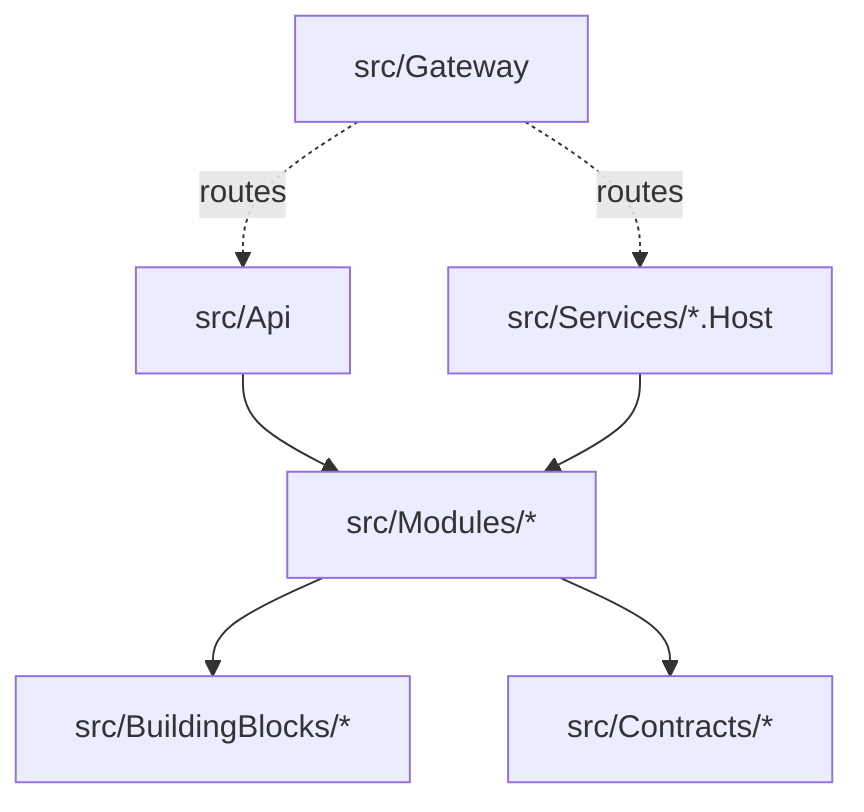

# 0006. Repository layout for the gateway, service hosts, contracts and BuildingBlocks

- **Status:** Proposed
- **Date:** 2026-10-28
- **ARB ticket:** TO BE CREATED
- **Authors:** AB-499 (epic AB-488)
- **Owning team:** TBD — owner to confirm before ARB
- **Related ADRs:** [0001](0001-service-boundaries.md), [0005](0005-contract-and-proto-versioning-policy.md)

## Context

The repo holds one solution (`booking-modular-monolith.sln`) with `src/Api` (the monolith host),
`src/Modules/<Module>/src` plus tests, `src/BuildingBlocks` (one project, `BuildingBlocks.csproj`,
with many folders such as `Core`, `EFCore`, `MassTransit`, `Jwt`, `PersistMessageProcessor`) and
`src/Aspire`. Several tickets in the epic add projects in parallel; without an agreed layout they
would put hosts, contracts and deployment files in different places.

ARB triggers: T8 (shared libraries for several services).

## Decision

We will stay a single repository and solution, with this layout:

| Path | What it holds |
| --- | --- |
| `src/Api` | The monolith host, unchanged until decommissioned |
| `src/Gateway` | YARP gateway host; tests in `src/Gateway/tests/Unit.Test` |
| `src/Services/<Module>.Host` | One service host per module (`Identity.Host`, `Flight.Host`, `Passenger.Host`, `Booking.Host`). Each host composes its existing module project from `src/Modules/<Module>` itself; there is no shared "service host" library |
| `src/Modules/<Module>/src` | The module (domain, features, persistence), unchanged in place |
| `src/Modules/<Module>/tests/Host.Test` | Tests for that module's service host |
| `src/Contracts/Contracts.Messages` | Integration events ([0005](0005-contract-and-proto-versioning-policy.md)) |
| `src/Contracts/Contracts.Grpc` | Shared protos, packages `flight` and `passenger` |
| `src/BuildingBlocks/<Area>/BuildingBlocks.<Area>.csproj` | BuildingBlocks split in place into one project per area; `BuildingBlocks.csproj` stays as a thin aggregate that references them, for back-compat |
| `src/Aspire` | Aspire AppHost and ServiceDefaults |
| `deployments/docker-compose/` | Compose files (infrastructure, services, monolith) |
| `deployments/k8s/` | Helm chart(s) |
| `docs/adr/` | These ADRs (`NNNN-<slug>.md`) |
| `docs/runbooks/` | Cut-over, rollback and operations runbooks |
| `docs/architecture/` | Target architecture description and diagrams |

Configuration keys shared across hosts: `Grpc:FlightAddress`, `Grpc:PassengerAddress`,
`Jwt:Authority`, `Jwt:Audience` (`booking-modular-monolith`). Every host exposes `/health/live`
and `/health/ready` and sets its own OpenTelemetry `service.name`.

## Alternatives considered

| Alternative | Pros | Cons | Why rejected |
| --- | --- | --- | --- |
| Do nothing (no agreed layout) | — | Parallel tickets collide in the `.sln` and diverge | Rework |
| One repository per service | Strong ownership | Shared modules and BuildingBlocks would need publishing first; cross-cutting changes span many PRs | Premature; can follow later via the NuGet packages |
| Move modules into `src/Services/<Module>/` | Everything for a service in one folder | Moves every file; breaks history and the monolith while it still runs | Hosts next to unchanged modules is enough |
| Split BuildingBlocks into a new folder tree | Clean start | Every `ProjectReference` and namespace changes | Splitting in place keeps paths and namespaces |

## Architecture

## Non-functional requirements

| NFR | Target | How met |
| --- | --- | --- |
| Availability SLO | N/A — source layout | |
| p95 latency | N/A — source layout | |
| RPO / RTO | N/A — source layout | |
| Peak load | N/A — source layout | |
| Scaling model | N/A — source layout | |
| Data retention | N/A — source layout | |

## Security & compliance

- **Data classification:** N/A — source layout.
- **Encryption at rest:** N/A.
- **Encryption in transit:** N/A.
- **AuthN / AuthZ:** N/A.
- **Secrets:** No secrets in host appsettings beyond local dev defaults.
- **Audit logging:** N/A.
- **Data residency / regions:** N/A.
- **Policy sections satisfied:** N/A — no infrastructure.
- **Threats considered:** N/A.

## Cost

| Item | Assumption | Monthly estimate |
| --- | --- | --- |
| None | Source layout only | 0 |
| **Total** | | 0 |

## Operations

- **On-call rotation:** N/A.
- **Runbook:** `docs/runbooks/`.
- **Dashboards / alarms:** N/A.
- **Rollback plan:** N/A.
- **Migration / cut-over plan:** N/A.

## Policy exceptions requested

| Rule | Resource | Justification | Compensating control | Expiry |
| --- | --- | --- | --- | --- |
| none | | | | |

## Consequences

- Positive: Parallel tickets know where their projects go; module code and history stay put; a later move to separate repos is possible through the NuGet packages.
- Negative / risks: One solution keeps growing; CI must build per service to stay fast.
- Follow-ups: Per-service CI pipelines; NuGet publishing for BuildingBlocks and Contracts.

## Open questions

- None.
