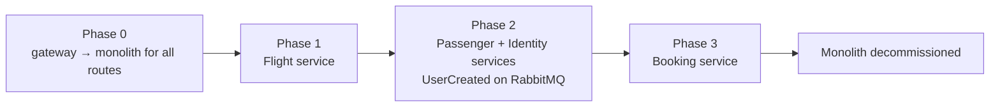

# 0007. Extraction order: Flight, then Passenger + Identity, then Booking

- **Status:** Proposed
- **Date:** 2026-10-28
- **ARB ticket:** TO BE CREATED
- **Authors:** AB-499 (epic AB-488)
- **Owning team:** TBD — owner to confirm before ARB
- **Related ADRs:** [0002](0002-strangler-fig-migration-behind-yarp-gateway.md), [0003](0003-sync-grpc-async-rabbitmq.md), [0004](0004-database-per-service-and-per-service-outbox-inbox.md)

## Context

The strangler-fig approach ([0002](0002-strangler-fig-migration-behind-yarp-gateway.md)) moves
one module at a time. The order matters because of the dependencies between modules:

- **Flight** depends on no other module. It serves gRPC to Booking and publishes events that no
  other module consumes.
- **Identity** issues tokens for every module and publishes `UserCreated`. **Passenger** consumes
  `UserCreated` and serves gRPC to Booking. In the monolith this event travels on the in-memory
  bus, which only reaches consumers in the same process — so Identity and Passenger cannot be
  split across processes unless both sides use RabbitMQ.
- **Booking** calls both Flight and Passenger over gRPC and keeps its state in EventStoreDB; it
  has the most dependencies and the event-sourced store.

## Decision

We will extract the services in this order:

1. **Flight.** Lowest risk: no inbound async dependencies. The monolith's Booking module calls the
   Flight service by setting `Grpc:FlightAddress` to the Flight service.
2. **Passenger and Identity together.** They share the `UserCreated` flow, so their gateway
   routes flip in the same step and both use RabbitMQ from that step on. (If one ever has to move
   alone, the monolith must first be switched to the RabbitMQ transport for that flow.) Identity
   keeps issuing tokens with the same signing key and issuer during the switch so tokens issued
   before the flip stay valid.
3. **Booking.** Last, once Flight and Passenger are services: the Booking service points
   `Grpc:FlightAddress` and `Grpc:PassengerAddress` at them, takes over the EventStoreDB
   subscription, and the monolith is then decommissioned.

Each step follows the same checklist: deploy the host with its own stores
([0004](0004-database-per-service-and-per-service-outbox-inbox.md)), copy data, turn the module's
background work off in the monolith, flip the gateway cluster, smoke-test through the gateway,
and keep the rollback path ready until the step is signed off.

## Alternatives considered

| Alternative | Pros | Cons | Why rejected |
| --- | --- | --- | --- |
| Do nothing (no fixed order) | Flexibility | Teams could move Passenger without Identity and lose `UserCreated` | Unsafe |
| Identity first (it issues tokens for everyone) | Auth path moved early | Highest blast radius first; must also move Passenger or switch the monolith's bus | Risk front-loaded |
| Booking first (the main business flow) | Biggest visible win | Depends on Flight and Passenger still in the monolith over gRPC, plus EventStoreDB subscription hand-over | Most moving parts first |

## Architecture

## Non-functional requirements

| NFR | Target | How met |
| --- | --- | --- |
| Availability SLO | No downtime per step beyond the flip itself; TBD — owner to confirm before ARB | Route flip with rollback |
| p95 latency | TBD — owner to confirm before ARB | |
| RPO / RTO | Per step: TBD — owner to confirm before ARB | Data copy and verification before the flip |
| Peak load | N/A — migration order | |
| Scaling model | N/A — migration order | |
| Data retention | Monolith databases kept until the decommission step is signed off | |

## Security & compliance

- **Data classification:** Identity and Passenger (personal data) move in the same step, under one review.
- **Encryption at rest:** Per [0004](0004-database-per-service-and-per-service-outbox-inbox.md).
- **Encryption in transit:** Per [0002](0002-strangler-fig-migration-behind-yarp-gateway.md) and [0008](0008-defer-service-to-service-grpc-authentication.md).
- **AuthN / AuthZ:** Token issuer, signing key and audience stay the same across the Identity flip.
- **Secrets:** Signing key material must be shared between the monolith and the Identity service during the flip.
- **Audit logging:** Each flip is recorded (who, when, which routes).
- **Data residency / regions:** Unchanged.
- **Policy sections satisfied:** N/A — no infrastructure by itself.
- **Threats considered:** Tokens rejected after the Identity flip (same key and issuer); lost `UserCreated` events (both sides on RabbitMQ).

## Cost

| Item | Assumption | Monthly estimate |
| --- | --- | --- |
| Monolith and services in parallel | Shrinks with each step | TBD — owner to confirm before ARB |
| **Total** | | TBD |

## Operations

- **On-call rotation:** TBD — owner to confirm before ARB.
- **Runbook:** `docs/runbooks/` — one cut-over and one rollback runbook per step.
- **Dashboards / alarms:** Error rate per gateway cluster during each flip.
- **Rollback plan:** Per step, see [0002](0002-strangler-fig-migration-behind-yarp-gateway.md) and [0004](0004-database-per-service-and-per-service-outbox-inbox.md).
- **Migration / cut-over plan:** This ADR.

## Policy exceptions requested

| Rule | Resource | Justification | Compensating control | Expiry |
| --- | --- | --- | --- | --- |
| none | | | | |

## Consequences

- Positive: Each step has one clear dependency story; the risky async flow moves as a unit.
- Negative / risks: Phase 2 is larger than the other steps. The monolith runs until phase 3 ends.
- Follow-ups: Cut-over and rollback runbooks; decommission of `src/Api`.

## Open questions

- Sign-off criteria and soak time per step.
