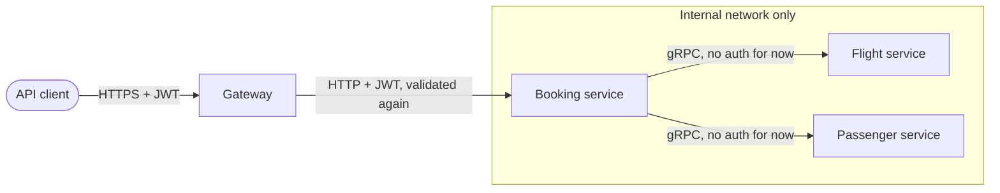

# 0008. Defer authentication of service-to-service gRPC

- **Status:** Proposed
- **Date:** 2026-10-28
- **ARB ticket:** TO BE CREATED
- **Authors:** AB-499 (epic AB-488)
- **Owning team:** TBD — owner to confirm before ARB
- **Related ADRs:** [0002](0002-strangler-fig-migration-behind-yarp-gateway.md), [0003](0003-sync-grpc-async-rabbitmq.md)

## Context

External callers authenticate with a JWT issued by Identity (Duende IdentityServer). Today every
`/api/*` endpoint requires the token (`Jwt:Authority`, audience `booking-modular-monolith`, policy
on the `scope` claim). The gRPC servers in Flight and Passenger are called only by Booking, and in
the monolith that call never leaves the host's own network. After extraction the gRPC calls cross
the internal network between containers. Securing them (mTLS, or forwarding/minting tokens with a
client-credentials flow) touches every host, the deployment platform and Identity's client
configuration at once.

ARB triggers: T6 (authentication and network-boundary decision).

## Decision

We will **not add authentication to service-to-service gRPC in this epic**. For now:

- gRPC endpoints listen only on the internal network (container/cluster network). They are never
  routed by the gateway and never exposed publicly.
- External authentication stays as it is: JWT from Identity, validated at the gateway and again
  at each service for HTTP endpoints, audience `booking-modular-monolith`.
- A follow-up ADR, reviewed by the ARB, chooses between mTLS (platform or service mesh) and a
  client-credentials token per calling service, and sets the date by which it must be in place
  before production.

## Alternatives considered

| Alternative | Pros | Cons | Why rejected |
| --- | --- | --- | --- |
| Do nothing (and say nothing) | — | Unauthenticated internal calls without a recorded decision or owner | A risk must be recorded |
| Forward the caller's JWT on gRPC | Reuses existing tokens | Background calls have no user token; audience/scope model must change | Needs its own design |
| mTLS now | Strong service identity | Certificate issuance and rotation for compose, Aspire, tests and Kubernetes all at once | Too much platform work for the scaffolding epic |

## Architecture

## Non-functional requirements

| NFR | Target | How met |
| --- | --- | --- |
| Availability SLO | N/A — security decision | |
| p95 latency | No auth overhead on gRPC for now | |
| RPO / RTO | N/A | |
| Peak load | N/A | |
| Scaling model | N/A | |
| Data retention | N/A | |

## Security & compliance

- **Data classification:** Passenger `GetById` returns personal data over the unauthenticated channel.
- **Encryption at rest:** N/A.
- **Encryption in transit:** Plain HTTP/2 on the internal network for now; TLS comes with the follow-up.
- **AuthN / AuthZ:** None on gRPC (this decision); JWT on all HTTP endpoints.
- **Secrets:** None added.
- **Audit logging:** gRPC calls are traced with OpenTelemetry (caller service visible in traces).
- **Data residency / regions:** Unchanged.
- **Policy sections satisfied:** TBD — this is a known gap to be closed before production.
- **Threats considered:** Any workload on the internal network can call Flight `ReserveSeat` or read Passenger data. Accepted for non-production only; network policies that allow only Booking to reach the gRPC ports are the interim compensating control in Kubernetes.

## Cost

| Item | Assumption | Monthly estimate |
| --- | --- | --- |
| None | | 0 |
| **Total** | | 0 |

## Operations

- **On-call rotation:** N/A.
- **Runbook:** N/A.
- **Dashboards / alarms:** gRPC calls from unexpected callers visible in traces.
- **Rollback plan:** N/A.
- **Migration / cut-over plan:** Follow-up ADR before production.

## Policy exceptions requested

| Rule | Resource | Justification | Compensating control | Expiry |
| --- | --- | --- | --- | --- |
| Internal service calls must be authenticated (if the policy has such a rule — TBD) | Flight and Passenger gRPC endpoints | Scaffolding epic; non-production only | Internal network only; Kubernetes network policies limit callers to Booking | Before first production deployment |

## Consequences

- Positive: The epic stays focused on hosting and data; the gap is recorded with an owner and an expiry.
- Negative / risks: Internal gRPC is open to any workload on the same network until the follow-up lands.
- Follow-ups: ARB follow-up ADR for gRPC service identity (mTLS vs. client credentials).

## Open questions

- Which mechanism (mTLS or client credentials) and by when.
