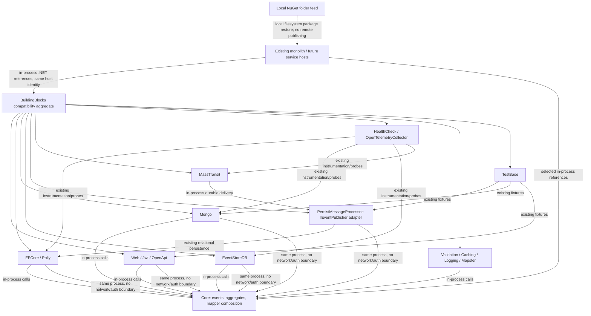

# 0010. Independently consumable BuildingBlocks

- **Status:** Proposed
- **Date:** 2026-10-28
- **ARB ticket:** TO BE CREATED
- **Authors:** AB-500 implementation
- **Owning team:** Booking platform maintainers (on-call owner to confirm before ARB)
- **Related ADRs:** AB-499 documents the broader microservices migration decisions.

## Context

The single BuildingBlocks assembly exposes persistence, broker, hosting and test dependencies
to every module. Extracted services cannot choose just the infrastructure they need. AB-500
must preserve CLR namespaces and keep the monolith compiling while allowing Booking to build
without EF Core or IdentityServer.

ARB triggers: **T8** — new shared library/platform components. No new deployable, data store,
vendor, wire contract, authentication boundary or runtime version is introduced.
T1–T7 and T9 are not triggered by this packaging-only change. T3 is not triggered: package
references are existing dependencies redistributed from the aggregate, not a new external vendor.
Triage is manual per coordinator instruction; the plugin detector is blocked by org guardrails.

## Decision

We will compile each existing infrastructure folder into its own SemVer-versioned NuGet package
under `src/BuildingBlocks/<Area>`, preserve namespaces, and keep the original project as a thin
source-compatibility aggregate. Core depends on abstractions rather than persistence or ASP.NET:
hosts select mappers, an `IEventPublisher`, and optional `IEventHeadersProvider`. Existing durable
delivery is supplied by PersistMessageProcessor, while Web supplies HTTP-aware headers. The
dependency table and consumption instructions live in `src/BuildingBlocks/README.md`.

## Alternatives considered

| Alternative | Pros | Cons | Why rejected |
| --- | --- | --- | --- |
| Do nothing | No migration cost | Every service takes all persistence and test dependencies | Violates minimal service consumption |
| Copy shared code into service hosts | Immediate isolation | Diverging infrastructure and duplicated fixes | Inconsistent maintenance |
| Rename all namespaces and APIs | Clean new taxonomy | Large unrelated module changes and possible message URN changes | Breaks migration compatibility constraint |

## Architecture

Existing package clients still use PostgreSQL/SQL Server, MongoDB, EventStoreDB, RabbitMQ,
ASP.NET JWT, gRPC and OpenTelemetry; their protocols and credential handling do not change.
NuGet restores existing third-party packages over HTTPS. No new network data flow is added.

## Non-functional requirements

| NFR | Target | How met |
| --- | --- | --- |
| Availability SLO | Unchanged; numeric target TBD — owner to confirm before ARB | Libraries run inside existing hosts |
| p95 latency | Unchanged; numeric target TBD — owner to confirm before ARB | No new remote hop; same persistence adapter |
| RPO / RTO | Unchanged; numeric targets TBD — owner to confirm before ARB | No store/schema migration |
| Peak load | TBD — owner to confirm before ARB | Existing host scaling model retained |
| Scaling model | Existing monolith today; service-local composition in later tickets | No new deployment in AB-500 |
| Data retention | Unchanged | No new stored data |

## Security & compliance

- **Data classification:** Existing correlation/user header metadata and business event payloads;
  no additional fields. Classification owner to confirm before ARB.
- **Encryption at rest:** Existing store configuration, unchanged; local feed contains code only.
- **Encryption in transit:** Existing client configuration unchanged; no new endpoints.
- **AuthN / AuthZ:** Existing JWT policies retained; removing a compile-time IdentityServer entity
  dependency keeps the policy name `ApiScope` unchanged.
- **Secrets:** No new credentials or secret stores.
- **Audit logging:** Existing host/store logging unchanged.
- **Data residency / regions:** No deployment or residency change.
- **Policy sections satisfied:** ARB T8 review required; approved-infrastructure policy N/A
  because no infrastructure is provisioned.
- **Threats considered:** Accidental broad dependency uptake; mitigate with focused references,
  Core assembly regression tests and an EF-free local NuGet consumer smoke check. Hosts must
  explicitly choose publishing semantics rather than silently dropping messages.

## Cost

| Item | Assumption | Monthly estimate |
| --- | --- | --- |
| Runtime infrastructure | Same hosts/stores/broker | No incremental infrastructure |
| Local package storage / CI | Small build artifacts; exact CI/storage usage TBD — owner to confirm | TBD |
| **Total** | No new provisioned runtime resources; not a measured CI cost estimate | TBD — owner to confirm before ARB |

## Operations

- **On-call rotation:** Existing Booking platform rotation; exact owner TBD before ARB.
- **Runbook:** `src/BuildingBlocks/README.md` documents build, local feed and registration.
- **Dashboards / alarms:** Existing host observability unchanged.
- **Rollback plan:** Restore the previous source/project references and rebuild all consumers;
  packages are not binary-compatible with the former single assembly.
- **Migration / cut-over plan:** Monolith retains aggregate; modules opt into focused references.
  Every package is packed locally; later service-host tickets own runtime composition.

## Policy exceptions requested

None. ARB sign-off remains required before merge; ticket provisioning belongs to the coordinator.

## Consequences

- Positive: Booking builds without EF Core; Core is independent of HTTP/durable delivery;
  each package has explicit references and can be packed alone.
- Negative / risks: Assembly identities change; rebuild consumers. HealthCheck/TestBase deliberately
  retain broad infrastructure dependencies and are not suitable for a minimal production host.
- Follow-ups: AB-506 extracts shared wire contracts; later host tickets select durable transport,
  per-service stores, and health instrumentation.

## Open questions

- Confirm operational ownership, numeric SLO/RPO/RTO/load targets and CI/storage cost before ARB.
- Provision the ARB ticket and obtain Platform review; no ARB Jira project is available here.
