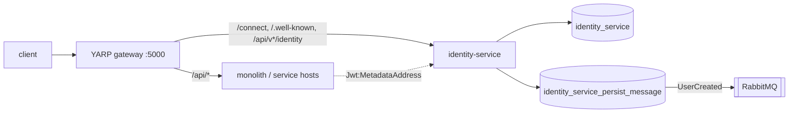

# 0013. Identity service is the sole token issuer behind the gateway

- Status: Proposed
- Ticket: AB-493 (epic AB-488)
- ARB: TO BE CREATED

## Context

AB-493 moves Duende IdentityServer from the monolith into its own deployable, `identity-service`
(`src/Services/Identity.Host`). ADR 0002 makes the YARP gateway the public origin
(`http://localhost:5000`), and ADR 0007 requires that tokens keep working across the Identity
flip. A standalone issuer has three facts to pin down: which issuer URI it stamps on tokens, where
resource servers fetch discovery/JWKS from, and which key signs the tokens.

## Decision

1. `identity-service` is the only token issuer. Gateway, monolith and service hosts validate with
   `BuildingBlocks.Jwt.AddJwt()` and audience `booking-modular-monolith`.
2. The issuer is the **public** origin: `AuthOptions:IssuerUri` = `Jwt:Authority` = the gateway URL.
   Tokens are the same whether they are minted directly at the host or through the gateway.
3. Resource servers (including the Identity host itself) fetch metadata from the **internal**
   address via `Jwt:MetadataAddress` (`http://<identity>/.well-known/openid-configuration`), so
   validation does not loop through the gateway.
4. Until a managed key exists, the signing key is Duende's developer credential persisted as
   `tempkey.jwk`. It is never committed; instances that must accept each other's tokens (monolith
   and host during the flip, replicas) mount the same file. `identity-service` runs as a single
   replica until key management is done.

## Alternatives

- Issuer = the host's internal URL: tokens minted through the gateway would carry a different
  `iss` than those minted directly, and every consumer would need to know the internal URL.
- Duende automatic key management with a shared EF key store: right long-term answer, but needs a
  licence decision and data-protection key sharing; left as a follow-up.

## Consequences

- Single replica and a shared key file are operational constraints until the follow-up lands.
- Changing the gateway origin is a breaking change for existing tokens.

## Non-functional requirements

- Availability: same as the monolith today (single instance). RPO: Identity DB backups.
- Data classification: user PII + password hashes in `identity_service`, unchanged from the monolith.
- Load: login + registration traffic of the current monolith.

## Security

- Tokens: RS256 JWT, audience `booking-modular-monolith`, issuer = gateway origin.
- Secrets: DB credentials and the signing key come from configuration/volume, never from git.
- Audit: Duende success/failure events stay enabled (`RaiseSuccessEvents`, `RaiseFailureEvents`).

## Cost and ownership

- One more container and two Postgres databases on existing infrastructure; no new vendor.
- Owner: Identity module owners; runbooks under `docs/runbooks/`.

