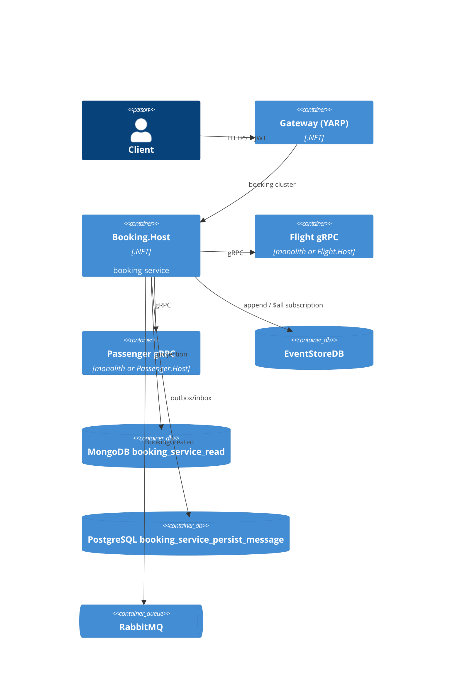

# 0016. Booking service host

- **Status:** Proposed
- **Date:** 2026-10-28
- **ARB ticket:** TO BE CREATED
- **Authors:** AB-496 (epic AB-488)
- **Owning team:** Booking team
- **Related ADRs:** [0002](0002-strangler-fig-migration-behind-yarp-gateway.md), [0003](0003-sync-grpc-async-rabbitmq.md),
  [0004](0004-database-per-service-and-per-service-outbox-inbox.md), [0006](0006-repository-layout-for-hosts-and-contracts.md),
  [0007](0007-extraction-order.md), [0008](0008-defer-service-to-service-grpc-authentication.md), [0012](0012-per-service-data-stores.md),
  [0014](0014-grpc-contracts-package-and-service-addressing.md), [0021](0021-rabbitmq-delivery-and-messageid-inbox.md)

## Context

ADR 0007 extracts Booking last. Booking is event-sourced in EventStoreDB, projects a MongoDB read model through an
EventStoreDB `$all` subscription, and calls Flight and Passenger synchronously over gRPC. AB-496 adds a standalone
host while the module stays composable by the monolith. ARB disposition: ARB_REQUIRED, triggers T1 (new deployable)
and T2 (service-owned EventStoreDB/MongoDB/outbox stores).

Running the existing subscription in its own process exposed two pre-existing defects in
`BuildingBlocks.EventStoreDB`: the host failed when EventStoreDB was not ready at startup, and SIGTERM never
completed (the drop handler re-entered a blocking `Wait`/`Thread.Sleep` resubscribe loop during client disposal).

## Decision

We will add `src/Services/Booking.Host`. It composes only the Booking module through `AddBookingModules` /
`UseBookingModules` and adds host infrastructure: JWT validation (audience `booking-modular-monolith`, authority =
gateway public address), `AddPersistMessageProcessor<BookingRoot>("Booking")`, MassTransit with service name
`booking-service` and only the Booking assembly, OpenTelemetry service name `booking-service`.

- Ports: REST 5104 locally, 8080 in containers. Booking exposes no gRPC server.
- Stores: EventStoreDB (`EventStoreOptions:ConnectionString`), MongoDB `booking_service_read`, PostgreSQL
  `booking_service_persist_message` (role `booking_service`) for outbox/inbox.
- gRPC clients: `Grpc:FlightAddress` / `Grpc:PassengerAddress`, defaulting to the monolith (`https://localhost:3000`)
  until the Flight/Passenger hosts are cut over; service-to-service gRPC stays unauthenticated (ADR 0008).
- Health: `/health/live` (self); `/health/ready` (persist-message PostgreSQL, MongoDB, EventStoreDB HTTP
  `/health/live`, RabbitMQ when the transport is RabbitMQ, gRPC health of Flight and Passenger, and the active
  EventStoreDB `$all` subscription while Booking background processing is enabled).
- The EventStoreDB subscription retries the initial subscribe with jittered exponential backoff (1 s to 30 s),
  ignores `Disposed`/cancellation drops, resubscribes asynchronously under a single-flight lock, and disposes the
  subscription when the host stops. `Modules:Booking:BackgroundProcessingEnabled=false` disables the subscription.
- Single active projector: the `$all` subscription uses checkpoint `checkpoint_default` and a check-then-insert
  projection, so only one process (monolith or host) may run Booking background processing against the same
  EventStoreDB/MongoDB. Cut-over (AB-505) disables it on the monolith.

## Alternatives considered

- Keep Booking in the monolith until Flight/Passenger hosts are live: blocks independent deployment, and the
  monolith-default gRPC addresses already allow running the host first.
- Persistent (competing-consumer) EventStoreDB subscriptions for the projection: allows several projector replicas
  but changes checkpoint semantics; deferred until Booking needs more than one replica.

## Non-functional requirements

- Availability: same target as the monolith Booking API; readiness gates traffic until all stores are reachable.
- RPO/RTO: EventStoreDB is the system of record; the Mongo read model can be rebuilt by replaying `$all`.
- Data classification: passenger name and booking/trip data (PII, unchanged from the monolith).
- Load: one replica initially (single active projector constraint above).

## Security and compliance

External REST requests are authenticated with JWTs from Identity at gateway and host. gRPC to Flight/Passenger runs
on the internal network without authentication (ADR 0008). Credentials come from configuration/environment, not
source. OpenTelemetry traces and structured logs give the audit trail.

## Cost and ownership

One additional container per environment, using existing EventStoreDB/MongoDB/PostgreSQL/RabbitMQ instances
(negligible new spend). Owner: Booking team; runbook: `src/Services/Booking.Host/README.md`.

## Operations

`/health/live` for liveness, `/health/ready` for readiness; SIGTERM drains and exits (measured < 1 s).
On-call: Booking team. Runbook: `src/Services/Booking.Host/README.md`.

## Policy exceptions

N/A — no AWS/IaC resources are added; only an application container image.

## Architecture

## Consequences

The host can be deployed and routed independently through the gateway's `booking` cluster. The EventStoreDB
subscription fix also applies to the monolith (startup no longer fails if EventStoreDB is late; shutdown completes).

## Open questions

- SLO, expected load and cost: TBD — owner to confirm before ARB.
- When to move the projector to persistent subscriptions to allow more than one replica.
