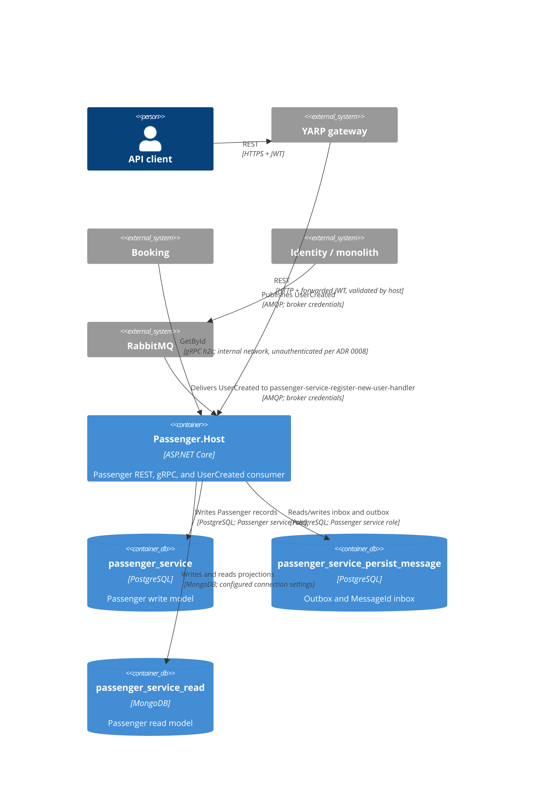

# 0018. Passenger service host

- **Status:** Proposed
- **Date:** 2026-10-28
- **ARB ticket:** TO BE CREATED
- **Authors:** AB-498 (epic AB-488)
- **Owning team:** Passenger team
- **Related ADRs:** [0002](0002-strangler-fig-migration-behind-yarp-gateway.md), [0003](0003-sync-grpc-async-rabbitmq.md),
  [0004](0004-database-per-service-and-per-service-outbox-inbox.md), [0006](0006-repository-layout-for-hosts-and-contracts.md),
  [0007](0007-extraction-order.md), [0008](0008-defer-service-to-service-grpc-authentication.md), [0012](0012-per-service-data-stores.md),
  [0014](0014-grpc-contracts-package-and-service-addressing.md), [0021](0021-rabbitmq-delivery-and-messageid-inbox.md)

## Context

ADR 0007's second extraction wave moves Passenger alongside Identity; AB-498 adds the host while the module remains in the monolith, requiring independent consumer and store ownership. ARB disposition: ARB_REQUIRED for the new deployable and data stores; triggers T1, T2, and T4 (Identity `UserCreated` integration).

## Decision

We will add `src/Services/Passenger.Host`, composing only the Passenger module through `AddPassengerModules` and `UsePassengerModules`; it remains solely responsible for persistence and endpoints.

REST uses HTTP/1.1 + HTTP/2 at 5103 locally / 8080 in containers; h2c gRPC uses HTTP/2-only at 5113 / 8081.
MassTransit serviceName `passenger-service` binds `UserCreated` to its own `passenger-service-register-new-user-handler` queue.

The host uses PostgreSQL databases `passenger_service` and `passenger_service_persist_message` for write data and inbox/outbox.
Outbox MessageId flows to RabbitMQ; inbox receipts key MessageId and consumer per ADR 0021. MongoDB uses
`passenger_service_read`; `Modules:Passenger:BackgroundProcessingEnabled` gates only the outbox worker.

REST validates JWTs at gateway and service with audience `booking-modular-monolith`; `/health/live`
checks self and `/health/ready` checks both PostgreSQL databases, MongoDB, and RabbitMQ.
gRPC health reports `passenger.PassengerGrpcService`; OpenTelemetry service name is `passenger-service`.

## Alternatives considered

| Alternative | Pros | Cons | Why rejected |
| --- | --- | --- | --- |
| Do nothing and keep Passenger in the monolith | No new deployable | Blocks independent extraction and service-owned stores | Does not meet AB-498 |
| Run the host against the monolith's Passenger databases | No additional logical stores | Couples deployments and lets both consumers write the same Passenger data | Violates ADR 0004 and the cut-over boundary |
| Give the host a separate queue but share the Passenger database | Queue ownership is clear | Concurrent `UserCreated` delivery still creates competing writes | Does not isolate data ownership |

## Architecture

The two PostgreSQL databases and named MongoDB database use the existing clusters.

## Non-functional requirements

| NFR | Target | How met |
| --- | --- | --- |
| Availability SLO | 99.9% proposed, same tier as the monolith; TBD by ARB | Independent host health checks; production topology remains to be reviewed |
| p95 latency | TBD — owner to confirm before ARB | Use the current Passenger module's endpoint budget as the baseline |
| RPO / RTO | Follow the shared PostgreSQL/MongoDB backup policy; targets TBD by ARB | Existing clusters and backup policy |
| Peak load | Same as current Passenger module traffic | Confirm against production traffic before rollout |
| Scaling model | Scale the host and queue consumers within Passenger capacity limits | Stateless HTTP/gRPC host; stores remain on shared clusters |
| Data retention | Follow existing Passenger policy; inbox retention TBD | No new retention or cleanup behavior is introduced |

## Security & compliance

- **Data classification:** Passenger name and passport number are PII, classified Confidential.
- **Encryption at rest:** Follow the shared PostgreSQL/MongoDB platform policy; confirm before production.
- **Encryption in transit:** TLS terminates at the gateway for REST. Internal gRPC is h2c on the private network per ADR 0008; broker and database transport controls follow cluster policy.
- **AuthN / AuthZ:** JWT is validated at the gateway and service for HTTP, audience `booking-modular-monolith`. Internal gRPC remains unauthenticated per ADR 0008 and must be network-restricted to internal callers.
- **Data access:** PostgreSQL uses the Passenger per-service role scoped to the two Passenger databases.
- **Secrets:** Supply deployed credentials through configuration/secrets management. Committed appsettings contain local-development defaults only.
- **Audit logging:** OpenTelemetry traces and application logs use service name `passenger-service`; do not log passenger PII.
- **Data residency / regions:** Unchanged; use the existing PostgreSQL and MongoDB clusters.
- **Policy sections satisfied:** No infrastructure-as-code resource is added by this host change; deployment-policy review remains with the platform and ARB.
- **Threats considered:** Duplicate `UserCreated` handling during cut-over, exposure of unauthenticated internal gRPC, and accidental PII disclosure in telemetry.

## Cost

| Item | Assumption | Monthly estimate |
| --- | --- | --- |
| Passenger host | One additional container on the existing service platform | Negligible incremental cost expected; confirm before rollout |
| Passenger stores | Two PostgreSQL databases and one MongoDB database on existing clusters | Negligible incremental cost expected; storage and capacity to be confirmed |
| **Total** | No new database clusters | Negligible incremental cost expected; final estimate TBD by owner |

## Operations

- **On-call rotation:** Passenger team; rotation to be confirmed before production.
- **Runbook:** `src/Services/Passenger.Host/README.md` until AB-505 runbooks are available.
- **Dashboards / alarms:** OpenTelemetry traces/logs, host readiness, Passenger queue depth, pending outbox age, and store availability; thresholds to be confirmed by the owner.
- **Rollback plan:** Route Passenger REST back to the monolith and disable the host consumer/outbox. Re-enable the monolith module only after data and worker state are checked.
- **Migration / cut-over plan:** AB-505 owns data migration and cut-over. Disable the monolith Passenger module before enabling the host consumer.

## Policy exceptions requested

| Rule | Resource | Justification | Compensating control | Expiry |
| --- | --- | --- | --- | --- |
| None | | | | |

## Consequences

- Positive: Passenger has an independently deployable host, queue, write stores, inbox/outbox, and read store.
- Negative / risks: Until AB-505, the monolith's `monolith-register-new-user-handler` and this host both receive `UserCreated`; both can create Passenger rows if pointed at the same Passenger database. The monolith must be disabled before the host consumer is enabled.
- Passenger IDs are generated by the Passenger consumer and are not the Identity user ID; callers must use the Passenger ID returned by Passenger reads.

## Open questions

- ARB ticket, SLO, p95, backup-derived RPO/RTO, capacity/cost, on-call, and data retention require owner and ARB confirmation; AB-505 must define migration, cut-over, rollback, and monolith module-disable procedures.
