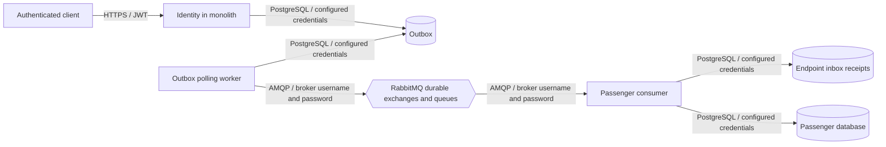

# 0021. RabbitMQ delivery and MessageId-based endpoint inbox

- **Status:** Proposed
- **Date:** 2026-10-28
- **ARB ticket:** TO BE CREATED
- **Authors:** AB-501 (epic AB-488)
- **Owning team:** TBD — owner to confirm before ARB
- **Related ADRs:** [0003](0003-sync-grpc-async-rabbitmq.md), [0004](0004-database-per-service-and-per-service-outbox-inbox.md)

## Context

The monolith's in-memory bus cannot deliver Identity `UserCreated` across processes.
Stable broker IDs and durable endpoint receipts are needed to tolerate publication retries
and duplicate delivery without colliding with existing outbox row IDs. This implements the
messaging decision in ADR 0003; per-module store location remains AB-492's responsibility.

ARB triggers: T1/T2 (activated durable broker), T4 (Identity → Passenger integration),
T8 (shared messaging and persistence components). Manual triage: the detector script cannot
run under organization guardrails; the source diff and trigger table were reviewed directly.

## Decision

We will default non-test hosts to RabbitMQ, explicitly register only their module's consumer
assemblies and prefix queues by service. The outbox row ID becomes MassTransit `MessageId`.
The consume filter serializes duplicate IDs with a PostgreSQL advisory transaction lock and
records successful completion in `inbox_message`, keyed by `(message_id, consumer)`. Consumer
errors roll back the receipt and retry three times, then enter the error queue. In-memory
transport is test-only unless explicitly selected with the Development fallback flag.

## Alternatives considered

| Alternative | Pros | Cons | Why rejected |
| --- | --- | --- | --- |
| Do nothing | No broker operations | Events never leave the process | Cannot extract Passenger |
| Deduplicate on event body ID | Simple | Default event IDs can be generated on access; transport identity differs | Does not identify redelivery reliably |
| Reuse the outbox primary key for receipts | No new table | Publisher and consumer collide in a shared store | Breaks monolith transition |
| Rely only on a unique insert after handling | Less locking | Concurrent duplicates execute business effects before the constraint rejects one | Does not serialize duplicate handlers |

## Architecture

## Non-functional requirements

| NFR | Target | How met |
| --- | --- | --- |
| Availability SLO | TBD — owner to confirm before ARB | Pending outbox survives broker outages |
| p95 latency | TBD — owner to confirm before ARB | Asynchronous polling; existing 30s interval configurable |
| RPO / RTO | TBD — owner to confirm before ARB | Stable IDs, durable queues and replayable outbox; HA not established |
| Peak load | TBD — owner to confirm before ARB | No throughput claim from functional tests |
| Scaling model | Competing replicas per endpoint | Different services have distinct queues and receipts |
| Data retention | TBD — owner to confirm before ARB | No automatic receipt cleanup introduced |

## Security & compliance

- **Data classification:** `UserCreated` includes personal name/passport data.
- **Encryption at rest:** Named broker volume for local persistence; production encryption TBD.
- **Encryption in transit:** Development AMQP uses a private compose network without TLS;
  production TLS and private ingress must be supplied by the platform (ADR 0003).
- **AuthN / AuthZ:** JWT for the API; configurable broker username/password and virtual host.
  `guest` defaults are local development only, not production authorization.
- **Secrets:** Configuration/environment injection; no real credentials committed.
- **Audit logging:** Message IDs and delivery failures; existing application logging policy applies.
- **Data residency / regions:** No new vendor or deployment region.
- **Policy sections satisfied:** No AWS CDK/Terraform resources introduced; production controls
  and deployment-policy review remain required before rollout.
- **Threats considered:** Concurrent duplicates, poison-message retry loops, isolated-service
  queue contention; external business side effects still require handler-level idempotency.

## Cost

| Item | Assumption | Monthly estimate |
| --- | --- | --- |
| RabbitMQ and PostgreSQL receipt growth | Existing local infrastructure; production load/HA unknown | TBD — owner to confirm before ARB |
| **Total** | $2k/month threshold cannot yet be evaluated | TBD |

## Operations

- **On-call rotation:** TBD — owner to confirm before ARB.
- **Runbook:** [RabbitMQ messaging](../runbooks/rabbitmq-messaging.md).
- **Dashboards / alarms:** Pending outbox age, queue and error-queue depths, consumer connectivity.
- **Rollback plan:** Coordinate publisher/consumer transport rollback; preserve broker volume,
  pending outbox and receipts. Do not silently fall back to in-memory on broker failure.
- **Migration / cut-over plan:** Follow ADR 0007; only one Passenger write endpoint active at cutover.

## Policy exceptions requested

None requested by this implementation. Production TLS, credential scope and HA need ARB confirmation;
this Proposed ADR is not approval to deploy or merge through architecture gates.

## Consequences

- Positive: Real cross-process transport, durable MessageId deduplication and isolated endpoint names.
- Negative / risks: PostgreSQL-specific locks; handler effects in other stores are not atomically
  committed with the receipt and remain at least once. Receipt retention must preserve replay safety.
- Follow-ups: AB-492 module-specific stores; host composition/configuration; production HA/TLS/retention.

## Open questions

- Owning team/on-call, SLO, latency, RPO/RTO, peak load, capacity and monthly cost.
- Production credentials/TLS, broker HA policy and outbox/inbox retention.
