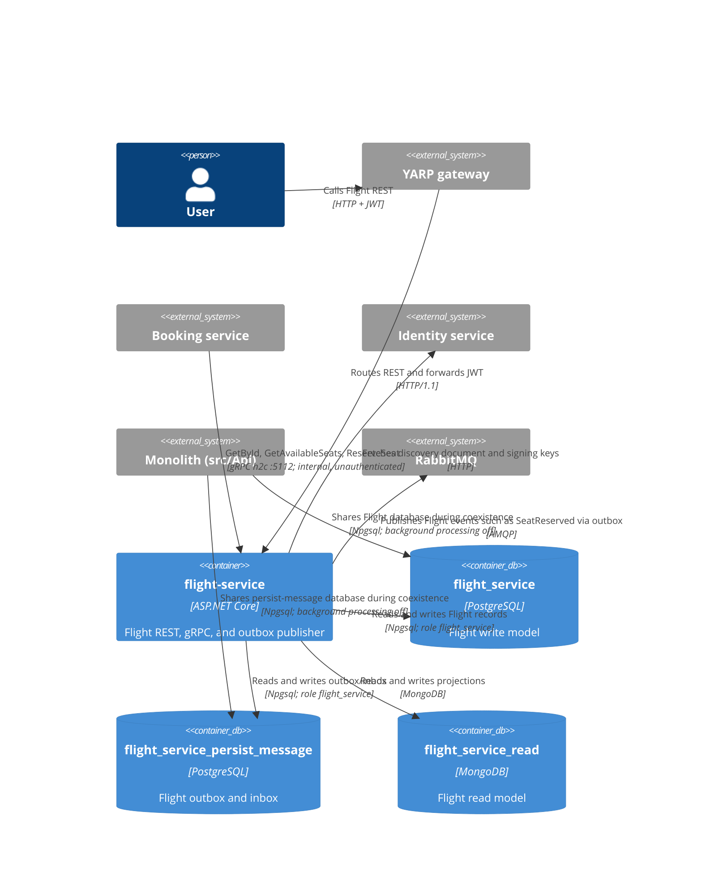

# 0022. Flight service host

- **Status:** Proposed
- **Date:** 2026-10-28
- **ARB ticket:** TO BE CREATED
- **Authors:** AB-502 (epic AB-488)
- **Owning team:** Flight team
- **Related ADRs:** [0002](0002-strangler-fig-migration-behind-yarp-gateway.md),
  [0004](0004-database-per-service-and-per-service-outbox-inbox.md),
  [0006](0006-repository-layout-for-hosts-and-contracts.md),
  [0007](0007-extraction-order.md),
  [0008](0008-defer-service-to-service-grpc-authentication.md),
  [0012](0012-per-service-data-stores.md),
  [0014](0014-grpc-contracts-package-and-service-addressing.md),
  [0021](0021-rabbitmq-delivery-and-messageid-inbox.md),
  [0013](0013-identity-service-token-issuer.md),
  [0018](0018-passenger-service-host.md)

## Context

ADR 0002 chooses a strangler-fig migration behind the YARP gateway, and ADR 0007 places Flight
first in the extraction order. AB-502 adds a deployable `flight-service` while the Flight module
remains in the monolith. The host needs independent process, store, and outbox ownership without
changing the existing module composition.

ARB triage: T1 is triggered by the new deployable service. T2, T4, and T6 are not newly triggered:
per-service stores, shared contracts, and the authentication model are already decided in ADRs
0012, 0014, 0013, and 0008. AB-505 owns data migration and the route cut-over.

## Decision

We will run Flight as a standalone host at `src/Services/Flight.Host`. It composes only the Flight
module through `AddFlightModules()` and `UseFlightModules()`, plus `AddFlightHostInfrastructure()`;
the host does not register Flight persistence or Mongo a second time.

The host validates REST JWTs with issuer `http://localhost:5000` and audience
`booking-modular-monolith`. Its metadata address points to the Identity host
(`http://localhost:5101/.well-known/openid-configuration` locally and
`http://identity-service:8080/.well-known/openid-configuration` in containers). MassTransit uses
service name `flight-service` and scans only the Flight assembly. The host uses its own outbox and
OpenTelemetry service name `flight-service` with instrumentation name `flight_service`.

The service owns PostgreSQL database `flight_service` for write data and
`flight_service_persist_message` for outbox/inbox data, both using the `flight_service` role. Its
MongoDB read model is `flight_service_read`.

REST listens on HTTP/1.1 + HTTP/2 at port 5102 locally and 8080 in containers. gRPC uses a separate
HTTP/2-only h2c endpoint at 5112 locally and 8081 in containers because the plaintext
HTTP/1.1 + HTTP/2 endpoint cannot reliably negotiate h2c. `FlightGrpcService` exposes `GetById`,
`GetAvailableSeats`, and `ReserveSeat`. Internal gRPC remains unauthenticated on the restricted
service network per ADR 0008.

`/health/live` checks `self`; `/health/ready` checks `self`, `postgres-flight`,
`postgres-flight-persist-message`, `mongo-flight`, and `rabbitmq`. gRPC health maps `""` to liveness
and `flight.FlightGrpcService` to readiness. The RabbitMQ check is omitted when the transport is
InMemory. The gateway routes Flight REST traffic to this host by setting
`ReverseProxy__Clusters__flight__Destinations__primary__Address=http://localhost:5102/`.

The host work also corrects Flight module mappings surfaced by cross-process runs:

- `Flight` to `FlightReadModel` maps `FlightNumber.Value`.
- `FlightDto` to `Contracts.Grpc.Flight.FlightResponse` converts `DepartureDate`, `ArriveDate`, and
  `FlightDate` with `Timestamp.FromDateTime(...ToUniversalTime())`.
- `SeatReadModel` to `SeatDto` maps `Id` to the domain `SeatId`.

During coexistence, the monolith and host point at the same Flight databases. When both run, the
monolith must set `Modules__Flight__BackgroundProcessingEnabled=false` so only the host runs the
Flight outbox poller/consumer; alternatively, the monolith must use different Flight databases.
AB-505 owns data migration, route flip, and rollback. Cut-over depends on AB-505.

## Alternatives considered

| Alternative | Pros | Cons | Why rejected |
| --- | --- | --- | --- |
| Do nothing and keep Flight in the monolith | No additional deployable | Blocks the first extraction in ADR 0007 | Does not meet AB-502 |
| Share ServiceDefaults or aggregate BuildingBlocks in the host | Reuses existing setup | Pulls in dependencies for other modules | Violates the host boundary in ADR 0010 |
| Use one mixed HTTP/1.1 + HTTP/2 port for REST and gRPC | Fewer ports | Plaintext HTTP/1.1 + HTTP/2 cannot reliably negotiate h2c | Separate HTTP/2-only gRPC port is required |
| Keep using the monolith's Flight stores | No new logical databases | Couples deployments and permits competing workers against the same data | Violates ADRs 0004 and 0012 |

## Architecture

## Non-functional requirements

| NFR | Target | How met |
| --- | --- | --- |
| Availability SLO | TBD — owner to confirm before ARB | Separate liveness and dependency readiness checks; production topology and target require confirmation |
| p95 latency | TBD — owner to confirm before ARB | OpenTelemetry traces provide measurements against the existing Flight endpoint baseline |
| RPO / RTO | TBD — owner to confirm before ARB | Confirm the PostgreSQL and MongoDB backup policy and recovery targets before rollout |
| Peak load | TBD — owner to confirm before ARB | Confirm against Flight production traffic before rollout |
| Scaling model | TBD — owner to confirm before ARB | Scale the stateless host independently within PostgreSQL, MongoDB, and RabbitMQ capacity |
| Data retention | TBD — owner to confirm before ARB | Confirm Flight data and persist-message inbox/outbox retention policies |

## Security & compliance

- **Data classification:** TBD — owner to confirm before ARB.
- **Encryption at rest:** TBD — owner to confirm before ARB for the existing PostgreSQL and MongoDB clusters.
- **Encryption in transit:** Host-to-host HTTP is plaintext; internal gRPC uses h2c on the restricted
  network per ADR 0008. TLS is a follow-up to the deferred internal transport security decision.
- **AuthN / AuthZ:** The gateway and host validate REST JWTs with issuer
  `http://localhost:5000` and audience `booking-modular-monolith`; metadata is fetched from the
  Identity host over HTTP. Internal gRPC remains unauthenticated per ADR 0008 and must be network
  restricted.
- **Data access:** PostgreSQL access uses the `flight_service` role for the two Flight databases.
- **Secrets:** Committed appsettings contain local-development credentials only. Deployment
  credentials must come from environment configuration or a secret store.
- **Health endpoints:** `/health/ready` is unauthenticated on the internal service network. The
  gateway does not route `/health/*` to Flight; its catch-all route remains on the monolith. The
  current response includes check names, statuses, and descriptions.
- **Audit logging:** OpenTelemetry identifies the host as `flight-service`; do not log JWTs or
  database and broker credentials.
- **Data residency / regions:** TBD — owner to confirm before ARB.
- **Policy sections satisfied:** This host change adds no infrastructure-as-code resources;
  deployment-policy review remains with the platform and ARB.
- **Threats considered:** Duplicate Flight outbox polling during coexistence, unauthenticated
  internal gRPC, plaintext internal transport, readiness details visible to reachable callers, and
  Flight integration events remaining unrouted until a consumer queue binds.

## Cost

| Item | Assumption | Monthly estimate |
| --- | --- | --- |
| Flight host | One additional host on the existing service platform | TBD — owner to confirm before ARB |
| Flight stores | Two PostgreSQL databases and one MongoDB database on existing clusters | TBD — owner to confirm before ARB |
| RabbitMQ | Flight publishes through the existing broker | TBD — owner to confirm before ARB |
| **Total** | No new database or broker cluster is proposed | TBD — owner to confirm before ARB |

## Operations

- **On-call rotation:** Flight team; TBD — owner to confirm before ARB.
- **Runbook:** `src/Services/Flight.Host/README.md` until AB-505 runbooks are available.
- **Dashboards / alarms:** OpenTelemetry traces/logs, host readiness, PostgreSQL/MongoDB health,
  RabbitMQ availability, and pending outbox age; thresholds TBD — owner to confirm before ARB.
- **Rollback plan:** Before the service databases receive writes the monolith cannot see, point the
  gateway Flight cluster back to the monolith and re-enable monolith Flight background processing.
  After the host writes service-owned data, rollback requires the AB-505 migration/reconciliation
  plan; it is no longer config-only.
- **Migration / cut-over plan:** AB-505 owns data migration, route flip, and rollback. Disable
  monolith Flight background processing before enabling the host worker against the shared stores.

## Policy exceptions requested

| Rule | Resource | Justification | Compensating control | Expiry |
| --- | --- | --- | --- | --- |
| None | | | | |

## Consequences

- Positive: Flight has an independently deployable host, service-owned stores, and its own outbox
  processing.
- Negative / risks: The monolith and host share Flight databases before AB-505; both must not run
  the Flight background worker simultaneously.
- Flight integration events currently have no subscribers. With Mandatory publishing, unroutable
  events remain pending in the outbox until a consumer queue binds.
- MongoDB documents written before the `FlightNumber.Value` mapping fix retain the bad FlightNumber
  string until they are re-seeded or re-projected.

## Open questions

- `TBD — owner to confirm before ARB`: ARB ticket and approval, availability SLO, p95 latency,
  RPO/RTO, peak load, scaling capacity, data retention, data classification, encryption-at-rest
  policy, data residency, cost, on-call rotation, and alert thresholds.
- AB-505 must define data migration/re-projection for pre-fix Mongo documents, cut-over, and
  rollback procedures.
