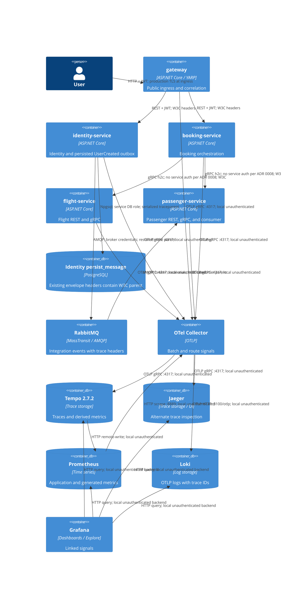

# 0023. Per-service observability

- **Status:** Proposed
- **Date:** 2026-10-28
- **ARB ticket:** TO BE CREATED
- **Authors:** AB-495 (epic AB-488)
- **Owning team:** Platform and service teams; ownership to confirm before ARB
- **Related ADRs:** [0002](0002-strangler-fig-migration-behind-yarp-gateway.md),
  [0003](0003-sync-grpc-async-rabbitmq.md),
  [0004](0004-database-per-service-and-per-service-outbox-inbox.md),
  [0008](0008-defer-service-to-service-grpc-authentication.md),
  [0013](0013-identity-service-token-issuer.md),
  [0014](0014-grpc-contracts-package-and-service-addressing.md),
  [0021](0021-rabbitmq-delivery-and-messageid-inbox.md),
  [0022](0022-flight-service-host.md)

## Context

The gateway and four extracted hosts need independent telemetry identities without losing one
request's causal chain. CreateBooking crosses YARP, Booking, and Flight/Passenger gRPC endpoints.
RegisterUser crosses YARP, Identity, a persisted outbox, RabbitMQ, and Passenger. Publishing a
stored message after the request has ended otherwise loses the originating trace context.

AB-495 also makes the existing local observability components work together without optional
Zipkin or Elasticsearch backends. Application service entries in the main compose file and
Aspire are outside this change's scope.

Manual ARB assessment: review is required for the telemetry routing topology and unauthenticated
metrics/health surfaces (T6 network/authentication boundaries), and shared instrumentation spanning
the platform and service teams (T8). The automated ARB detector was
blocked by the environment guardrail; this is not an automated triage result. Production network
restrictions, telemetry access policy, retention, and cost remain approval prerequisites.

## Decision

We will register OpenTelemetry in each host and the gateway with a distinct `service.name`, W3C
context propagation, persisted outbox parent context, and a shared collector pipeline to Tempo,
Jaeger, Prometheus, and Loki, with separate live/ready checks and an internal metrics endpoint.

### Identity, export, and sampling

- Service names are `gateway`, `identity-service`, `flight-service`, `passenger-service`, and
  `booking-service`; each also has a non-empty instrumentation name.
- Name precedence is `OTEL_SERVICE_NAME` from configuration/environment, then
  `ObservabilityOptions:ServiceName`, then the application name. Logs, traces, and metrics share
  that resource identity and include `service.environment` and `deployment.environment`.
- `OTEL_EXPORTER_OTLP_ENDPOINT`, when non-empty, wins over
  `ObservabilityOptions:OTLPOptions:OTLPGrpcExporterEndpoint`, enables OTLP export, and disables the
  alternative Aspire OTLP path. Signal-specific enable/disable options remain applicable.
- The default trace sampler is parent-based always-on in every environment unless
  `OTEL_TRACES_SAMPLER` is configured. Sampling cost and the production sampling policy are TBD.

### Propagation and instrumentation

- W3C TraceContext and Baggage propagate across YARP/REST, gRPC, and MassTransit/RabbitMQ. Gateway
  correlation IDs are span tags and baggage under `correlation.id`.
- Instrument ASP.NET Core, HttpClient, gRPC clients, MassTransit, EF Core, Npgsql, and the configured
  application ActivitySource. Health, alive, and metrics requests are excluded from HTTP tracing.
- Capture `traceparent` and `tracestate` in existing serialized `MessageEnvelope.Headers` inside
  `persist_message.data`. No database column or migration is needed. Delayed outbox publication
  and internal dispatch start Producer activities using `BuildingBlocks.PersistMessageProcessor`,
  parented to that stored context. Stored propagation headers are not copied over MassTransit's
  newly generated publish context. This persists trace context, not the complete baggage set.
- Keep gRPC client instrumentation with downstream HttpClient instrumentation suppressed to avoid
  duplicate client spans. The suppression-aware propagator prevents a suppressed
  `System.Net.Http.HttpRequestOut` activity from replacing the gRPC trace headers. With the plain
  composite propagator, HttpClient reinjected its own context even though that activity was not
  exported; downstream server spans then referenced a missing parent. The wrapper retains W3C
  extraction and baggage while preserving the exported gRPC parent.

### Collector and backends

- Receive OTLP on `4317` (gRPC) and `4318` (HTTP), batch, and export traces to both Tempo and Jaeger.
- Export metrics through collector Prometheus endpoint `:8889` with
  `resource_to_telemetry_conversion.enabled: true`, preserving `service_name` on application series.
  Do not also remote-write the same application metrics from the collector.
- Export logs through `otlphttp` to Loki at `http://loki:3100/otlp`; expose collector health on
  `:13133`. Remove collector Zipkin and Elasticsearch exporters and their Grafana datasources.
- Pin Tempo to `grafana/tempo:2.7.2`, with OTLP listening on `0.0.0.0:4317`. Enable service-graphs and
  span-metrics generation and remote-write these derived metrics to Prometheus. These are distinct
  from application OTLP metrics, not a second export of the same series.
- Provision Grafana datasource links between Tempo traces and Loki logs by trace ID, and from
  Tempo to Prometheus metrics. Provision dashboard UID `booking-services` with service selection
  and fixed `[5m]` rate windows.
- Scrape the collector as the primary dashboard source. Keep direct `/metrics` scrape jobs for
  compose DNS targets on `8080` and local hosts on `5000/5101/5102/5103/5104` for diagnosis. Select
  one metrics job in dashboards/queries rather than summing collector and direct copies. Unreachable
  direct targets may remain down; local processes must bind a container-reachable address to scrape.

### Health contract

Every host exposes anonymous `/health/live` for self-only checks, `/health/ready` for its configured
dependencies, and `/metrics` when the Prometheus exporter is enabled. Gateway readiness is a self
check, not an aggregate of upstream service readiness; its liveness selects only live-tagged checks.
Compose probes Tempo, Prometheus, and Grafana using available image tools. Collector and Loki
images lack shell/curl/wget; verify their HTTP health endpoints externally rather than adding broken
container probes. Backend failure must not prevent application startup solely through telemetry export.

## Alternatives considered

| Alternative | Pros | Cons | Why rejected |
| --- | --- | --- | --- |
| Do nothing; retain monolith-oriented telemetry | No additional work | No reliable per-host diagnosis or delayed-message trace continuity | Does not meet AB-495 |
| Export each signal directly from every app to each backend | Removes collector hop | Duplicates backend configuration and couples hosts to vendors | Collector centralizes routing and resource-label conversion |
| Start a new trace when publishing each outbox message | Simple background processing | Loses the request-to-consumer causal chain | Stored W3C context preserves the original parent |
| Export both gRPC and nested HTTP client spans | Exposes both layers | Duplicates client operations and adds noise | Suppression plus propagation protection provides one complete client/server chain |
| Remote-write and scrape the same application metrics | Multiple ingestion paths | Double-counting and increased cost | Use collector scrape as primary; isolate diagnostic jobs |
| Follow Tempo latest | Automatic upgrades | Current v3 rejects the repository's 2.x configuration | Pin 2.7.2; validate upgrades separately |

## Architecture

## Non-functional requirements

| NFR | Target | How met |
| --- | --- | --- |
| Availability SLO | TBD — owner to confirm before ARB | Decouple telemetry export from request availability; live/ready checks expose service health |
| p95 latency | TBD — owner to confirm before ARB | HTTP histograms and distributed traces provide measurements; benchmark instrumentation overhead |
| RPO / RTO | TBD — owner to confirm before ARB | Define recovery/backup expectations for telemetry stores separately from business stores |
| Peak load | TBD — owner to confirm before ARB | Size collector ingestion, storage, and queues against measured requests/events |
| Scaling model | TBD — owner to confirm before ARB | Per-host resources support independent scaling; local single-instance backends are not a production HA design |
| Data retention | TBD — owner to confirm before ARB | Define signal-specific retention and outbox cleanup policies |
| Sampling cost | TBD — owner to confirm before ARB | Parent-based always-on initially; measure volume before selecting production sampling and budgets |

## Security & compliance

- **Data classification:** TBD — owner to confirm before ARB. Logs, baggage, and trace attributes
  may contain identifiers; restrict attributes and review redaction before production rollout.
- **Encryption at rest:** TBD — owner to confirm before ARB for telemetry volumes and backups.
- **Encryption in transit:** Local OTLP, backend HTTP, and internal h2c are plaintext. Production
  TLS, network isolation, and collector authentication are follow-ups, not controls implemented here.
- **AuthN / AuthZ:** `/metrics` and `/health/*` are unauthenticated and intended for an internal
  network. Local compose publishes backend ports and does not itself enforce that restriction.
  Follow up with ingress/network policy, restricted telemetry access, and readiness-detail review.
  Grafana local demo credentials must not be used in production.
- **Secrets:** Use deployment environment/secret stores; never put tokens, credentials, or signing
  keys into telemetry, trace headers, or committed evidence.
- **Audit logging:** Correlate request logs using trace IDs and `correlation.id`; telemetry is not
  a replacement for a durable security audit trail. Audit requirements remain TBD.
- **Data residency / regions:** TBD — owner to confirm before ARB.
- **Policy sections satisfied:** No AWS CDK/Terraform resources are introduced. Enterprise
  production-infrastructure and telemetry policy approval remains with Platform/Security and ARB;
  this ADR does not assert production compliance.
- **Threats considered:** Anonymous metrics/health disclosure, forged inbound trace/baggage context,
  sensitive log attributes, cardinality/volume abuse, and unauthenticated telemetry ingestion.

## Cost

| Item | Assumption | Monthly estimate |
| --- | --- | --- |
| Host instrumentation and collector | Five hosts; initial always-on trace recording | TBD — owner to confirm before ARB |
| Tempo and Jaeger | Both receive traces; duplicate storage during local evaluation | TBD — owner to confirm before ARB |
| Prometheus, Loki, and Grafana | Local containers; production load, retention, replicas, and storage unspecified | TBD — owner to confirm before ARB |
| **Total** | Production sizing and the $2k/month review threshold cannot yet be evaluated | TBD — owner to confirm before ARB |

## Operations

- **On-call rotation:** Platform and service teams; TBD — owner to confirm before ARB.
- **Runbook:** [Observability dashboards and local operation](../../deployments/configs/dashboards.md).
- **Dashboards / alarms:** Grafana `booking-services`, Explore/Tempo, and Jaeger on `:16686`;
  alert thresholds for service errors/latency, exporter failures, ingestion, and pending outbox age
  are TBD — owner to confirm before ARB.
- **Rollback plan:** Revert observability code/config and restart affected hosts/collector. Existing
  serialized trace headers are additive and require no database rollback. Disable exporters or
  change sampling through configuration when reducing telemetry load.
- **Migration / cut-over plan:** No business-data migration. Roll out per-host resource/export
  configuration, then validate CreateBooking and delayed RegisterUser end-to-end traces. Leave
  gateway route cut-over and Aspire/service deployment ownership with their existing workstreams.

## Policy exceptions requested

| Rule | Resource | Justification | Compensating control | Expiry |
| --- | --- | --- | --- | --- |
| None requested | | Production controls and approvals remain open; this is a local-development configuration | | |

## Consequences

- Positive: Service-level metrics/logs and continuous synchronous/asynchronous request traces are
  available from linked dashboards without database schema changes.
- Negative / risks: Always-on sampling, dual trace stores, and high-cardinality log attributes may
  increase resource use. Collector exporter aliases/resource conversion currently emit deprecation
  warnings; upgrade them alongside a separately validated collector version.
- Suppression-aware propagation must be regression-tested when upgrading .NET or OTel instrumentation.
- Follow-ups: Production sampling/retention, TLS/authentication, internal-only health/metrics,
  collector/backend version policy, dashboards/alerts, and ARB approval. Unrouted mandatory
  `PassengerCreated`/`BookingCreated` events can still retry independently of successful traced flows.

## Open questions

- `TBD — owner to confirm before ARB`: ARB ticket/approval, owning team/on-call, availability SLO,
  p95/overhead budget, RPO/RTO, peak load, scaling/HA, retention, sampling policy/cost, alert thresholds,
  data classification, audit requirements, at-rest encryption, and residency.
- Which production access controls enforce internal-only metrics/health, authenticated OTLP, and
  restricted Grafana/backend queries? Who owns the security follow-up and its delivery date?
- Should Jaeger remain alongside Tempo after local evaluation, and what is the production
  collector/backend pinning and upgrade policy?
