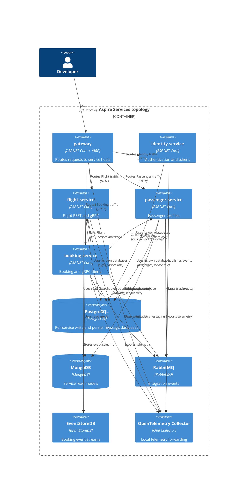

# 0024. Aspire local orchestration

- **Status:** Proposed
- **Date:** 2026-10-28
- **ARB ticket:** TO BE CREATED
- **Authors:** AB-497 (epic AB-488)
- **Owning team:** Platform team
- **Related ADRs:** [0002](0002-strangler-fig-migration-behind-yarp-gateway.md),
  [0004](0004-database-per-service-and-per-service-outbox-inbox.md),
  [0013](0013-identity-service-token-issuer.md),
  [0014](0014-grpc-contracts-package-and-service-addressing.md),
  [0016](0016-booking-service-host.md),
  [0018](0018-passenger-service-host.md),
  [0021](0021-rabbitmq-delivery-and-messageid-inbox.md),
  [0022](0022-flight-service-host.md)

## Context

The Aspire AppHost previously launched the single `src/Api` process behind the gateway. The Identity,
Flight, Passenger, and Booking hosts now need a shared local development topology that preserves
service ownership of database connections and allows their cross-service gRPC dependency to resolve.

## Decision

**Superseded in part by [ADR 0027](0027-cutover-and-monolith-decommission.md) (AB-505):**
AppHost is now Services-only. The topology selector, legacy API project and gateway
monolith cluster/fallback have been removed. Unknown paths return 404;
previous-release recovery uses the Compose rollback overlay instead of AppHost.

Services is the only AppHost topology. It starts the gateway and four service hosts, with no `api`
process or topology selector. ADR 0027/AB-505 removed the former Monolith topology.

Each service receives only its own PostgreSQL database and persist-message connection strings, using
its `<module>_service` role. Aspire service discovery resolves Booking's gRPC addresses; endpoint
references configure the gateway's YARP clusters. A shared AppHost helper configures service names
and uses AB-495's `OTEL_SERVICE_NAME`, `OTEL_EXPORTER_OTLP_ENDPOINT`, and
`OTEL_EXPORTER_OTLP_PROTOCOL` environment contract to send telemetry to the OpenTelemetry Collector.
The collector forwards traces to Tempo and Jaeger, metrics to Prometheus, and logs to Loki; Grafana
is available at port 3030. The Aspire dashboard shows resources, health, and console logs, but not
service traces or metrics. Forwarding collector telemetry to the Aspire dashboard is a follow-up
owned by AB-495's collector configuration.

The gateway has only the four service clusters and no catch-all fallback. Unknown paths return 404.
Dedicated `/connect/**` and `/.well-known/**` routes remain anonymous.

This is local-development orchestration only; it does not define production infrastructure.

## Alternatives considered

| Alternative | Pros | Cons | Why rejected |
| --- | --- | --- | --- |
| Keep the single API process in the AppHost | No topology change | Does not exercise the extracted service hosts together | A service topology is needed for local host development |
| Add YARP service discovery to the gateway | Cluster destinations could resolve dynamically | Requires a gateway code change | Endpoint references configure local destinations without changing gateway code |

## Architecture

## NFRs

N/A — this AppHost is for local development, not a production deployment.

## Security

N/A — local development credentials and endpoint behavior remain governed by the existing host
configuration; this decision does not change production authentication or network boundaries.

## Cost

N/A — no production resources are provisioned.

## Operations

ServiceDefaults is not used by the hosts; AppHost configures their observability through AB-495's
`OTEL_*` environment variables. Services is the only topology; previous-release recovery uses the
[Compose rollback overlay](../runbooks/cutover/decommission.md), not AppHost.

## Policy exceptions

N/A — this decision defines local orchestration only.

## Consequences

- Developers can run the four service hosts and gateway together from Aspire.
- Gateway YARP service discovery remains a follow-up; endpoint references are used for now.
- Forwarding collector telemetry to the Aspire dashboard remains a follow-up in AB-495's collector configuration.
- Previous-release monolith recovery is outside AppHost and follows ADR 0027's cutover runbook.

## Open questions

- The ARB ticket is TO BE CREATED.
- Revisit gateway YARP service discovery if dynamic cluster resolution becomes necessary.
