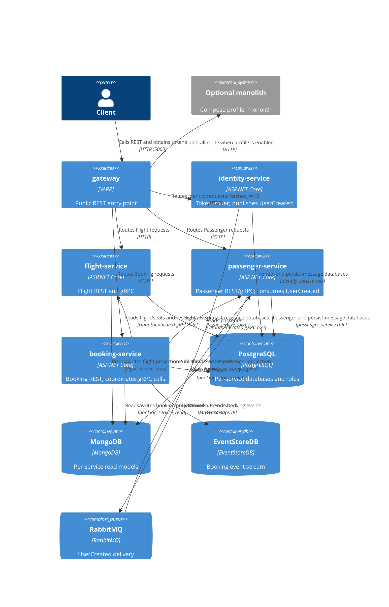

# 0025. Multi-service Docker Compose topology

- **Status:** Proposed
- **Date:** 2026-10-28
- **ARB ticket:** TO BE CREATED
- **Authors:** AB-503 (epic AB-488)
- **Owning team:** Booking team
- **Related ADRs:** [0002](0002-strangler-fig-migration-behind-yarp-gateway.md),
  [0003](0003-sync-grpc-async-rabbitmq.md),
  [0004](0004-database-per-service-and-per-service-outbox-inbox.md),
  [0008](0008-defer-service-to-service-grpc-authentication.md),
  [0012](0012-per-service-data-stores.md),
  [0013](0013-identity-service-token-issuer.md),
  [0014](0014-grpc-contracts-package-and-service-addressing.md),
  [0018](0018-passenger-service-host.md),
  [0021](0021-rabbitmq-delivery-and-messageid-inbox.md),
  [0022](0022-flight-service-host.md)

## Context

The extracted Identity, Flight, Passenger, and Booking hosts and the YARP gateway need a repeatable
local deployment topology. AB-503 runs those five application containers against the existing
infrastructure Compose file, while retaining the monolith as an optional coexistence profile.

The change is an ARB-triggering deployment-topology change with a network-boundary change: the
gateway is the public application entry point, while service REST and gRPC debug ports bind to
loopback. Infrastructure services and images remain those already defined by the infrastructure
Compose file; this change adds no data store or vendor.

## Decision

The application Compose file includes `docker-compose.infrastructure.yaml` and starts
`identity-service`, `flight-service`, `passenger-service`, `booking-service`, and `gateway`.
Only the gateway publishes an application port to all host interfaces (`5000:8080`). The service
debug ports are bound to `127.0.0.1`: Identity `5101`, Flight `5102` and gRPC `5112`, Passenger
`5103` and gRPC `5113`, and Booking `5104`. Internal service-to-service gRPC uses unauthenticated
h2c on the Compose network per ADR 0008.

All service REST requests pass through the gateway. The gateway validates tokens using issuer
`http://localhost:5000`; services fetch signing-key metadata from `identity-service:8080`.
RabbitMQ carries `UserCreated` from Identity to the Passenger consumer.

The existing PostgreSQL instance hosts per-service databases and roles per ADR 0012. Identity,
Flight, and Passenger each use a service database and a persist-message database; Booking uses
PostgreSQL for its persist-message database. The existing MongoDB instance contains the
`flight_service_read`, `passenger_service_read`, and `booking_service_read` projections. Booking
alone uses the existing EventStoreDB instance for its event stream.

The `monolith` Compose profile is opt-in. When run alongside the services, its module background
processing is disabled so it does not compete with the service hosts for outbox polling or
the Booking EventStoreDB subscription. The gateway catch-all cluster can be reconfigured to
target `http://booking_modular_monolith/`.
The monolith's MassTransit consumers are still registered regardless of the module flag, so while
the profile runs, `UserCreated` is delivered to both `monolith-register-new-user-handler` and
`passenger-service`; the profile is for short coexistence and rollback checks only.

Health checks gate startup in dependency order: infrastructure, Identity/Flight/Passenger, Booking,
then gateway. Booking also waits for healthy EventStoreDB, Flight, and Passenger services.

## Alternatives considered

| Alternative | Pros | Cons | Why rejected |
| --- | --- | --- | --- |
| Keep a single monolith Compose deployment | Fewest containers and simplest local setup | Does not exercise the extracted hosts or gateway routing | Does not meet AB-503 |
| Maintain a separate Compose file per service | Each service can be started independently | Duplicates orchestration and complicates a full end-to-end topology | One composed topology is needed to test cross-service flows |
| Duplicate infrastructure definitions in `docker-compose.yaml` | One file contains every service | Infrastructure configuration drifts from the file owned by the observability setup | Include the shared infrastructure Compose file |
| Put infrastructure behind a profile | Allows application containers to be selected separately | A default full topology would not start its required databases and broker | Keep required infrastructure included by default |

## Architecture

## Non-functional requirements

| NFR | Target | How met |
| --- | --- | --- |
| Availability SLO | TBD — owner to confirm before ARB | Compose health checks gate dependencies; production availability requires a deployment platform |
| p95 latency | TBD — owner to confirm before ARB | OpenTelemetry provides measurements across gateway and service hosts |
| RPO / RTO | TBD — owner to confirm before ARB | Confirm backup and recovery targets for the existing stores before rollout |
| Peak load | TBD — owner to confirm before ARB | Confirm expected traffic and capacity of shared infrastructure before rollout |
| Scaling model | TBD — owner to confirm before ARB | Application hosts are separate containers; production scaling is outside local Compose |
| Data retention | TBD — owner to confirm before ARB | Confirm service data and persist-message retention policies |

## Security & compliance

- **Data classification:** TBD — owner to confirm before ARB.
- **Encryption at rest:** TBD — owner to confirm before ARB for the existing PostgreSQL, MongoDB,
  and EventStoreDB data.
- **Encryption in transit:** External gateway HTTP is configured for local development. Internal
  REST and gRPC use plaintext on the Compose network; unauthenticated gRPC h2c is retained per
  ADR 0008 and must remain network-restricted.
- **AuthN / AuthZ:** The gateway is the public application entry point and validates REST JWTs using
  issuer `http://localhost:5000`. Services retrieve IdentityServer metadata and signing keys from
  `identity-service:8080`. Internal gRPC remains unauthenticated per ADR 0008.
- **Network exposure:** Application service and gRPC debug ports bind to loopback. Infrastructure
  ports are published for local development by the existing infrastructure Compose file and must
  be restricted appropriately outside a developer workstation.
- **Data access:** PostgreSQL databases use per-service roles and credentials as specified in
  ADR 0012; MongoDB read models are separated by service database.
- **Secrets:** Compose defaults and committed appsettings are for local development only. Use
  deployment environment configuration or a secret store for non-local credentials.
- **Audit logging:** OpenTelemetry uses distinct service names; do not log bearer tokens or
  database/broker credentials.
- **Data residency / regions:** TBD — owner to confirm before ARB.
- **Policy sections satisfied:** No new infrastructure resource, datastore, or vendor is introduced.
- **Threats considered:** Exposure of internal debug ports, unauthenticated h2c on the shared
  network, local-development credentials, and duplicate background processing if the monolith is
  run without its background modules disabled.

## Cost

| Item | Assumption | Monthly estimate |
| --- | --- | --- |
| Application containers | Five local application containers; production sizing is not defined by Compose | TBD — owner to confirm before ARB |
| Databases and broker | Uses existing PostgreSQL, MongoDB, EventStoreDB, and RabbitMQ services | TBD — owner to confirm before ARB |
| Observability | Uses the existing observability Compose stack | TBD — owner to confirm before ARB |
| **Total** | No new datastore or vendor is proposed | TBD — owner to confirm before ARB |

## Operations

- **On-call rotation:** TBD — owner to confirm before ARB.
- **Runbook:** `deployments/docker-compose/README.md` for local Compose operation.
- **Dashboards / alarms:** OpenTelemetry traces and service health; thresholds TBD — owner to confirm
  before ARB.
- **Health / startup:** Infrastructure checks gate Identity/Flight/Passenger, which gate Booking,
  which gates the gateway.
- **Rollback plan:** Use the monolith profile and configure the applicable gateway cluster
  destination as `http://booking_modular_monolith/`. Keep service background processing disabled
  in the monolith while the corresponding service host is active.
- **Data initialization:** PostgreSQL initialization SQL runs only when the data volume is first
  created. Reinitialization requires removing the Compose volumes and deletes local data.
- **Migration / cut-over plan:** This ADR covers local orchestration; production migration and
  cut-over remain outside AB-503.

## Policy exceptions requested

| Rule | Resource | Justification | Compensating control | Expiry |
| --- | --- | --- | --- | --- |
| None | | | | |

## Consequences

- Positive: The local topology exercises the gateway, four independently built service hosts,
  existing shared infrastructure, and the optional monolith coexistence path.
- Positive: Service debug ports are restricted to loopback and the gateway owns public application
  traffic.
- Negative / risks: The local topology publishes multiple infrastructure ports and uses local
  development credentials and plaintext internal transport.
- Negative / risks: The monolith and services share stores while coexisting; monolith background
  processing must remain disabled to prevent duplicate workers.

## Open questions

- `TBD — owner to confirm before ARB`: ARB ticket and approval, availability SLO, p95 latency,
  RPO/RTO, peak load, scaling capacity, data retention, data classification, encryption-at-rest
  policy, data residency, cost, on-call rotation, and alert thresholds.
- Production ingress, TLS termination, and secret management are not defined by the local Compose
  topology.
- Gate monolith MassTransit consumer registration on `Modules:<Module>:BackgroundProcessingEnabled`
  so the `monolith` profile cannot double-consume `UserCreated` (follow-up outside AB-503).
