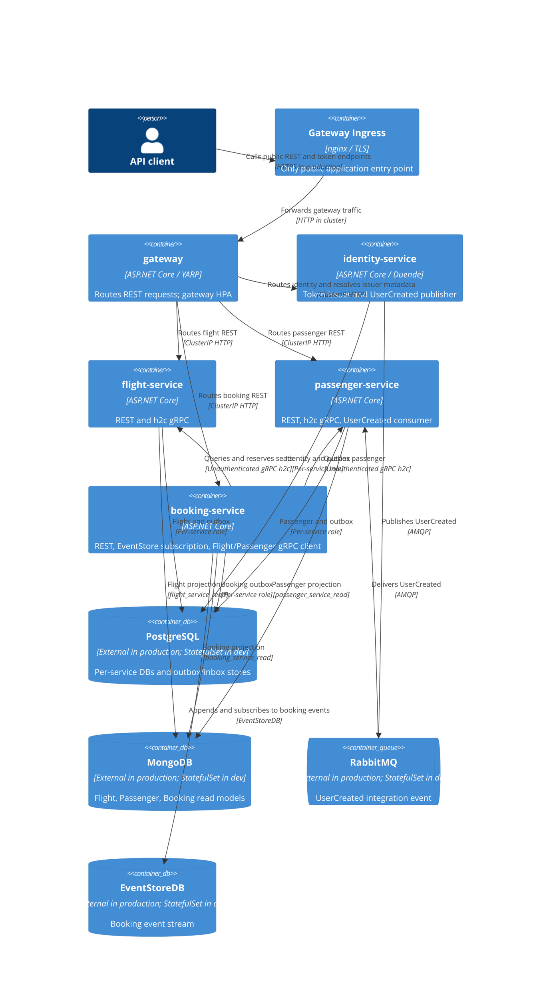

# 0026. Kubernetes deployment with Helm

- **Status:** Proposed
- **Date:** 2026-10-28
- **ARB ticket:** TO BE CREATED
- **Authors:** AB-491 (epic AB-488)
- **Owning team:** Booking team
- **Related ADRs:** [0002](0002-strangler-fig-migration-behind-yarp-gateway.md),
  [0003](0003-sync-grpc-async-rabbitmq.md),
  [0004](0004-database-per-service-and-per-service-outbox-inbox.md),
  [0008](0008-defer-service-to-service-grpc-authentication.md),
  [0012](0012-per-service-data-stores.md),
  [0013](0013-identity-service-token-issuer.md),
  [0014](0014-grpc-contracts-package-and-service-addressing.md),
  [0025](0025-multi-service-docker-compose-topology.md)

## Context

The extracted Identity, Flight, Passenger, and Booking hosts and their YARP gateway need a
repeatable Kubernetes deployment contract for local kind testing and a production-facing Helm
values example. AB-491 adds Kubernetes resource definitions and a smoke flow without changing the
application hosts or the existing Docker Compose topology.

The new Ingress is the only public application entry point (T6). Service REST and h2c gRPC endpoints
remain ClusterIP-only. A development-only option deploys local PostgreSQL, MongoDB, RabbitMQ, and
EventStoreDB in the same namespace; production values disable those StatefulSets and point at
external stores.

## Decision

Use Helm v3 chart `deployments/k8s/helm/booking` with a shared template set ranged over the five
workloads: `identity-service`, `flight-service`, `passenger-service`, `booking-service`, and
`gateway`. Environment overlays are Helm values files for kind and production; no Kustomize layer
is introduced. Kubernetes Service names default to the Compose DNS names and may be overridden per
service. All generated gateway destinations, JWT discovery addresses, and Booking gRPC addresses
derive from those names.

The gateway Ingress is the only public application entry point. Gateway-to-host routing uses HTTP
and all internal service ports are ClusterIP. Flight and Passenger expose their gRPC h2c listener
on service port 8081 with Kubernetes `appProtocol: kubernetes.io/h2c`. Internal gRPC remains
unauthenticated per ADR 0008 and must be network-restricted.

All app containers use the `docker` ASP.NET Core environment, health endpoints, UID/GID 1654,
`RuntimeDefault` seccomp, dropped capabilities, no privilege escalation, a read-only root
filesystem, and a writable `/tmp` volume by default. OTLP export is disabled unless an endpoint is
configured. Read-only filesystem and UID/GID are values-controlled for hosts that prove they need
different runtime settings.

PostgreSQL credentials, RabbitMQ auth, MongoDB/EventStoreDB connection strings, and the Duende
IdentityServer signing key are supplied from Kubernetes Secrets. Empty development `existingSecret`
fields let the chart create local-only application Secret values; production values name external
Secrets. The identity chart requires a pre-created signing-key Secret at
`identity.signingKey.existingSecret`, mounted at `/app/keys/tempkey.jwk`. All Identity replicas must
share this private key. Rotating an external Secret requires a workload rollout restart; external
Secret changes are not represented in the chart checksum annotation.

The optional in-chart data stores are single-instance, development-only StatefulSets. PostgreSQL
initialization creates the same per-service roles and databases used by Compose, reading passwords
from Secret-backed environment variables. Production values turn this infrastructure off.

Only the gateway has HPA enabled by default. The other hosts remain at one replica: their outbox
pollers do not use row locking or `FOR UPDATE SKIP LOCKED`, so multiple pollers can double-publish.
Booking additionally owns the EventStoreDB `$all` subscription and must remain single-active while
background processing is enabled. Helm rejects Booking replica/HPA settings above one in that
configuration.

## Alternatives considered

| Alternative | Pros | Cons | Why rejected |
| --- | --- | --- | --- |
| Raw Kubernetes manifests plus Kustomize | Native resources and familiar environment overlays | Repeats service configuration and separates cross-service addresses from their names | A shared Helm template set keeps common workload and DNS settings together |
| Convert Compose with Kompose or another compose-on-Kubernetes tool | Reuses parts of the local Compose topology | Does not model probes, secret contracts, HPA policy, stable ingress, and Booking's single-active guard cleanly | Compose remains the local reference, while Kubernetes needs explicit operational policy |
| Infrastructure operators or Bitnami subcharts | Rich lifecycle management and feature options | Adds dependencies/operators and more production choices than the local development need | Keep dev infra as small first-party StatefulSet examples; production uses external managed services |

## Architecture

## Non-functional requirements

These are proposed target placeholders for production sizing and ARB review, not measured SLOs:

| NFR | Target | How met / validation |
| --- | --- | --- |
| Availability | Target 99.9% monthly for gateway and service APIs | Gateway HPA and optional PDB; production store HA and topology remain platform responsibilities |
| Latency | Target p95 under 300 ms for non-booking REST calls | Measure using production-like load and OpenTelemetry before acceptance |
| RPO | Target 15 minutes or less | Requires external store backups/replication; the dev StatefulSets do not meet this target |
| RTO | Target 4 hours or less | Requires a tested restore and service recovery runbook |
| Expected load | Placeholder target 100 requests/second sustained and 300 requests/second peak | Confirm with product usage forecasts and performance tests |
| Scaling | Gateway 2–6 replicas in the production example; stateful hosts remain single-replica | Outbox leader election/locking is a prerequisite to scaling workers |
| Data retention | TBD — owner to confirm before ARB | Define per-store retention and event retention before production rollout |

## Security & compliance

- **Data classification:** TBD — owner to confirm before ARB; treat account, passenger, and passport
  data as sensitive personal data until classification is finalized.
- **Data flows:** Client traffic terminates TLS at the production Ingress and reaches the gateway;
  gateway requests Identity, Flight, Passenger, and Booking. Identity publishes `UserCreated` to
  RabbitMQ for Passenger. Booking calls Flight and Passenger over internal h2c gRPC and writes to
  PostgreSQL, MongoDB, and EventStoreDB.
- **Encryption in transit:** TLS is configured at the production Ingress. Pod-to-pod REST and gRPC
  remain plain HTTP/h2c, and store/broker encryption depends on external service settings; these
  are documented gaps and require network restriction. The kind overlay uses local HTTP.
- **Authentication:** Public API access uses JWTs issued by Identity. Internal gRPC is intentionally
  unauthenticated per ADR 0008. NetworkPolicies are a follow-up, not a current control.
- **Secrets:** Do not commit credentials or signing JWK files. Use external secret management in
  production; generated chart Secrets and default credentials are for disposable development
  environments only. Secret values may be present in Kubernetes API storage, so cluster
  encryption-at-rest and least-privilege RBAC must be configured by the platform. Rotate credentials
  with explicit pod restarts.
- **Audit logging:** Preserve authentication and administrative audit events without recording
  bearer tokens, passwords, signing material, or database credentials. Define alert retention and
  audit ownership before production use.
- **Network boundary:** Ingress routes only to gateway. Service and datastore ports are not
  externally published. Add default-deny NetworkPolicies and explicit service-to-service allowances.
- **Data residency / regions:** TBD — owner to confirm before ARB.

## Cost

| Item | Estimate / assumption |
| --- | --- |
| Application compute | Placeholder target: 5 services with production resource requests in the overlay; actual monthly cost depends on cluster node sizing and workload. |
| Managed data stores | TBD — owner to confirm before ARB; the dev StatefulSets have no production availability or backup commitment. |
| Ingress, load balancing, and observability | Placeholder target: one gateway Ingress and the existing platform observability stack; confirm platform-specific charges. |
| **Total** | TBD — owner to confirm before ARB after expected load, region, and managed-store sizing are known. |

## Operations

- **On-call rotation:** Booking team — owner to confirm the production rota before launch.
- **Runbook:** `deployments/k8s/README.md`.
- **Health / startup:** App startup probes allow up to 150 seconds. Readiness checks gate Service
  endpoints; startup init containers wait for required infrastructure, and Booking waits for Flight
  and Passenger readiness.
- **Scaling:** Gateway CPU HPA is configurable. Keep background-processing hosts at one active
  replica until outbox locking/leader election is delivered.
- **Rollback:** Roll back the Helm release and its values to the prior compatible chart/image
  version. Schema/data rollback remains governed by service migration policy.
- **Recovery:** Back up external stores and signing-key Secret, test restore procedures, and define
  RPO/RTO before production cut-over. `DELETE_CLUSTER=1` is for disposable kind only.

## Policy exceptions

| Rule | Resource | Justification | Compensating control | Expiry |
| --- | --- | --- | --- | --- |
| None requested | | | | |

## Consequences and follow-ups

- The chart and kind flow exercise the gateway, service DNS, gRPC, messaging, stores, and shared
  Identity signing-key behavior in a Kubernetes environment.
- Local dev infra is convenient but must not be promoted to production. Production requires
  managed PostgreSQL, MongoDB, RabbitMQ, and EventStoreDB.
- Outbox leader election or database row locking is required before scaling service workers.
- Add default-deny NetworkPolicies and least-privilege rules before a production deployment.
- Add mTLS or authenticated service-to-service transport to close the internal plaintext/h2c gap.
- Integrate External Secrets or an equivalent approved external secret controller and operationalize
  Secret rotation.
- Confirm production NFR, cost, data classification, retention, residency, and audit requirements
  with the owning team and ARB.

## Open questions

- ARB ticket remains **TO BE CREATED**; the owning team must submit this Proposed decision for
  review before a production deployment.
- Availability, latency, RPO/RTO, expected load, data classification, retention, residency, and
  audit requirements remain `TBD — owner to confirm before ARB`.
- Confirm the production on-call rotation, managed-store choices, cluster cost, and approved secret
  controller with the platform and Booking teams.
