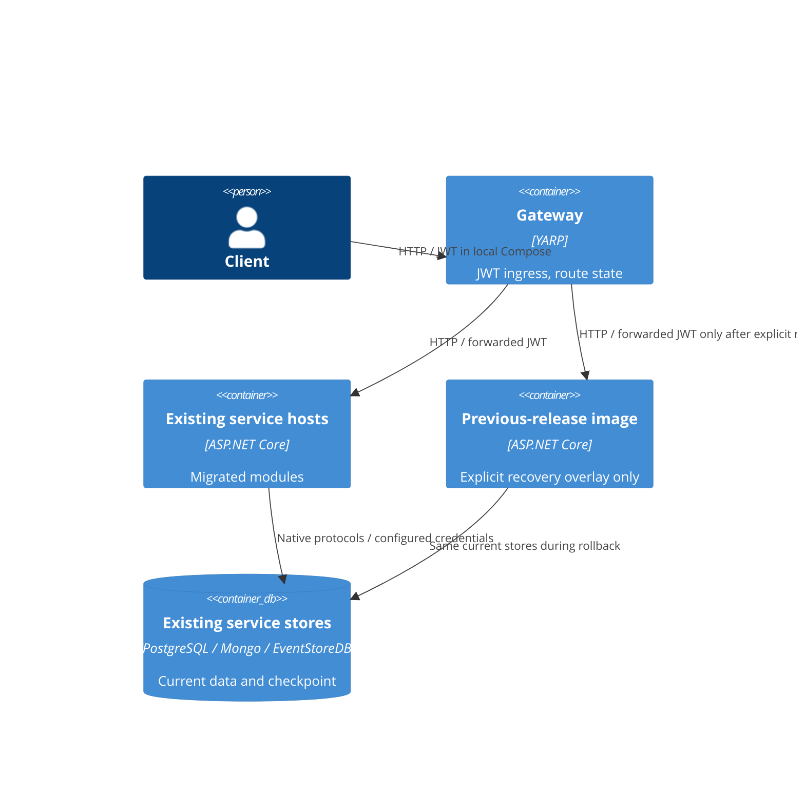

# 0027. Cutover and monolith decommission

- **Status:** Proposed
- **Implementation:** Local decommission implemented in AB-505 phase 2; production approval pending.
- **Date:** 2026-10-29
- **ARB ticket:** TO BE CREATED
- **Authors:** AB-505 (epic AB-488)
- **Owning team:** Booking team
- **Related ADRs:** [0002](0002-strangler-fig-migration-behind-yarp-gateway.md),
  [0007](0007-extraction-order.md), [0012](0012-per-service-data-stores.md),
  [0025](0025-multi-service-docker-compose-topology.md)

## Context

Extracted services need an evidence-based route cutover, reversible during a defined soak.
The repository now contains only service hosts behind the gateway. Local recovery explicitly
redeploys a prebuilt previous-release monolith image with current service stores via an overlay.
That is not evidence that production legacy data has already been migrated.
This decision documents the final lifecycle of the architecture under AB-488: data handover and
retirement affect T2 (store ownership) and T6 (removal of legacy routing). Those production changes
require ARB approval. Phase 1 supplied local tooling; phase 2 retires the source host and fallback.

## Decision

We will migrate Flight first, Identity and Passenger together, then Booking, using authenticated
upstream-proven rollback drills and a signed-off N-day soak. We retain compatible current stores,
signing keys and single-active background ownership while route rollback remains available.
Once all clusters use services and the monolith/fallback receives zero traffic for N days, a
production rollout retires the monolith. After retirement rollback redeploys the previous
release tag/image; it is no longer a route-only operation. The repository decommission is
implemented: module tests use service hosts, default routes use services, and unknown paths return 404.

## Alternatives considered

| Alternative | Pros | Cons | Why rejected |
| --- | --- | --- | --- |
| Do nothing | No operational change | No rehearsed recovery or retirement criteria | Cannot safely complete migration |
| Big-bang replacement | Short overlap | Broad failure domain and difficult data recovery | Conflicts with ADR 0007 |
| Indefinite dual writers | Immediate reverse route | Divergent data, duplicate consumers and competing checkpoints | Violates single-owner invariants |

## Architecture

See [before/during/after diagrams](../architecture/cutover.md).

## Non-functional requirements

| NFR | Target | How met |
| --- | --- | --- |
| Availability SLO | TBD — owner to confirm before ARB | Readiness gates and per-stage recovery |
| p95 latency | TBD — owner to confirm before ARB | Compare gateway/service telemetry during canary |
| RPO / RTO | TBD — owner to confirm before ARB | Restore rehearsal and current-store rollback |
| Peak load | TBD — owner to confirm before ARB | Capacity test before production go/no-go |
| Scaling model | Existing per-service deployment | Single-active Booking subscription regardless of replicas |
| Data retention | TBD — owner to confirm before ARB | Retain legacy backups and images through approved window |

## Security & compliance

- **Data classification:** Identity/Passenger contain personal data; formal classification TBD before ARB.
- **Encryption at rest:** Existing store controls; production keys/backup encryption TBD before ARB.
- **Encryption in transit:** Compose HTTP/h2c is local-only; production TLS/ingress approval remains required.
- **AuthN / AuthZ:** Preserve issuer, audience, JWKS and signing material; probes use bearer tokens.
- **Secrets:** No tokens/passwords in route state or proof output. Local seeded credentials are for drills only.
  Production secret-management owner TBD before ARB.
- **Audit logging:** Per-request GUID upstream proof, operator change record and checkpoint evidence.
- **Data residency / regions:** No new location; production inventory TBD before ARB.
- **Policy sections satisfied:** No cloud infrastructure provisioned by this phase; no policy exception requested.
- **Threats considered:** Stale-data rollback, duplicate writes, leaked canary headers and split signing keys.

## Cost

| Item | Assumption | Monthly estimate |
| --- | --- | --- |
| Existing services and stores | No new vendor or infrastructure | No incremental provisioned resource in phase 1 |
| Temporary monolith overlap / backups | Production window and sizing unknown | TBD — owner to confirm before ARB |
| **Total** | No justified calculator inputs yet; assess $2k/month threshold before approval | TBD — owner to confirm before ARB |

## Operations

- **On-call rotation:** Booking team; named rotation/incident commander TBD before execution.
- **Runbook:** [Cutover index](../runbooks/cutover/README.md).
- **Dashboards / alarms:** Gateway destination/error/latency, broker lag, projection lag, subscription checkpoint;
  numerical limits TBD before ARB.
- **Rollback plan:** Paired Identity/Passenger flips, current-store prerequisites; after retirement redeploy prior tag.
- **Migration / cut-over plan:** Per-service write pause, backfill/reconciliation and ownership transfer in runbooks.

## Policy exceptions requested

| Rule | Resource | Justification | Compensating control | Expiry |
| --- | --- | --- | --- | --- |
| none | | | | |

## Consequences

- Positive: Repeatable gateway-only flip with correlated upstream evidence and explicit rollback boundary.
- Negative / risks: Recreating the local gateway can interrupt requests; this is not zero-downtime deployment.
- Negative / risks: Legacy MassTransit consumers ignore module background flags, so coexistence must be short
  in Compose and production consumer isolation is a prerequisite, not solved here.
- Follow-ups: Approve ARB, run production data backfills/recovery rehearsal and approve the production retirement window.

## Open questions

- N soak days, numerical go/no-go budgets, RPO/RTO, retention, production capacity and cost.
- Formal data classification, production encryption/secrets/residency ownership and on-call rotation.
- Production backfill tooling and legacy consumer isolation must be approved before accepting writes.
