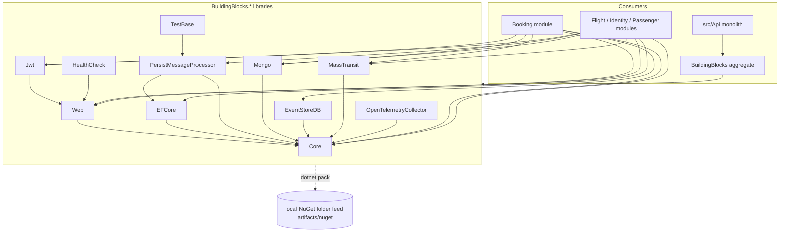

# ADR 0100: Split BuildingBlocks into independently consumable shared libraries

- Status: Proposed (ARB_REQUIRED, trigger T8 new shared library; ARB ticket TO BE CREATED; merge into the
  integration branch allowed, epic merge to `main` waits on ARB approval)
- Ticket: AB-500 (epic AB-488, Microservices Migration Scaffolding)
- Date: 2026-10-29

## Context

`src/BuildingBlocks/BuildingBlocks.csproj` was one assembly with ~95 package references (EF Core, MongoDB,
EventStoreDB, MassTransit/RabbitMQ, gRPC, Duende IdentityServer, YARP, OpenTelemetry, Testcontainers, ...).
Every module referenced it, so any future service host would inherit every dependency and every CVE.
`EventDispatcher` also required `IPersistMessageProcessor` and a single `IEventMapper` that the monolith host built
by hand from all four modules' mappers, so a single-module host could not use it without the other modules.

## Decision

1. Each `src/BuildingBlocks/<Area>` folder is its own SDK project `BuildingBlocks.<Area>.csproj`
   (Core, Constants, Utils, Exception, Contracts, Logging, Caching, Polly, Mapster, Web, Validation, ProblemDetails,
   OpenApi, Jwt, EFCore, PersistMessageProcessor, Mongo, EventStoreDB, MassTransit, HealthCheck,
   OpenTelemetryCollector, TestBase). CLR namespaces are unchanged.
2. Dependencies point inward to Core; Core has no project references, no ASP.NET Core and no data-store/broker packages.
   Cycles were removed by moving `EfTxBehavior` and `ConsumeFilter<T>` into PersistMessageProcessor, having HealthCheck
   bind its own option shapes (same config sections), making ProblemDetails detect EF concurrency exceptions by type
   name, replacing `nameof(Duende...ApiScope)` with `IdentityConstant.Policy.ApiScope`, and moving the NSubstitute
   helper to TestBase.
3. `EventDispatcher` depends on `IEnumerable<IEventMapper>`, `IIntegrationEventPublisher` and
   `IEnumerable<IEventHeadersProvider>`. Modules call `AddEventMapper<T>()`; PersistMessageProcessor provides the
   outbox-backed `IIntegrationEventPublisher`; Web provides the HTTP header provider.
4. `BuildingBlocks.csproj` stays as a code-free aggregate for the monolith during the transition. Modules reference
   focused libraries; Booking has no EF Core in its graph.
5. Libraries are packable as `BookingModularMonolith.BuildingBlocks.<Area>` with one shared SemVer version
   (`BuildingBlocksVersion`), packed to a local folder feed by `scripts/pack-building-blocks.sh`. No external feed or
   publishing is introduced.

## Diagram (C4 container view of the libraries)

## Non-functional requirements

- Availability / RPO / RTO: unchanged; this is a build-time restructuring with no new runtime component.
- Data classification: unchanged; no new data is stored or moved.
- Load: unchanged; same code paths run in the same process. Dispatcher overhead is one extra enumerable of mappers.
- Build: every library must build and pack on its own (CI `BuildingBlocks` workflow).

- Keep one assembly and rely on trimming: does not reduce restore graph, vulnerability surface or coupling.
- Per-library independent versions: more release overhead while all libraries still change together; revisit once
  services consume packages from separate repos.
- Rename namespaces to match packages: breaking for every consumer and MassTransit message URNs; rejected (binding
  epic decision).

## Consequences

- Service hosts (AB-488 Phase 2) reference only what they use; e.g. Booking.Host needs no EF Core.
- Single-module hosts register only their own mappers; the monolith composes all four through DI.
- Two types changed assembly (not namespace); consumers using the aggregate are unaffected.
- Dockerfiles must copy every `BuildingBlocks.*.csproj` before restore (done for `src/Api/Dockerfile`).
- Dependency-surface unit tests and a CI workflow guard against re-coupling.

## Security & compliance

- Data flows, encryption, authn/z, secrets handling and audit logging are unchanged. `BuildingBlocks.Jwt` keeps the
  same bearer validation; the `ApiScope` policy name is the same string as before.
- Packages are produced into a local folder feed only; nothing is published to nuget.org or any external feed.

## Cost and ownership

- No recurring cost. Owner: platform / AB-488 migration team; runbook: `src/BuildingBlocks/README.md`.

## Security / operability / cost summary

No new runtime component, data store, network path or vendor. Package versions are unchanged from the previous
aggregate (plus `MassTransit.Abstractions` and `Grpc.Core.Api`, which were already transitive). Smaller dependency
graphs per service reduce patch blast radius. No cost impact.
