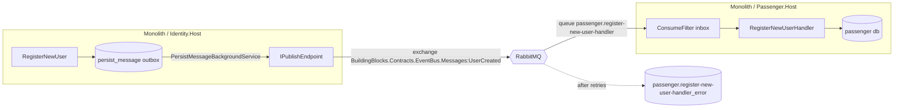

# ADR 0101: RabbitMQ transport, module-owned queues and broker-keyed inbox

- Status: Proposed (ARB_REQUIRED, trigger T4 async contract/transport change between bounded contexts; ARB ticket
  TO BE CREATED; merge into the integration branch allowed, epic merge to `main` waits on ARB approval)
- Ticket: AB-501 (epic AB-488, Microservices Migration Scaffolding)
- Date: 2026-10-29

## Context

The monolith registered MassTransit with `TransportType.InMemory` and scanned `AppDomain.CurrentDomain.GetAssemblies()`
for consumers (`src/Api/src/Extensions/SharedInfrastructureExtensions.cs`). Integration events such as Identity
`UserCreated` -> Passenger `RegisterNewUserHandler` never left the process, so a module could not move to its own host.
RabbitMQ was already provisioned by docker-compose and Aspire but unused. Endpoint names came from the default
formatter (`register-new-user`), so two hosts with a consumer of the same class name would share a queue by accident,
and the inbox filter (`ConsumeFilter<T>`) was never attached and keyed rows on `IEvent.EventId`, which is regenerated
on every access.

## Decision

1. **Transport is configuration.** `MessagingOptions:Transport` (`RabbitMq` | `InMemory`, default `RabbitMq`) selects the
   transport via `services.AddCustomMassTransit(configuration, env, configureBus, assemblies...)`. Unknown values fail at
   startup. InMemory remains for unit tests; integration tests run against a RabbitMQ Testcontainer.
2. **Connection.** `ConnectionStrings:rabbitmq` (amqp URI, injected by Aspire) wins; otherwise `RabbitMqOptions`
   (`HostName`, `Port`, `VirtualHost`, `UserName`, `Password`). Local/dev/compose/Aspire use user `booking/booking`
   (`guest` is loopback-only on a stock broker). Missing host fails fast.
3. **Module-owned queues.** Hosts pass the module assemblies that own their consumers (no AppDomain scan; an empty
   list registers nothing). `ModuleEndpointNameFormatter` names each receive endpoint
   `<module-assembly>.<consumer>`, e.g. `passenger.register-new-user-handler`. When the monolith and a
   `Passenger.Host` run side by side they bind the **same** queue (competing consumers) rather than each receiving a copy;
   `Modules:<Module>:BackgroundProcessingEnabled` (shared decision) decides which process consumes.
   Exchange names are unchanged (MassTransit message URNs, e.g. `BuildingBlocks.Contracts.EventBus.Messages:UserCreated`).
4. **Outbox.** `PersistMessageProcessor` keeps publishing through `IPublishEndpoint`, so it publishes to RabbitMQ when the
   bus does. The published `MessageId` is the outbox row id, so a re-publish after a crash carries the same id.
5. **Inbox.** `bus.UsePersistMessageInbox(context)` adds `ConsumeFilter<T>` to every consumer. The inbox row id is a
   deterministic hash of (receive endpoint, `MessageId`): a redelivery of a processed message is skipped, a retry of an
   in-progress message reuses its row, and the same message on two endpoints gets two rows.
6. **Retry.** Bus-level exponential retry (3 retries, 200 ms min; `ValidationException` not retried) runs outside the
   inbox filter; exhausted messages fault (`Fault<T>` published) and move to `<queue>_error`.

## Diagram

## Alternatives considered

- Keep InMemory and call modules directly: blocks the service split (rejected).
- Per-host queue names (`<host>.<consumer>`): every host running a consumer would get its own copy, double-processing
  during side-by-side cutover (rejected).
- MassTransit's EF Core transactional outbox/inbox: replaces the repo's persist-message store and its schema; larger
  migration than this ticket (deferred).

## Non-functional requirements

- Availability: one RabbitMQ node in dev/compose; production HA (quorum queues, clustering) belongs to the
  platform/cutover tickets. Publishing is asynchronous via the outbox, so a broker outage delays delivery but does not
  fail user requests; the outbox retries until the broker returns.
- Delivery: at-least-once; consumers are idempotent through the inbox. RPO for in-flight events equals the outbox
  database RPO.
- Data classification: `UserCreated` carries name and passport number (PII) - unchanged payload, now on the broker.
- Load: low (user registration, booking events).

## Security & compliance

- Credentials come from configuration/env/Aspire parameters (`rabbitmq-username`/`rabbitmq-password`, secret). The
  `booking/booking` values are local-development defaults only; real environments must inject secrets.
- AMQP is plaintext on the internal compose/cluster network; TLS (amqps URI via `ConnectionStrings:rabbitmq`) is a
  deployment concern for ARB. The management UI (15672) is exposed only by local compose.
- No new external vendor: RabbitMQ and MassTransit were already dependencies.

## Cost and ownership

- No new paid infrastructure. Owner: booking platform team; runbook `docs/runbooks/messaging.md`.

## Consequences

- Running the monolith now requires a reachable broker (compose/Aspire provide it), or `MessagingOptions__Transport=InMemory`.
- Queue names change from `register-new-user` to `passenger.register-new-user-handler`; old queues on an existing broker
  can be deleted after the deploy.
- Integration tests are slower (real broker) and need Docker.
