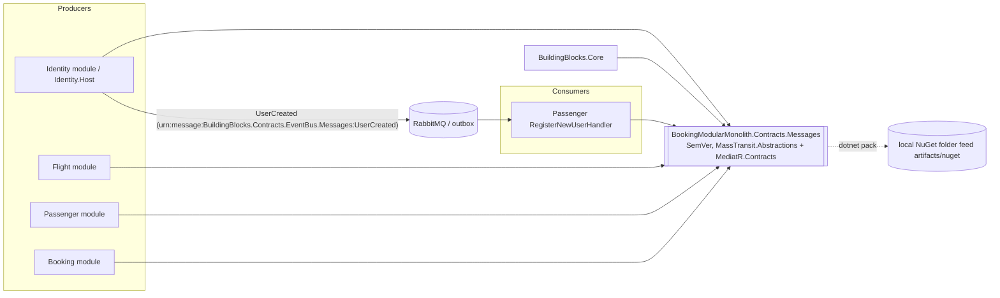

# ADR 0101: Versioned integration-event contracts package

- Status: Proposed (ARB_REQUIRED, triggers T4 shared async-contract schema and T8 new shared library; ARB ticket
  TO BE CREATED; merge into the integration branch allowed, epic merge to `main` waits on ARB approval)
- Ticket: AB-506 (epic AB-488, Microservices Migration Scaffolding)
- Date: 2026-10-29

## Context

All integration events (`BuildingBlocks.Contracts.EventBus.Messages.*`, e.g. Identity's `UserCreated` consumed by
Passenger) lived in `BuildingBlocks.Contracts`, which depended on `BuildingBlocks.Core` (MediatR, Google.Protobuf,
Sieve, ...) and was versioned together with the 21 other BuildingBlocks libraries (ADR 0100). Once Identity and
Passenger run as separate services (`src/Services/<Module>.Host`) they are built and deployed independently, so
the message schema they share must be an artifact of its own with a version both sides can pin and an explicit
rule for evolving it without breaking the other side.

## Decision

1. Move the four contract files and the `IEvent` / `IIntegrationEvent` marker interfaces into
   `src/Contracts/Contracts.Messages/Contracts.Messages.csproj`. Its only dependencies are `MassTransit.Abstractions`
   (`[ExcludeFromTopology]`, `NewId`) and `MediatR.Contracts` (`INotification`); no project references, no ASP.NET
   Core, no data-store or transport packages. Delete `BuildingBlocks.Contracts`.
2. CLR namespaces stay `BuildingBlocks.Contracts.EventBus.Messages` and `BuildingBlocks.Core.Event`: the type name is
   the MassTransit URN and the outbox/inbox `DataType`, so renaming would be a breaking wire change.
   `BuildingBlocks.Core` references the contracts and `[TypeForwardedTo]`s the two interfaces.
3. Pack as `BookingModularMonolith.Contracts.Messages` with its own SemVer version (`ContractsMessagesVersion` in
   `src/Contracts/Versions.props`, starting at 1.0.0) into the existing local folder feed `artifacts/nuget`
   (`scripts/pack-contracts.sh`). BuildingBlocks moves to 1.1.0 because Core now depends on the package.
4. Every producer/consumer (Identity, Flight, Passenger, Booking, Core, the aggregate) imports
   `src/Contracts/Contracts.Messages.Reference.props`: project reference by default, pinned package reference with
   `-p:UseContractsPackage=true` (`ContractsMessagesPackageVersion` overrides the pin).
5. Compatibility policy (`src/Contracts/README.md`): additive changes only (MINOR); never rename/remove/retype a
   member or move a message; breaking changes ship as a new message version next to the old one (matching the `V1`
   feature-folder convention) and old versions are removed only in a MAJOR release. A committed baseline
   (`Baselines/messages.json`) and `MessageCompatibilityTests` enforce it in CI.

## Diagram (C4 container view)

## Non-functional requirements

- Availability / RPO / RTO: unchanged; build-time restructuring, no new runtime component.
- Data classification: unchanged. `UserCreated` carries name and passport number (PII) exactly as before; no field
  was added or moved to a new store.
- Load: unchanged; same messages, same URNs, same serializer.
- Compatibility: wire format and URNs identical to the previous assembly (asserted by the baseline test and a
  MassTransit in-memory `UserCreated` round trip).

## Alternatives considered

- Keep contracts inside BuildingBlocks: every service would pin the whole BuildingBlocks version to talk to another
  service, coupling platform upgrades to schema changes.
- One package per producing module (Identity.Contracts, ...): cleaner ownership but four release trains for eleven
  records today; revisit when services move to separate repositories.
- Schema-first contracts (protobuf / JSON Schema registry): larger change to serialization and tooling; out of scope
  for the scaffolding epic.
- Rename namespaces to `Contracts.Messages`: breaking wire change (URN, outbox `DataType`); rejected.

## Consequences

- Services can pin a contract version independently of BuildingBlocks and of each other.
- Contract changes need a version bump and, if not additive, a new message version; CI fails otherwise.
- Dockerfiles that restore before copying sources must also copy `src/Contracts/*.props` and
  `Contracts.Messages.csproj` (done for `src/Api/Dockerfile` and `src/Gateway/Dockerfile`).
- Code compiled against the old `BuildingBlocks.Core` keeps resolving `IEvent`/`IIntegrationEvent` via type forwards.

## Security & compliance

- Data flows, encryption, authn/z, secrets handling and audit logging are unchanged; the package contains only
  record types and marker interfaces.
- Packages are produced into a local folder feed only; nothing is published to nuget.org or any external feed.
  `MediatR.Contracts` (MIT) was already in the restore graph transitively via MediatR.

## Cost and ownership

- No recurring cost. Owner: platform / AB-488 migration team; runbook: `src/Contracts/README.md`.
