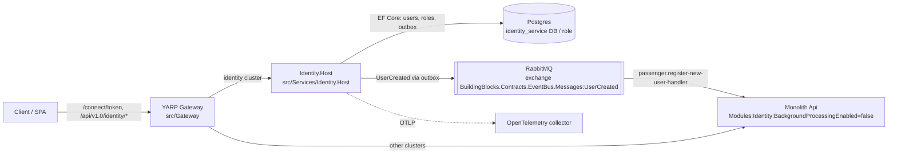

# ADR 0103: Standalone Identity service host

- Status: Proposed (ARB review required; ticket to be created)
- Ticket: AB-493 (epic AB-488, Microservices Migration Scaffolding)
- Date: 2026-10-29

## Context

The Identity module currently runs inside the monolith API, alongside Flight, Passenger, and Booking. The migration needs Identity to run as an independent process while preserving the existing module implementation and contracts. The module already owns its EF Core context and outbox processor, and its integration events are transported through RabbitMQ.

Running both hosts at once must not cause the monolith and standalone host to poll the same Identity outbox. The standalone service also needs a dedicated database so its identity data and outbox can be managed independently from the monolith.

## Decision

1. Add `Identity.Host` as an ASP.NET Core host that composes the existing Identity module and shared ServiceDefaults. It references only Identity and focused shared BuildingBlocks; it does not reference the monolith API or other business modules.
2. Configure the host to use the `identity_service` PostgreSQL database for Identity data and the module-owned outbox. Configure RabbitMQ and health/telemetry endpoints through host configuration.
3. Register MassTransit with only the Identity module assembly. Do not re-register the Identity persistence processor at the host layer; the module already owns that registration.
4. Keep the monolith's Identity endpoints available for the transition, but disable its Identity background processor when both hosts run side by side. Route gateway Identity traffic to the standalone host.
5. Keep service-host composition explicit for now. A shared ServiceHost library was considered but rejected by the AB-488 epic decision; the small host-specific composition is clearer than introducing a common abstraction before additional service hosts establish stable shared needs.

## Architecture

## Non-functional requirements

- Availability: same target as the monolith it replaces for the Identity routes; liveness `/alive`, readiness `/health` (Identity Postgres + RabbitMQ).
- RPO/RTO: governed by the `identity_service` Postgres backups; outbox rows survive broker outages and are retried by the poller.
- Data classification: PII (user name, e-mail, passport number) and password hashes — unchanged from the module; now stored in a service-owned database.
- Expected load: login/registration traffic only (low; tens of requests per second at peak). Single replica while the outbox has no row locking.

## Security and compliance

- Authn/z: Duende IdentityServer issues tokens with audience `booking-modular-monolith`; register-user requires the `ApiScope` policy via `BuildingBlocks.Jwt`. Issuer (`AuthOptions:IssuerUri`) must equal the gateway's public URL when routed through the gateway.
- Signing keys: the developer signing credential is for local/dev only and is git-ignored; production needs a managed signing key shared by any process issuing or validating tokens (ARB follow-up).
- Data flows: HTTP via the gateway; Postgres over the private network with the least-privilege `identity_service` role (no CONNECT on other modules' DBs); RabbitMQ with the `booking` user. Encryption in transit for Postgres/RabbitMQ is an environment concern (TLS not enabled for local compose).
- Secrets: connection strings and broker credentials in appsettings are local-development defaults; deployed environments inject them via environment variables/secrets.
- Audit: IdentityServer success/failure/error events are raised and logged; logs/traces export via OpenTelemetry.

## Cost and ownership

- Cost: one additional container plus one database on the existing Postgres instance; negligible new spend (well under the ARB cost threshold).
- Ownership: Identity module team; runbook `docs/runbooks/identity-service.md`.

## Consequences

- Identity can be deployed and scaled independently, with a service-owned database and outbox.
- Side-by-side operation requires the monolith Identity background processor to be disabled and gateway routing/issuer metadata to be configured consistently.
- Local developer signing keys differ between the two processes; tokens are not interchangeable unless an environment provisions a shared signing key.
- The outbox worker has no distributed lease, so operate a single Identity host replica until coordination is added.
- Existing Identity data must be migrated from `identity_modular_monolith` to `identity_service` as part of AB-505 before production cutover.
- The host has its own container build, integration tests, and service runbook.

## Alternatives considered

- **Keep Identity only in the monolith:** rejected because it does not enable an independent Identity service or the migration's service-boundary validation.
- **Introduce a shared ServiceHost library:** rejected by the AB-488 epic decision; defer until the service hosts demonstrate stable common composition needs.
- **Move Identity module code into the host:** rejected because it would duplicate or relocate module ownership rather than reuse the existing module.
