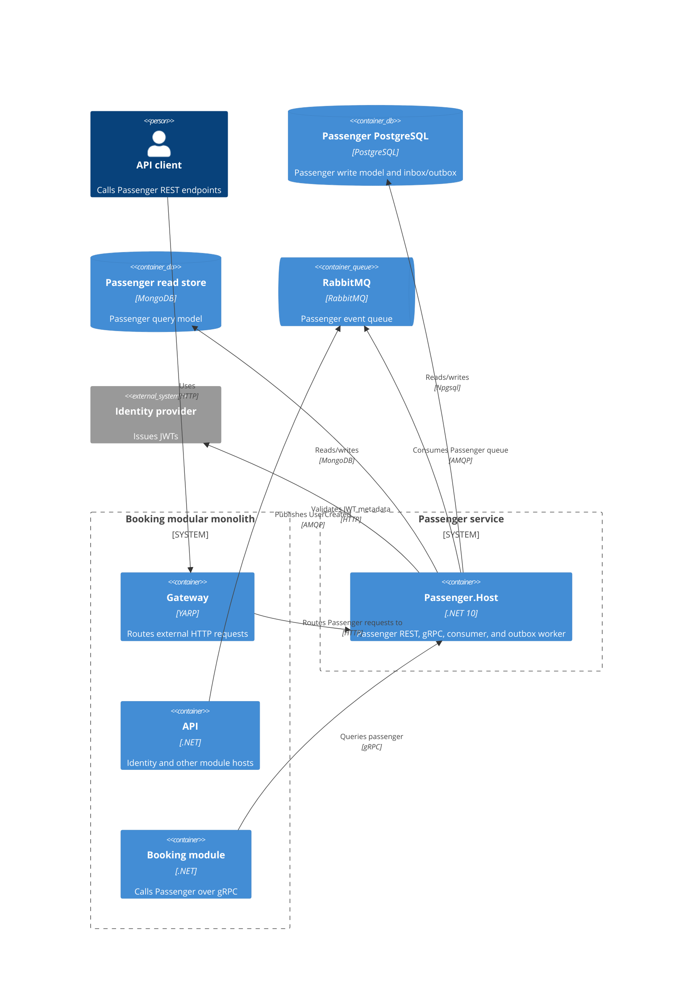

# ADR 0104: Standalone Passenger service host

- **Status:** Proposed
- **Date:** 2026-03-03

## Context

The Passenger bounded context currently runs inside the modular-monolith API. Its
PostgreSQL write model, MongoDB read model, and RabbitMQ consumer can be composed
in a separate process without moving the module implementation or changing its
contracts. A standalone host enables an independently deployed Passenger service
while keeping the existing monolith available during the transition.

The host and monolith must not consume `passenger.register-new-user-handler`
concurrently while writing to different databases. Existing data and pending
messages are not moved as part of this decision; the migration/cutover plan is
deferred to AB-505.

## Decision

Add `Passenger.Host` as a thin service composition root. It composes only the
Passenger module, ServiceDefaults, and focused shared building blocks. The module
continues to own its database contexts, migration, message processor, and gRPC
service mapping.

The service owns its PostgreSQL database (`passenger_service`) and MongoDB read
database (`passenger_service_read`) and consumes Passenger's existing RabbitMQ
queue. Its readiness endpoint checks the Passenger write database, read
database, and RabbitMQ when RabbitMQ is the configured transport.

In the monolith, `Modules:Passenger:BackgroundProcessingEnabled=false` disables
the Passenger outbox worker and excludes its consumers from MassTransit
registration. When the standalone service is active, the monolith must use this
setting so the Passenger host is the only consumer and processor for the module.
Run a single Passenger host replica with background processing enabled; the
outbox does not currently use row locking.

The host exposes HTTP on port 5102 and gRPC on port 5202 for local development;
its container listens on 80 and 81 respectively. Booking continues to use the
shared Passenger gRPC contract and can be routed to the new host without a
contract change.

## Alternatives considered

1. **Keep Passenger embedded in the monolith.** This avoids operational
   complexity, but does not provide independent deployment or data ownership.
2. **Run the host alongside the monolith without consumer gating.** Rejected
   because both processes bind the same queue and can split event processing
   between separate databases.
3. **Extract all modules at once.** Rejected as a larger and riskier migration
   than extracting Passenger independently.

## Consequences

- Passenger can be deployed and scaled independently from the monolith's HTTP
  process, while retaining the existing module code and gRPC contract.
- Operators must provision both Passenger databases and configure RabbitMQ,
  authentication metadata, and service routing.
- The monolith remains the identity authority and continues publishing the
  `UserCreated` integration event.
- Data migration, inbox/outbox draining, and cutover of existing read models are
  explicitly out of scope for this ADR and remain deferred to AB-505.
- Only one replica may run Passenger background processing at a time until the
  outbox supports safe concurrent polling.

## Non-functional requirements

- `/health/live` reports process liveness independently from dependencies.
- `/health/ready` checks the Passenger PostgreSQL database, MongoDB read
  database, and RabbitMQ when selected as the transport.
- The host must honor module-specific configuration and resolve health-check
  connection settings at request time so deployment overrides work.
- Host project references must not pull in Api, Flight, Identity, Booking, or
  aggregate BuildingBlocks projects.

## Security

REST endpoints use the configured JWT bearer authentication and authorization
policies. The internal Passenger gRPC endpoint is currently unauthenticated.
Restrict it to trusted internal networks as an operational control. A shared
Architecture Review Board follow-up is required to decide the service-to-service
authentication boundary; this host does not introduce a new gRPC authentication
scheme.

## Data ownership

The Passenger service writes passenger records and its inbox/outbox data to the
`passenger_service` PostgreSQL database. Its query/read model is stored in the
`passenger_service_read` MongoDB database. The monolith's existing
`passenger_modular_monolith` and `passenger_modular_monolith_read` stores are not
automatically copied or reconciled by this change.

## Container view

## Operations

See the [Passenger service runbook](../runbooks/passenger-service.md) for local
configuration, side-by-side operation, routing, health checks, and container
commands.
