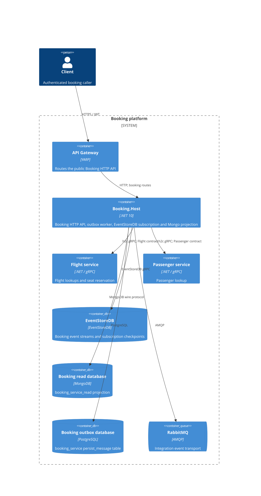

# 0104. Standalone Booking service host

- **Status:** Proposed
- **Date:** 2026-10-29
- **ARB ticket:** TO BE CREATED
- **Authors:** Devin (AB-496)
- **Owning team:** Booking team
- **Related ADRs:** [0001](0001-yarp-api-gateway-single-ingress.md), [0100](0100-buildingblocks-shared-libraries.md), [0103](0103-shared-grpc-contracts-and-service-addressing.md)

## Context

Booking currently runs only inside the modular-monolith API process. AB-496 adds a separately deployable HTTP host
that composes the existing Booking module without changing its CLR namespaces or gRPC/message contracts. The host
will have an independent deployment and own the Booking persistence configuration, outbox worker, EventStoreDB
subscription checkpoint, HTTP boundary, and service configuration. The Booking module continues to call Flight and
Passenger over the shared gRPC contracts.

### Architecture review triage

**ARB_REQUIRED** — T1 adds a deployable service; T2 gives Booking a host-owned PostgreSQL outbox database
(`booking_service`), Mongo read database (`booking_service_read`), and EventStoreDB checkpoint/subscription ID; T6
adds a network boundary for Booking HTTP traffic behind the gateway and cross-process h2c gRPC calls to Flight and
Passenger. Service-to-service gRPC remains unauthenticated as an explicit follow-up.

### Container view

The diagram shows logical service boundaries. Production endpoints, TLS termination, and managed service placement are
deployment choices; local defaults are plain HTTP/h2c and local containers.

## Decision

1. **Self-composed host.** Add `src/Services/Booking.Host` as a small ASP.NET Core host which calls
   `AddBookingHostInfrastructure`, `AddBookingModules`, and the Booking module endpoint mapping. The host references
   Booking and the focused shared building blocks it uses, not the monolith API, other business modules, the
   aggregate BuildingBlocks project, or BuildingBlocks.EFCore. The existing Booking module owns its commands,
   projections, EventStoreDB repository, and downstream gRPC clients.
2. **Host-owned persistence configuration.** Standalone defaults target PostgreSQL database/role `booking_service`,
   Mongo database `booking_service_read`, and the existing EventStoreDB cluster. The host keeps its own outbox and
   subscription checkpoint. It does not introduce a new database server or change the Booking module's persistence
   contracts.
3. **Subscription identity and worker switch.** The EventStoreDB subscription ID is
   `Modules:Booking:SubscriptionId` (standalone default `booking-service`). If omitted, it remains `default` for
   compatibility with the monolith's existing checkpoint. `Modules:Booking:BackgroundProcessingEnabled` defaults to
   true; when false, both the Booking persist-message polling worker and the EventStoreDB subscription are absent.
   This permits the monolith to serve non-Booking functions while Booking.Host processes Booking work during a
   side-by-side cutover. `PersistMessageOptions:Enabled=false` remains an independent global outbox-worker switch.
4. **Downstream discovery.** Booking continues to use logical `http://_grpc.flight` and `http://_grpc.passenger`
   addresses, resolved from the `Services:flight:grpc:0` and `Services:passenger:grpc:0` entries. Local defaults
   point to the monolith's h2c listener; Docker defaults point to the Flight and Passenger service DNS names.
   Booking.Host serves HTTP only; it does not expose a gRPC server or gRPC health endpoint.
5. **Readiness and operations.** The host exposes `/health/live` for liveness and `/health/ready` for readiness in all
   environments. Readiness includes Booking PostgreSQL, MongoDB, EventStoreDB, Flight gRPC, Passenger gRPC, and
   RabbitMQ when RabbitMQ is the selected transport. The host runs one active Booking background-processing replica:
   the EventStoreDB subscription and outbox worker are not designed for concurrent processing by multiple replicas.
6. **Migration boundary.** Store migration/rebuild and gateway cutover sequencing remain AB-505 work. No existing
   data is moved by this host scaffold.

## Non-functional requirements

These are initial service objectives and sizing assumptions for rollout, to be validated with production telemetry:

| Area | Initial target / assumption |
|---|---|
| Availability | 99.9% monthly for the HTTP API, subject to gateway and required dependency availability |
| RPO | 0 for acknowledged EventStoreDB events under the configured durable-write policy; projection state is rebuildable from EventStoreDB |
| RTO | 30 minutes for a single-host restart or failover, with service restoration gated by readiness |
| Expected load | Initial envelope: under 1 booking creation/second sustained, 10/second peak, with fewer than 100 concurrent HTTP requests; capacity testing required before increasing this envelope |
| Data classification | Internal/confidential operational data. Booking records include passenger names and travel details; name plus itinerary is personal-data/PII-like information. Passport data is not intentionally copied into the Booking projection. |
| Recovery | EventStoreDB is the booking event source; restore or replay the host-owned read model and subscription from the configured checkpoint after an incident. Outbox delivery is at-least-once. |

The targets do not imply that the first deployment has independent multi-zone failover. Availability and recovery
depend on the durability and operational configuration of the shared managed dependencies.

## Security and compliance

- Public callers reach the Booking HTTP API through the gateway and authenticate with JWTs validated for audience
  `booking-modular-monolith`. Authorization remains on the Booking endpoint policy.
- Internal Flight and Passenger gRPC calls are currently unauthenticated h2c inside the service network. Network
  policy must restrict these endpoints to trusted workloads. mTLS or service identity is a follow-up for ARB review;
  the existing `Grpc:RequireTls` option can reject plain-text endpoints when the platform enables TLS.
- The local and Docker examples use HTTP/h2c for internal traffic. Production ingress should use HTTPS to the gateway;
  service-to-service encryption should be enabled when certificate/service-mesh support is ready.
- Credentials and signing material must be provided through environment overrides backed by the deployment secret
  store, not committed to appsettings or image layers. The `booking/booking` values in local config are development
  defaults only.
- OpenTelemetry and application logs provide operational audit trails for requests, dependency failures, and worker
  activity. Do not log bearer tokens, passenger names, or other sensitive payloads. Retention/access controls follow
  the platform logging policy.

## Cost estimate and operational ownership

Planning estimate for the first production deployment: one small Booking.Host replica (approximately 0.5 vCPU and
1 GiB memory) is expected to add roughly **$25–$75/month** in shared-cluster compute and routine telemetry at low
initial load. This excludes gateway and the existing PostgreSQL, MongoDB, EventStoreDB, and RabbitMQ service costs;
the host creates logical databases/checkpoints on those managed services, not new database clusters. Platform
Finance/Operations must validate the estimate against the target region and runtime before launch.

The **Booking team** owns the service, its alerts, deployment, and incident response. The readiness and troubleshooting
procedure is in [the Booking service runbook](../runbooks/booking-service.md).

## Alternatives considered

- **Keep Booking in the monolith only.** Requires no new deployable boundary, but does not support the planned
  service extraction and independent deployment.
- **Create a shared ServiceHost library.** Would centralize repeated composition but introduces a shared abstraction
  before a second service host establishes stable requirements.
- **Move or duplicate Booking domain code into the host.** Rejected; it would fork module ownership and alter
  contracts/namespaces. The host composes the existing module.
- **Reuse the monolith checkpoint ID and shared stores.** Rejected for standalone operation: the host needs its own
  checkpoint and Booking-owned databases. The `default` checkpoint remains the fallback only when no ID is set, for
  monolith backward compatibility.

## Consequences

- Booking can run independently while keeping the module implementation unchanged.
- Side-by-side operation requires disabling Booking background processing in the monolith and running no more than
  one background-processing replica. Enabling workers in both compositions can duplicate projection/outbox work.
- A newly named `booking-service` subscription has an independent checkpoint and may replay existing events into
  the standalone read model on first start. Plan read-model state and checkpoint transitions with AB-505.
- Internal gRPC has no service authentication yet, and h2c does not encrypt traffic; this is an accepted interim
  boundary requiring restricted network access and a follow-up.
