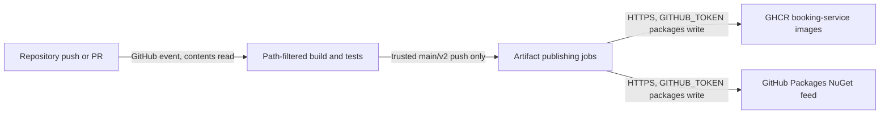

# 0490. Independent service artifact publishing

- **Status:** Proposed
- **Date:** 2026-10-28
- **ARB ticket:** TO BE CREATED (no ARB project available; no ticket created)
- **Authors:** AB-490 implementation
- **Owning team:** Booking platform maintainers; rotation owner TBD before ARB
- **Related ADRs:** AB-499 migration decisions (coordinated separately)

## Context

The running monolith retains its existing CI. New service hosts arrive in later
waves and need independent validation and versioned artifacts without unrelated
module builds. Shared contracts/BuildingBlocks need version-gated distribution.
ARB trigger: T6, narrowly scoped registry write permission for trusted CI jobs.
The workflow does not add a running application service or deployment.

## Decision

We will use five path-filtered GitHub Actions entry workflows, one reusable
service workflow, GHCR SHA-tagged images and GitHub Packages NuGet artifacts.
Package publication is driven by evaluated PackageVersion changes. Missing hosts
skip successfully. Only trusted branch publishing jobs obtain packages:write;
PR builds remain read-only and never publish.

## Alternatives considered

| Alternative | Pros | Cons | Why rejected |
| --- | --- | --- | --- |
| Do nothing | No permissions change | No independent artifacts | Does not meet migration requirements |
| Build every service on every change | Simple selection | Unrelated builds and tests | Defeats independent pipelines |
| Separate registry and PATs | Registry independence | New vendor/secret lifecycle | GHCR already supports repository tokens |

## Architecture

## Non-functional requirements

| NFR | Target | How met |
| --- | --- | --- |
| Availability SLO | TBD — owner to confirm before ARB | GitHub Actions/Packages managed service |
| p95 latency | N/A — no request-serving component | Build duration visible per workflow |
| RPO / RTO | TBD — owner to confirm before ARB | Source-controlled reproducible builds, SHA rollback |
| Peak load | Five service builds per shared change | Independent hosted runners |
| Scaling model | Managed runners, concurrency per service/ref | Do not cancel trusted publishing on later pushes |
| Data retention | TBD — owner to confirm before ARB | Registry retention managed separately |

## Security & compliance

- **Data classification:** Source-derived binaries only; no customer data.
- **Encryption at rest:** GitHub-managed registry storage; no new key resources.
- **Encryption in transit:** HTTPS to GHCR/GitHub Packages.
- **AuthN / AuthZ:** Ephemeral GITHUB_TOKEN; contents:read for verification,
  packages:write exclusively for trusted publish jobs.
- **Secrets:** No long-lived publishing secret added.
- **Audit logging:** GitHub Actions runs, OCI source/revision labels, NuGet versions.
- **Data residency:** GitHub-managed; residency requirements TBD before approval.
- **Policy sections satisfied:** No Terraform/CDK/CloudFormation added; runtime
  infrastructure policy is N/A. ARB approval remains required for permission grant.
- **Threats considered:** Fork-PR credential access, unintended public artifacts,
  mutable rollback tags, hidden test failures. PR publication denied; default
  package visibility retained; SHA tags; test exit status propagated.

## Cost

| Item | Assumption | Monthly estimate |
| --- | --- | --- |
| Actions minutes and package storage | Existing GitHub organization, five pipelines; usage unknown | TBD — owner to confirm before ARB |
| Total | No new runtime infrastructure | TBD; no unverified cost assertion |

## Operations

- **On-call rotation:** Booking platform maintainers; named rotation TBD.
- **Runbook:** docs/runbooks/service-pipelines.md.
- **Dashboards / alarms:** GitHub Actions status checks and registry audit history.
- **Rollback:** Consume an earlier image SHA/package version; revert workflow edits
  through reviewed PRs if necessary. Published versions are not overwritten.
- **Migration / cut-over:** No deployment/cutover in this ticket; hosts opt in by
  providing their agreed project and Dockerfile.

## Policy exceptions requested

None. ARB approval for the permission change is pending, not bypassed.

## Consequences

- Positive: independent service builds, reproducible version references, no PATs.
- Negative/risks: shared changes fan out; registry permissions need owner approval.
- Follow-ups: registry retention, availability/cost/residency ownership before ARB.

## Open questions

- Confirm named operational owner, SLO, retention, residency and monthly usage.
- Create ARB ticket when an ARB project is available; approve before merge.
