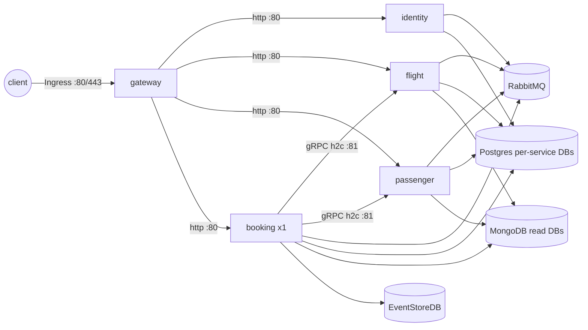

# ADR 0491: Kubernetes deployment via a single Helm chart for the service topology

- Status: Proposed
- Ticket: AB-491 (epic AB-488)
- ARB ticket: TO BE CREATED (ARB_REQUIRED)

## Context

The README names Kubernetes as a deployment target, but the repo only had docker-compose files.
The four service hosts (ADR 0493/0496/0498/0502) and the YARP gateway (ADR 0001) now build as
separate images (AB-490 publishes `ghcr.io/cog-gtm/booking-<service>`), so they need cluster
scaffolding that keeps the epic's rules: gateway is the only public entry (ADR 0001), each service
owns its databases (ADR 0004/0492), Booking→Flight/Passenger over gRPC on a dedicated h2c port
(ADR 0494), and exactly one Booking background processor (ADR 0005/0496).

## Decision

- One Helm chart `deployments/k8s/helm/booking`, values-driven per service (`services.<name>`):
  Deployment, ClusterIP Service, ConfigMap (non-secret config as ASP.NET env keys), Secret
  (connection strings, broker creds), optional HPA, requests/limits, startup/liveness probes on
  `/health/live` and readiness on `/health/ready`.
- `gateway` is the only `Ingress` backend; all other Services are ClusterIP. YARP destinations are
  repointed with `ReverseProxy__Clusters__<module>__Destinations__monolith__Address=http://<svc>:80`.
- `flight`/`passenger` Services expose port 81 named `grpc` (`appProtocol: kubernetes.io/h2c`);
  Booking uses `Grpc__FlightAddress=http://flight:81`, `Grpc__PassengerAddress=http://passenger:81`.
- Booking: `Recreate` strategy, and the chart fails rendering if `replicas>1` or HPA is enabled
  while `backgroundProcessingEnabled=true`. Identity: >1 replica / HPA requires
  `identity.signingKey.existingSecret` (an RSA JWK mounted at `/app/tempkey.jwk`) so replicas
  sign with the same key.
- `infra.enabled` (default true, false in `environments/production.yaml`) adds single-replica
  Postgres 16 / MongoDB 7 / RabbitMQ 3 / EventStoreDB 24.10 StatefulSets for local clusters only,
  with the per-service roles/databases of ADR 0492. Production points at managed endpoints.
- Environment overlays are plain values files (`environments/kind.yaml`, `production.yaml`);
  `kind-smoke.sh` is the acceptance test; a new `k8s-manifests.yml` workflow runs helm lint,
  helm template | kubeconform and the chart guards (no cluster, no new permissions).

## Alternatives considered

- Raw manifests + kustomize overlays — five near-identical service stacks with no way to enforce
  the Booking/Identity replica rules at render time.
- One subchart per service — independent versioning, but triples boilerplate while all services
  still release together from one repo; the per-service values blocks give the same knobs.
- Bitnami dependency charts for infra — heavier, extra chart repo dependency and images, and the
  local-only infra does not need HA/operators.

## Consequences

- Network boundary: one public Ingress (gateway); internal gRPC stays unauthenticated inside the
  namespace (accepted risk, ADR 0007) — a NetworkPolicy/mTLS follow-up is recommended.
- Secrets: chart-generated Secrets hold local defaults only; production uses `existingSecret`
  references (RabbitMQ, Identity signing key, per-service DB Secrets). No real secrets in git.
- NFRs (initial): gateway/identity/flight/passenger horizontally scalable (HPA on CPU); Booking is
  a single replica (availability bounded by pod restart time) until the ESDB subscription supports
  competing consumers. Data classification unchanged (PII stays in the service DBs of ADR 0492);
  RPO/RTO is owned by the managed data stores in production, the in-chart infra is not durable.
- Cost: no new recurring spend from this change (scaffolding only); cluster sizing is per
  environment. Ownership: platform team for the chart, service teams for their values blocks.
- Follow-ups for ARB: NetworkPolicies, PodDisruptionBudgets, external-secrets integration,
  image signing/pinning by digest, TLS between gateway and services.
