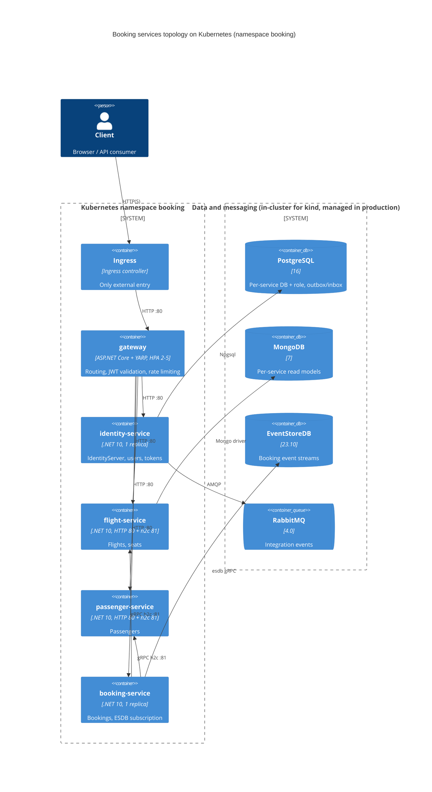

# 0491. Kubernetes Helm deployment for the services topology

- **Status:** Proposed
- **Date:** 2026-10-29
- **ARB ticket:** TO BE CREATED
- **Authors:** Devin (AB-491)
- **Owning team:** Booking platform team
- **Related ADRs:** [0001: YARP API gateway](0001-yarp-api-gateway-single-ingress.md), [0002: per-service data ownership](0002-per-service-data-ownership.md), [0495: observability and probes](0495-per-service-observability-and-trace-propagation.md), [0503: multi-service Compose topology](0503-multi-service-docker-compose-topology.md)

## Context

The README lists Kubernetes as a deployment target, but the repository has no manifests. AB-503 defined the
multi-service topology for Docker Compose: a YARP gateway in front of the Identity, Flight, Passenger and Booking
hosts, each with its own PostgreSQL database and role, Mongo read database, RabbitMQ queues, and (for Booking)
EventStoreDB. Running the same topology on a cluster needs per-service workloads, internal service discovery, a
single external entry point, and configuration and secrets kept outside the images.

ARB triggers: T6 (a new public network boundary: a cluster Ingress in front of the gateway), T5 (Kubernetes
resources are not covered by an `approved-infra.yaml` in this repository; the policy is AWS/CDK oriented), T8 (a
shared deployment artifact for every service team). T2 applies only to the optional in-cluster development data
stores, which hold no new data classes. No new vendor SDK enters the application (T3); Traefik is used only by the
local kind smoke test.

## Decision

We will ship one Helm chart, `deployments/k8s/helm/booking`, with per-environment values overlays in
`deployments/k8s/environments/` (`kind.yaml`, `production.yaml`).

1. **One template set over `services.<identity|flight|passenger|booking|gateway>`.** Each service renders a
   Deployment, a ClusterIP Service, a ConfigMap (non-secret env), a Secret (credentials, unless `existingSecret`)
   and optionally an HPA. Configuration uses the same environment keys as the Compose topology
   (`ReverseProxy__Clusters__<c>__Destinations__primary__Address`, `PostgresOptions__ConnectionString__<Module>`,
   `Services__<svc>__grpc__0`, `Modules__<Module>__BackgroundProcessingEnabled`, ...), so a route or an address
   moves by configuration alone.
2. **Service DNS names match Compose** (`identity-service`, `flight-service`, `passenger-service`,
   `booking-service`, `gateway`) and are not prefixed with the release name. All cross-service addresses (gateway
   clusters, Booking gRPC clients, JWT metadata) are derived from the configurable `services.<x>.name`.
   Flight and Passenger expose HTTP on 80 and h2c gRPC on 81 (`appProtocol: kubernetes.io/h2c`).
3. **Single ingress.** Only the gateway gets an Ingress (controller-agnostic `ingress.className`). Unmatched
   fallback routes are rewritten to `/__gateway/unmatched` (404), as in Compose.
4. **Probes bind to the shared health contract (AB-495):** startup and liveness use `/health/live`, readiness
   uses `/health/ready`.
5. **Externalized secrets.** Database, RabbitMQ, Mongo and EventStore connection settings live in per-service
   Secrets. `global.allowInsecureDefaults` is `false` by default: rendering fails unless every service names an
   `existingSecret` and Identity names a `signingKey.existingSecret`. Only the kind overlay sets it to `true`. The
   IdentityServer RSA JWK is mounted read-only via `subPath` at `/app/tempkey.jwk`, and `/app/keys` stays a
   writable emptyDir, so every Identity pod signs with the same key.
6. **Single-replica background processing.** The four service hosts default to one replica. Rendering fails if
   `backgroundProcessing: true` is combined with `replicas > 1` or an HPA, because the outbox has no row locking
   and the Booking EventStoreDB subscription is single-consumer. `extraEnv` cannot override chart-owned keys, so
   this guard cannot be bypassed. The gateway is stateless and gets an HPA (2-5 replicas, 70% CPU).
7. **Optional in-cluster infrastructure** (`infrastructure.enabled`, on only in kind): PostgreSQL 16 with a
   generated per-service init script stored in a Secret (identifiers are validated before rendering), MongoDB 7,
   RabbitMQ (non-guest user) and EventStoreDB. Production points at external managed services.
8. **Namespace and resources.** Install into a dedicated namespace (`-n booking --create-namespace`); every
   container has requests and limits; containers drop all capabilities except `NET_BIND_SERVICE`, disallow
   privilege escalation, use the RuntimeDefault seccomp profile, and do not mount service-account tokens.
9. **Verification.** `deployments/k8s/tests/chart-render-test.sh` runs Helm lint, render guards and kubeconform
   (Kubernetes 1.31). `deployments/k8s/kind/smoke.sh` creates a kind cluster with Traefik and metrics-server,
   deploys the chart, checks service DNS and gRPC ports, checks the signing key, and runs the Compose booking flow
   (`scripts/smoke/compose-e2e.sh`) through the ingress. CI: `.github/workflows/helm-chart.yml`.

## Alternatives considered

| Alternative | Pros | Cons | Why rejected |
| --- | --- | --- | --- |
| Do nothing (Compose/Aspire only) | No new artifacts | README promise unmet; no cluster path for cutover (AB-505) | Ticket scope |
| Plain manifests + kustomize overlays | No templating engine | Five near-identical copies; cross-service names duplicated by hand; no render-time guards | Guards and derived addresses are central to safety |
| Aspire publish to Kubernetes | Reuses the AppHost model | Generated output not reviewable or pinned; less control over probes/secrets/HPA | Kept Aspire for local orchestration (ADR 0497) |
| One chart per service | Independent release cadence | Cross-service addresses and shared guards scattered over five charts | Can be split later; one chart while the topology is still moving |
| ingress-nginx for kind | Familiar | Retired upstream (March 2026) | Traefik used locally; chart stays controller-agnostic |

## Architecture

## Non-functional requirements

| NFR | Target | How met |
| --- | --- | --- |
| Availability SLO | Gateway survives a pod loss; services as today (single replica) | Gateway min 2 replicas + HPA; readiness gates traffic; services restart on liveness failure |
| p95 latency | Unchanged from Compose | Same images and config; ClusterIP routing |
| RPO / RTO | Production: per managed data store; kind: ephemeral | `infrastructure.persistence.enabled` for PVCs; production uses external stores |
| Peak load | Gateway scales on CPU | HPA 2-5 at 70% CPU; metrics-server required |
| Scaling model | Gateway horizontal; services vertical until outbox locking exists | Render guard rejects service scale-out while background processing is on |
| Data retention | Unchanged | No new data stores in production |

## Security & compliance

- **Data classification:** unchanged; passenger PII and credentials stay in the existing per-service stores.
- **Encryption at rest:** provided by the managed stores in production; not provided for the kind dev stores.
- **Encryption in transit:** TLS terminates at the Ingress (`ingress.tls`); Postgres `SSL Mode` is configurable
  (`Require` in the production overlay); in-cluster service-to-service HTTP/gRPC is plaintext and
  unauthenticated (shared decision, ARB follow-up), as is local EventStoreDB.
- **AuthN / AuthZ:** unchanged; the gateway and hosts validate JWTs with `Jwt:Audience=booking-modular-monolith`
  against the Identity issuer at `global.publicUrl`.
- **Secrets:** Kubernetes Secrets per service, or `existingSecret` (for example from an external secrets
  operator). The chart refuses to render chart-generated dev credentials unless `allowInsecureDefaults=true`.
  Rotation of an `existingSecret` needs a `kubectl rollout restart` (not covered by checksum annotations).
- **Audit logging:** unchanged (application logs/OTLP; `global.observability.otlpEndpoint`).
- **Threats considered:** exposure of internal services (only the gateway has an Ingress); credentials in
  ConfigMaps (render test asserts none contain `Password=`); SQL injection through values in the init script
  (identifiers validated, passwords escaped); duplicate event publishing through scale-out (render guard);
  token forgery or validation failures from per-pod signing keys (shared mounted JWK).
- **Known gaps:** images run as root to bind port 80; Duende's unlicensed automatic key management still
  publishes an extra per-pod key in JWKS; no NetworkPolicy yet. These are follow-ups.

## Cost

| Item | Assumption | Monthly estimate |
| --- | --- | --- |
| Application pods | 6 pods at 100m/256Mi requests on an existing cluster | Within existing cluster capacity |
| Managed data stores | Already required by the services topology | No change from this ADR |
| **Total** | | No new recurring spend from the chart itself |

## Operations

- **On-call rotation:** Booking platform team.
- **Runbook:** [docs/runbooks/kubernetes.md](../runbooks/kubernetes.md).
- **Dashboards / alarms:** existing Grafana `booking-services` dashboard via OTLP; `kubectl get hpa`.
- **Rollback plan:** `helm rollback booking <revision> -n booking`; the Compose topology remains available.
- **Migration / cut-over plan:** data migration and traffic cut-over belong to AB-505.

## Policy exceptions requested

| Rule | Resource | Justification | Compensating control | Expiry |
| --- | --- | --- | --- | --- |
| none | | | | |

## Consequences

- Positive: the services topology runs on any conformant cluster with the same configuration contract as
  Compose; unsafe combinations (scale-out with background workers, dev credentials in production) fail at render time.
- Negative / risks: service hosts cannot scale horizontally yet; the chart is one release for all services.
- Follow-ups: outbox row locking to allow service scale-out; disable Duende automatic key management; non-root
  images; NetworkPolicies; authenticated service-to-service gRPC.

## Open questions

- Should the chart be split per service once services release independently?
