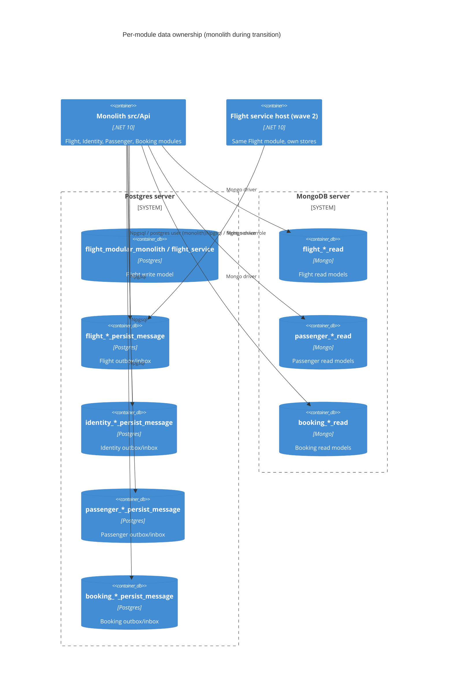

# 0492. Per-service databases and per-module outbox/inbox (AB-492)

- **Status:** Proposed
- **Date:** 2026-10-13
- **ARB ticket:** TO BE CREATED (no ARB Jira project on this site)
- **Authors:** Devin (for AB-488 microservices migration)
- **Owning team:** Booking platform team (owner of `booking-modular-monolith`)
- **Related ADRs:** sibling AB-488 ADRs (gateway AB-489, messaging AB-501, contracts AB-494/AB-506)

## Context

The modules (Identity, Flight, Passenger, Booking) already use separate Postgres write databases, but
they shared three stores that block a clean split into services:

1. one `persist_message` outbox/inbox database (`PersistMessageDbContext`) used by every module, polled
   by a single `PersistMessageBackgroundService`;
2. one Mongo read database (`booking_modular_monolith_read`) for Flight, Passenger and Booking;
3. one `IEventDispatcher` / `IPersistMessageProcessor`, so a module could not tell which store it wrote to.

Two pollers (monolith + a service host) on the same outbox table would double-publish, and a shared
read DB makes collection ownership implicit. `UseMigration<TContext>` also ran every module's seeders.

ARB triggers: **T2** (new/changed data stores: per-module outbox DBs, per-module Mongo read DBs, per-service
Postgres roles/DBs), **T8** (shared BuildingBlocks API change used by all modules).

## Decision

We will make every data store module-owned:

- **Outbox/inbox**: `builder.AddPersistMessageProcessor<TModuleRoot>("<Module>")` registers
  `PersistMessageDbContext<TModule>`, `IPersistMessageProcessor<TModule>`, `IEventDispatcher<TModule>` and
  a `PersistMessageBackgroundService<TModule>` per module. There is no non-generic/shared registration and
  no fallback connection string; a missing module connection string fails fast.
- **Mongo**: `builder.AddMongoDbContext<TContext>("<Module>")` binds named `MongoOptions` per module; the
  database name is required per module (no shared fallback).
- **Seeding/migrations**: `UseMigration<TContext>` migrates `TContext` and runs only the `IDataSeeder`s in
  `TContext`'s assembly.
- **Background switch**: `Modules:<Module>:BackgroundProcessingEnabled` (default `true`) gates that module's
  outbox poller, its MassTransit consumers (monolith) and, for Booking, the EventStoreDB `$all` subscription.
- **Service databases**: compose provisions `<module>_service` + `<module>_service_persist_message` Postgres
  databases, each owned by a dedicated `<module>_service` role with `CONNECT` revoked from `PUBLIC`.

The monolith keeps its existing `*_modular_monolith` write DBs and credentials; only its outbox/inbox is
split into `<module>_modular_monolith_persist_message` and its read DB into `<module>_modular_monolith_read`
(Booking keeps `booking_modular_monolith_read`).

### Configuration keys

| Concern | Key (first match wins) | Monolith value | Service host value |
| --- | --- | --- | --- |
| Write DB | `ConnectionStrings:<module>` (Aspire), `PostgresOptions:ConnectionString:<Module>` | `<module>_modular_monolith` | `<module>_service` |
| Outbox/inbox | `ConnectionStrings:<module>-persist-message` (Aspire), `PersistMessageOptions:ConnectionString:<Module>` | `<module>_modular_monolith_persist_message` | `<module>_service_persist_message` |
| Read DB name | `MongoOptions:<Module>:DatabaseName` (required) | `<module>_modular_monolith_read` | `<module>_service_read` |
| Read DB server | `MongoOptions:<Module>:ConnectionString`, `ConnectionStrings:<module>-mongo`, `ConnectionStrings:mongo`, `MongoOptions:ConnectionString` | shared server | own server/credentials |
| Background work | `Modules:<Module>:BackgroundProcessingEnabled` (default `true`) | `false` once that service host runs | `true` |
| Poller | `PersistMessageOptions:Enabled` (default `true`), `PersistMessageOptions:Interval` | | |

## Alternatives considered

| Alternative | Pros | Cons | Why rejected |
| --- | --- | --- | --- |
| Do nothing | No change | Monolith and service host poll the same `persist_message` table; implicit read-DB ownership | Blocks AB-488 split |
| Shared outbox DB, one schema or a `module` column per module | One DB to run | Still one store and credentials across services; pollers need row-level partitioning | Ticket requires no shared persist_message store |
| Outbox table inside each module's write DB | Single DB per module | Booking has no Postgres write DB; existing EF migrations would need to own the table | Kept as an option for later (table creation already works in a non-empty DB) |
| Keyed DI services (`[FromKeyedServices("Flight")]`) instead of `TModule` generics | No marker types | Stringly-typed, errors only at runtime, `ActivatorUtilities`/MediatR behaviours need attributes | Generic marker types are compile-time checked |
| Outbox locking so monolith + service share a table | No new DBs | Distributed locking, still a shared store | Rejected in favour of the per-module switch (epic decision) |

## Architecture

Monolith and service host use different database names (`*_modular_monolith*` vs `*_service*`), so the
diagram's `*` stands for either; they never share a store.

## Non-functional requirements

| NFR | Target | How met |
| --- | --- | --- |
| Availability SLO | TBD — owner to confirm before ARB | Unchanged infra; one Postgres + one Mongo server |
| p95 latency | Unchanged | Same queries; one extra pooled connection per module |
| RPO / RTO | TBD — owner to confirm before ARB | Per-database backups now possible |
| Peak load | TBD | Up to 4 outbox pollers instead of 1 (default every 30 s) |
| Scaling model | Per service | Each service scales with its own DBs |
| Data retention | Unchanged | Outbox rows are not purged today (pre-existing) |

## Security & compliance

- **Data classification:** unchanged (passenger PII stays in the Passenger stores).
- **Encryption at rest / in transit:** unchanged (local dev compose has none; production TBD by platform).
- **AuthN / AuthZ:** service DBs owned by a dedicated role; `CONNECT` revoked from `PUBLIC`, so a service
  role cannot open another service's database.
- **Secrets:** compose init script uses dev-only passwords; real environments must inject credentials via
  connection-string configuration from a secret store.
- **Audit logging / residency:** unchanged.
- **Threats considered:** cross-service reads/writes (mitigated by roles); duplicate publishing by two
  pollers (mitigated by separate DBs + background switch).

## Cost

| Item | Assumption | Monthly estimate |
| --- | --- | --- |
| Extra logical databases | Same Postgres/Mongo servers | ~$0 |
| **Total** | | ~$0 (no new servers) |

## Operations

- **On-call rotation / runbook / dashboards:** TBD — owning team.
- **Rollback plan:** revert the PR; the old shared `persist_message` DB is untouched.
- **Migration / cut-over plan:** before deploying, drain the old shared `persist_message` table (no rows
  with `message_status <> 2`). Flight's read models are rebuilt by the Flight seeder only when the Postgres
  `seat` table is empty, and Passenger's read models are not rebuilt, so copy `flight*`/`passenger*`
  collections from `booking_modular_monolith_read` into the new read DBs (or re-seed). Data migration into
  `*_service` DBs is deferred to cut-over (AB-505).

## Policy exceptions requested

| Rule | Resource | Justification | Compensating control | Expiry |
| --- | --- | --- | --- | --- |
| none | | | | |

## Consequences

- Positive: no shared outbox/inbox or read DB; each module migrates/seeds independently; a service host can
  take over a module by setting `Modules:<Module>:BackgroundProcessingEnabled=false` in the monolith.
- Negative / risks: more databases to provision; the monolith's write+outbox transaction still spans two
  connections (`TransactionScope`, as before); existing local deployments need the data steps above.
- Follow-ups: per-service credentials for the monolith's own DBs at cut-over; outbox purge job;
  MassTransit inbox wiring with `IPersistMessageProcessor<TModule>` (AB-501).

## Open questions

- NFR targets and production credential management (owner to confirm before ARB).
