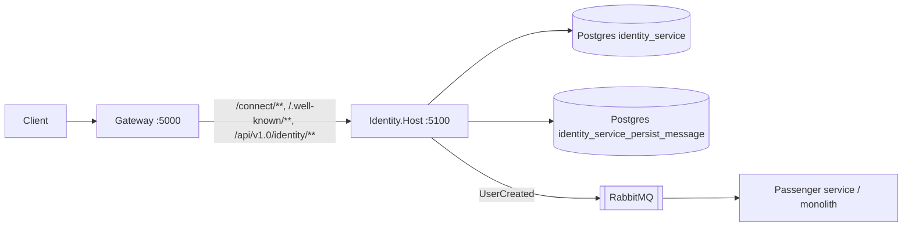

# 0493. Standalone Identity service host

- **Status:** Proposed
- **Date:** 2026-10-13
- **ARB ticket:** TO BE CREATED
- **Authors:** Devin (AB-493)
- **Owning team:** TBD — owner to confirm before ARB
- **Related ADRs:** 0001-service-boundaries, 0002-strangler-fig-migration-behind-gateway,
  0004-data-ownership-database-per-service, 0008-service-host-layout-and-ports,
  0492-ab-492-per-service-databases-and-outbox, 0501-ab-501-rabbitmq-message-broker

## Context

The Identity module (ASP.NET Identity + Duende IdentityServer) only runs inside the monolith
`src/Api`, composed via `AddIdentityModules()`/`UseIdentityModules()`. Epic AB-488 extracts one
deployable per module behind the YARP gateway (strangler fig). Identity is the issuer every other
service validates tokens against and the publisher of the `UserCreated` integration event.

ARB triggers: T1 (new deployable `Identity.Host` + Docker image), T2 (new Postgres databases
`identity_service` and `identity_service_persist_message`, holding user PII/password hashes that
today live in `identity_modular_monolith`), T6 (the token issuer moves to its own process; issuer
is configured with `AuthOptions:IssuerUri`).

## Decision

Add `src/Services/Identity.Host` (ASP.NET Core, port 5100 / container port 80) that composes only
the Identity module plus focused BuildingBlocks projects (Core, EFCore, Jwt, Web, MassTransit,
PersistMessageProcessor, HealthCheck, OpenTelemetryCollector, ProblemDetails) and
Contracts.Messages. `Identity.csproj` references focused BuildingBlocks projects instead of the
aggregate so the host does not pull in Mongo/EventStoreDB/TestBase through the module.

- Data: `PostgresOptions:ConnectionString:Identity` → `identity_service`;
  `PersistMessageOptions:ConnectionString:Identity` → `identity_service_persist_message`.
  Migrations run at startup (`UseMigration<IdentityContext>`), seed data outside `test`.
- Messaging: `MessageBroker:TransportType=RabbitMq`, `ServiceName=identity-service`; `UserCreated`
  is written to the Identity outbox and published to RabbitMQ by the outbox worker.
- Auth: IdentityServer issuer from `AuthOptions:IssuerUri`; set it to the gateway's public URL
  when traffic arrives via `/connect/**` and `/.well-known/**` on the gateway. The host's own API
  (`register-user`) validates bearer tokens via `Jwt:{Authority,Audience}`.
- No other modules, no gRPC, no Mongo/EventStore. Data migration from the monolith DB is deferred
  to cutover (AB-505).

## Alternatives considered

| Alternative | Pros | Cons | Why rejected |
| --- | --- | --- | --- |
| Keep Identity in the monolith | No new deployable | Blocks AB-488 extraction | Epic goal |
| Reuse monolith `identity_modular_monolith` DB | No data migration | Shared DB couples deployables | ADR 0004 (DB per service) |
| Reference ServiceDefaults | Shared defaults | Pulls the aggregate BuildingBlocks | Ticket asks for focused refs |

## Architecture

## Non-functional requirements

- Availability: same as monolith during transition (single replica); Identity outage blocks token
  issuance for all services — run at least as many replicas as the gateway in production.
- Data classification: PII (names, email, passport number) and password hashes — unchanged data,
  new physical location.
- Load: login and registration traffic only.

## Security & compliance

- Signing keys: `AddDeveloperSigningCredential` (unchanged from the monolith) — production key
  management is an open item for ARB.
- Secrets (DB/RabbitMQ credentials) come from configuration/environment; defaults are local-dev only.
- Transport: plain HTTP inside the cluster behind the gateway, same as other hosts (ADR 0008).

## Cost & ownership

- One extra container plus two databases on the existing Postgres server; no new vendor.
- Owner: TBD (Identity team) — runbook to be added with the cutover (AB-505).

## Consequences

- Downstream services must trust the configured issuer; wave-3 tickets (gateway repoint, compose,
  Aspire) wire `AuthOptions__IssuerUri`/`Jwt__Authority` and the RabbitMQ connection.
- While the monolith and Identity.Host run side by side, turn off the monolith's Identity outbox
  worker with `Modules:Identity:BackgroundProcessingEnabled=false` (ADR 0005).
