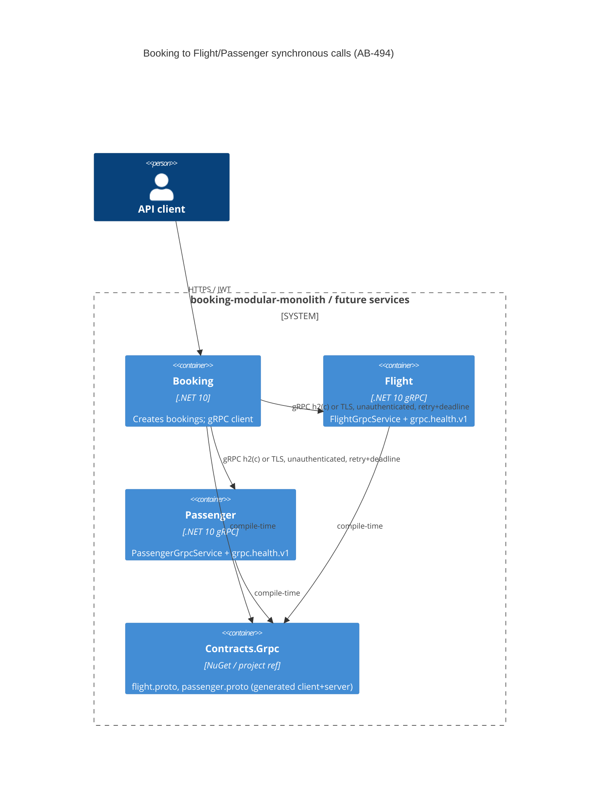

# 0494. Shared gRPC contracts package and config-driven service addressing

- **Status:** Proposed
- **Date:** 2026-10-13
- **ARB ticket:** TO BE CREATED
- **Authors:** Devin (AB-494)
- **Owning team:** TBD — booking-modular-monolith maintainers to confirm before ARB
- **Related ADRs:** AB-499 target-architecture ADRs (sibling ticket); AB-489 YARP gateway

## Context

Booking calls Flight and Passenger synchronously over gRPC. Each side compiled its own copy of the
`.proto` files, and the copies had drifted: Booking's clients used `package bookingFlight;` /
`bookingPassenger;` while the servers use `flight;` / `passenger;`. The proto package is part of
the HTTP/2 path (`/flight.FlightGrpcService/GetById`), so a cross-process call from Booking to a
separately deployed Flight or Passenger service returns `Unimplemented`. Booking also bound
endpoint addresses from a scalar `GrpcOptions` section with no deadlines, no gRPC-aware retries,
and no readiness signal, which blocks the strangler-fig split into separately deployable services
(epic AB-488).

ARB triggers: T4 (sync contract change — new shared proto schema and corrected wire package on the
Booking client side), T8 (new shared library consumed by three modules/future services), T6
(minor — the docker image now exposes an internal unauthenticated h2c gRPC port 81). Detector hit
T1 on `src/Api/Dockerfile` is a false positive (existing image, only a COPY line and `EXPOSE 81`).

## Decision

We will keep a single copy of each gRPC contract in a new `src/Contracts/Contracts.Grpc` project
(SemVer `Contracts.Grpc` package, generated clients and servers, `.proto` files packed under
`protos/`), referenced by Booking, Flight and Passenger; normalise the packages to `flight` and
`passenger`; and make Booking resolve `Grpc:FlightAddress` / `Grpc:PassengerAddress` from
configuration as plain `http(s)` URLs that go through Microsoft.Extensions.ServiceDiscovery
(Aspire `services:<name>:<scheme>:<n>` locally, DNS/Kubernetes service names in cluster). Booking's
gRPC clients use gRPC-native retries (status `Unavailable`, exponential backoff, `Grpc:MaxAttempts`),
a default per-call deadline (`Grpc:Deadline`), a Polly circuit breaker on the HTTP handler in place
of the host-wide standard resilience handler, optional TLS (`https` addresses, dev-only
`Grpc:AllowUntrustedServerCertificate`), and `grpc.health.v1` readiness checks (tags `ready`,
`grpc`). gRPC servers expose `grpc.health.v1`. Contracts evolve additively only; breaking changes
ship as a new versioned package (`flight.v2`) served side by side.

## Alternatives considered

| Alternative | Pros | Cons | Why rejected |
| --- | --- | --- | --- |
| Do nothing | No churn | Cross-process calls fail (`Unimplemented`); drift continues | Blocks AB-488 service split |
| Keep per-module copies, fix package names only | Smallest diff | Copies drift again; no single owner for the contract | Ticket requires one source of truth |
| Separate contracts repo / Buf registry | Strong governance, breaking-change linting | New tooling and pipeline; overkill while services share one repo | Can be adopted later; package already carries the protos |
| Keep standard HTTP resilience handler (Polly retry) for gRPC | One policy for all HttpClients | HTTP retries don't understand gRPC status codes and can't replay streams; double-retries with gRPC retries | gRPC-native retry is the documented approach |

## Architecture

## Non-functional requirements

| NFR | Target | How met |
| --- | --- | --- |
| Availability SLO | TBD — owner to confirm before ARB | Retries on `Unavailable`, circuit breaker, readiness checks gate traffic |
| p95 latency | TBD — owner to confirm before ARB | Default deadline 10s caps tail latency; configurable per environment |
| RPO / RTO | N/A — no data store introduced | — |
| Peak load | TBD — owner to confirm before ARB | Multiple HTTP/2 connections enabled per channel |
| Scaling model | Horizontal per service (AB-491) | Discovery resolves DNS/K8s service names |
| Data retention | N/A — no data persisted | — |

## Security & compliance

- **Data classification:** unchanged — same flight/passenger fields as today (passenger PII: name,
  passport number, email) now cross a network hop instead of an in-process loopback call.
- **Encryption at rest:** N/A — no new storage.
- **Encryption in transit:** TLS when the address is `https://`; plain h2c is allowed for in-cluster
  or docker-network traffic. `AllowUntrustedServerCertificate` is development-only.
- **AuthN / AuthZ:** none service-to-service (explicit epic decision; ARB follow-up to add mTLS or
  token auth). The gRPC port must not be exposed through the gateway or public ingress.
- **Secrets:** none introduced.
- **Audit logging:** unchanged (existing request logging / OpenTelemetry).
- **Data residency / regions:** unchanged.
- **Policy sections satisfied:** no AWS/CDK resources; `policy/approved-infra.yaml` not applicable.
- **Threats considered:** unauthenticated internal port (mitigated by network isolation; follow-up),
  retry storms (bounded attempts + backoff + circuit breaker).

## Cost

| Item | Assumption | Monthly estimate |
| --- | --- | --- |
| Code-only change | No new infrastructure | $0 |
| **Total** | | $0 |

## Operations

- **On-call rotation:** TBD — owner to confirm before ARB
- **Runbook:** `src/Contracts/Contracts.Grpc/README.md` (contract rules); Booking `Grpc` config keys
- **Dashboards / alarms:** readiness checks tagged `ready`/`grpc`; AB-495 wires them into probes/dashboards
- **Rollback plan:** revert the PR; contracts are wire-compatible with the existing servers
- **Migration / cut-over plan:** monolith keeps calling itself (`Grpc:*Address` → its own gRPC
  endpoint); repoint the addresses to Flight/Passenger services when their hosts ship (AB-496/498)

## Policy exceptions requested

| Rule | Resource | Justification | Compensating control | Expiry |
| --- | --- | --- | --- | --- |
| none | | | | |

## Consequences

- Positive: one contract, cross-process calls work, endpoints are environment-driven, transient
  faults and slow dependencies are bounded.
- Negative / risks: contract changes now affect three modules at once; unauthenticated gRPC.
- Follow-ups: service-to-service auth (ARB), breaking-change linting (e.g. `buf breaking`) in CI,
  readiness probe wiring (AB-495), AppHost references for discovery (AB-497).

## Open questions

- Owning team, on-call rotation, SLO and latency targets for the gRPC dependency.
- Timeline for service-to-service authentication.
