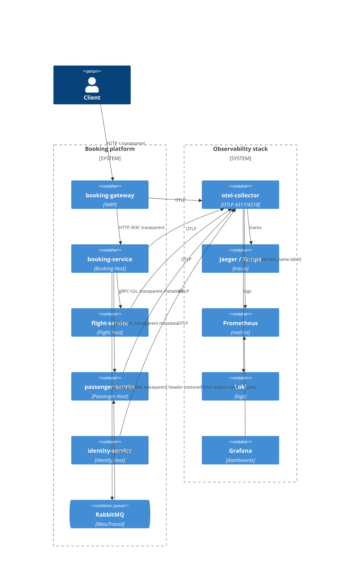

# 0495. Per-service observability, probe contract and trace propagation

- **Status:** Proposed
- **Date:** 2026-10-29
- **ARB ticket:** TO BE CREATED
- **Authors:** Devin (AB-495)
- **Owning team:** Platform team
- **Related ADRs:** [0001](0001-yarp-api-gateway-single-ingress.md), [0100](0100-buildingblocks-shared-libraries.md), [0102](0102-rabbitmq-transport-and-module-queues.md), [0103](0103-standalone-identity-service-host.md), [0104](0104-passenger-service-host.md), [0496](0496-standalone-booking-service-host.md), [0502](0502-standalone-flight-service-host.md)

## Context

OpenTelemetry, health checks and the Jaeger/Tempo/Prometheus/Grafana/Loki stack were wired for one process. After the
strangler-fig split (gateway + Identity/Flight/Passenger/Booking hosts beside the monolith) we found:

- Every deployable reported a free-text `service.name` ("Flight Service", ...) or its assembly name, so backends could not
  reliably tell processes apart, and there was no environment override for orchestrators.
- Most appsettings used the misspelt key `OTLPGrpExporterEndpoint`, which never bound: docker hosts silently exported to
  `localhost:4317` instead of `otel-collector:4317`.
- Health endpoints were mapped per host with diverging paths (`/health`+`/alive` in Development only, `/health/live`+`/health/ready`
  in some hosts, both in others), so compose/K8s had no single probe contract.
- An integration event written to the outbox inside a request was published later by the background worker in a *new*
  trace: the RabbitMQ hop broke the distributed trace.

### Architecture review triage

```
ARB triage: ARB_REQUIRED
Triggers:
- T4 Async contract change: PersistMessageProcessor stores W3C traceparent/tracestate in every outbox/internal-command
  envelope header (additive, no wire rename); /health/live, /health/ready become a probe contract for all services
- T8 Spans >1 team: shared BuildingBlocks.HealthCheck / OpenTelemetryCollector / PersistMessageProcessor behaviour
  changes for gateway, monolith and the Identity/Flight/Passenger/Booking hosts
Not triggered: T1 (detector hit on docker-compose.yaml is healthchecks/env on existing services only), T2, T3 (detector
hit is a pre-existing grafana.com link in dashboards.md), T5, T6, T7 (Tempo pinned 2.7.2, not an upgrade), T9
Required next steps: ADR (this file), ARB ticket, diagram, NFRs, cost estimate
```

### Telemetry flow



## Decision

1. **Service identity.** `service.name` resolves `OTEL_SERVICE_NAME` > `ObservabilityOptions:ServiceName` > application
   name; every deployable declares a kebab-case name (`booking-gateway`, `booking-modular-monolith`, `identity-service`,
   `flight-service`, `passenger-service`, `booking-service`) with `service.namespace=booking`,
   `deployment.environment.name` and `service.instance.id`. `OTEL_EXPORTER_OTLP_ENDPOINT` overrides the collector endpoint.
   The misspelt key keeps binding for backwards compatibility.
2. **Probe contract (ServiceDefaults, all environments).** `/health/live` and `/alive` = checks tagged `live` (process only);
   `/health/ready` = every other check (the host's own dependencies); `/health` = all. JSON body
   `{status, checks:{name:{status,description}}}`. Hosts no longer map their own probe routes; gRPC health stays on the
   h2c listener. Probe/scrape paths are excluded from request traces and HTTP metrics.
3. **Health as a metric.** An `IHealthCheckPublisher` exports `booking.health.status{check}` (1/0.5/0) every 30 s
   (`HealthOptions:MetricsEnabled`, default true).
4. **Trace context through the outbox.** When an outbox/internal-command row is written, the current W3C `traceparent`/`tracestate`
   is stored in the envelope headers. The worker starts `outbox publish <Event>` (source `BuildingBlocks.PersistMessageProcessor`)
   parented to it; MassTransit's publish/consume spans (already instrumented, W3C headers on RabbitMQ) become its children.
   Stored trace headers are not copied onto the MassTransit message, so MassTransit owns the wire `traceparent`.
   HTTP (YARP, HttpClient) and gRPC client/server spans already propagate W3C context.
5. **Backends.** The collector converts resource attributes to metric labels (`service_name`), a provisioned Grafana
   dashboard `booking-services` gives per-service health, RED metrics, logs (Loki) and traces (Tempo); Tempo is pinned to 2.7.2.

## Alternatives considered

- *Keep per-host probe mapping* — rejected: three diverging contracts already existed; orchestrator manifests (AB-491/AB-503) need one.
- *Use MassTransit's own outbox* — out of scope; replacing the persist-message outbox is a much larger change than carrying the trace context.
- *Span links instead of parent/child for the outbox hop* — links preserve causality but Jaeger/Tempo render them as separate traces;
  the acceptance criterion is one trace per booking request.

## Consequences

- Delayed outbox publishes appear in the originating trace (possibly seconds later); retries add sibling publish spans.
- Deployment manifests must use `/health/live` for liveness and `/health/ready` for readiness/startup.
- Additional label cardinality per service in Prometheus (bounded: one series set per service instance).
- The Booking EventStoreDB `$all` projection still starts its own traces (follow-up).

## Non-functional requirements

- Availability: telemetry export is best-effort and asynchronous (batch exporters); a collector outage must not fail requests.
  Probes have no external dependency beyond the checks each host already registered.
- Data classification: telemetry is operational metadata (Internal). Trace headers carry only IDs; no PII is added to spans,
  probe bodies or the persisted envelope. RPO/RTO: not applicable (telemetry is not system of record).
- Expected load: one health gauge series per check per instance every 30 s; outbox adds one span per published row.

## Security, cost, ownership

No new endpoints beyond probes already exposed by the gateway/hosts; probe bodies list check names and status only (no
connection strings). No new vendor; existing OSS stack. Owner: Platform team.
