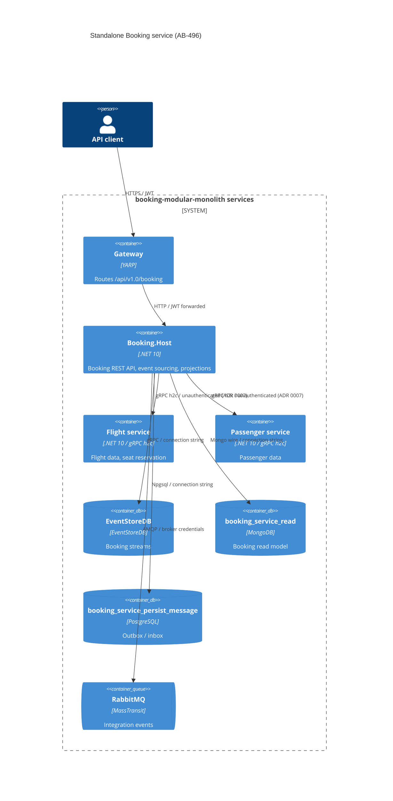

# 0496. Standalone Booking service host

- **Status:** Proposed
- **Date:** 2026-10-13
- **ARB ticket:** TO BE CREATED
- **Authors:** Devin (AB-496)
- **Owning team:** TBD — booking-modular-monolith maintainers to confirm before ARB
- **Related ADRs:** [0002](0002-strangler-fig-migration-behind-gateway.md),
  [0003](0003-inter-service-communication.md), [0004](0004-data-ownership-database-per-service.md),
  [0005](0005-side-by-side-background-processing-switch.md),
  [0007](0007-unauthenticated-internal-grpc-accepted-risk.md),
  [0008](0008-service-host-layout-and-ports.md), [0494](0494-ab-494-shared-grpc-contracts-and-addressing.md),
  [0500](0500-ab-500-split-buildingblocks.md)

## Context

Epic AB-488 splits the modular monolith into one deployable service per module behind the YARP
gateway (strangler fig). Booking is the only event-sourced module: it appends to EventStoreDB,
projects into a Mongo read model through an all-streams subscription, publishes `BookingCreated`
through the outbox, and calls Flight and Passenger synchronously over gRPC from
`CreateBookingCommandHandler`. Until now it only ran inside `src/Api`.

ARB triggers: T1 (new deployable service `Booking.Host` + Docker image), T2 (new stores owned by the
service: EventStoreDB stream store, Mongo `booking_service_read`, Postgres
`booking_service_persist_message`), T4 (Booking→Flight/Passenger gRPC calls become cross-process;
`BookingCreated` published on the shared RabbitMQ broker from a new process). T6 is not newly
triggered: the host exposes the same JWT-protected REST surface the monolith already exposes for
Booking, and service-to-service gRPC stays unauthenticated as accepted in ADR 0007.

## Decision

We will add `src/Services/Booking.Host`, a standalone ASP.NET Core host that composes the existing
`src/Modules/Booking` module unchanged in shape (`AddBookingModules` / `UseBookingModules`) plus only
the focused BuildingBlocks it needs (HealthCheck, Jwt, MassTransit, OpenTelemetryCollector,
PersistMessageProcessor, ProblemDetails and, transitively, Core/EventStoreDB/Mongo/Web) and the
shared `Contracts.Grpc` / `Contracts.Messages` packages. The host owns its own EventStoreDB
connection and all-streams subscription, its Mongo read database `booking_service_read` and its
outbox/inbox database `booking_service_persist_message`. It reaches Flight and Passenger through the
AB-494 gRPC clients configured by `Grpc:FlightAddress` / `Grpc:PassengerAddress`, listens on 5400
locally (80 in the container), and exposes `/`, `/health` and `/alive` plus OpenTelemetry. The host
does not reference the aggregate `BuildingBlocks.csproj` or the Aspire `ServiceDefaults` project
(which depends on the aggregate); it registers the same service defaults (health checks,
observability, service discovery, HTTP resilience) itself.

### Configuration (Booking.Host)

| Concern | Key | Local default |
|---|---|---|
| Event store | `EventStoreOptions:ConnectionString` | `esdb://localhost:2113?tls=false` |
| Read DB | `MongoOptions:ConnectionString`, `MongoOptions:Booking:DatabaseName` | `booking_service_read` |
| Outbox/inbox | `PersistMessageOptions:ConnectionString:Booking` | `booking_service_persist_message` |
| gRPC dependencies | `Grpc:FlightAddress`, `Grpc:PassengerAddress`, `Grpc:Deadline`, `Grpc:MaxAttempts` | `http://localhost:5201`, `http://localhost:5301` |
| Background work | `Modules:Booking:BackgroundProcessingEnabled` | `true` (ESDB `$all` subscription + outbox poller) |

The host owns the Booking outbox registration (`AddPersistMessageProcessor<BookingRoot>("Booking")`),
mirroring the monolith, because the Booking module itself does not reference EF Core.

## Alternatives considered

| Alternative | Pros | Cons | Why rejected |
| --- | --- | --- | --- |
| Do nothing (Booking stays in `src/Api`) | No new deployable | Booking cannot scale/deploy independently; blocks AB-488 | Contradicts epic goal |
| Move Booking module code into the host project | One project per service | Large diff; monolith would lose Booking during transition | Strangler fig needs the monolith to keep composing the module |
| Share the monolith's EventStoreDB/Mongo/outbox stores | No new stores | Two writers/subscribers on the same stores; violates ADR 0004 | Data ownership per service |
| Reference `ServiceDefaults` for defaults | Less code | Pulls the aggregate BuildingBlocks into the service | Violates AB-500 focused-reference rule |

## Architecture

## Non-functional requirements

| NFR | Target | How met |
| --- | --- | --- |
| Availability SLO | TBD — owner to confirm before ARB | `/health` (readiness incl. ESDB/Mongo/Postgres/RabbitMQ when enabled) and `/alive` probes |
| p95 latency | TBD — owner to confirm before ARB | gRPC deadline `Grpc:Deadline` (10s default) bounds CreateBooking |
| RPO / RTO | TBD — owner to confirm before ARB | EventStoreDB is the source of truth; read model rebuildable from streams |
| Peak load | TBD — owner to confirm before ARB | Stateless host; scale horizontally (one subscription consumer per checkpoint, see open questions) |
| Scaling model | Horizontal pods/containers | Outbox and subscription are per-service |
| Data retention | Unchanged from monolith | N/A |

## Security & compliance

- **Data classification:** Same booking/passenger-name data the monolith already stores; no new classes.
- **Encryption at rest:** Inherited from the hosting platform's database volumes (unchanged).
- **Encryption in transit:** REST behind the gateway; internal gRPC h2c unencrypted (ADR 0007 accepted risk; `https` addresses supported).
- **AuthN / AuthZ:** Same JWT bearer + `ApiScope` policy as the monolith; internal gRPC unauthenticated (ADR 0007).
- **Secrets:** Connection strings and broker credentials via configuration/env vars; none committed.
- **Audit logging:** Structured logs + OpenTelemetry traces/metrics (BuildingBlocks.OpenTelemetryCollector).
- **Data residency / regions:** Unchanged.
- **Policy sections satisfied:** No cloud infrastructure-as-code in this change.
- **Threats considered:** Lateral movement over unauthenticated internal gRPC (ADR 0007 follow-up).

## Cost

| Item | Assumption | Monthly estimate |
| --- | --- | --- |
| Booking.Host container + its own ESDB/Mongo/Postgres DBs | Shares existing servers in compose/Helm | TBD — owner to confirm before ARB |
| **Total** | | TBD |

## Operations

- **On-call rotation:** TBD — owner to confirm before ARB
- **Runbook:** TBD (AB-505 cut-over)
- **Dashboards / alarms:** OpenTelemetry exporters configured by `ObservabilityOptions`
- **Rollback plan:** Repoint the gateway Booking cluster back to the monolith and re-enable `Modules:Booking:BackgroundProcessingEnabled` there.
- **Migration / cut-over plan:** Data migration from the monolith stores is deferred to AB-505.

## Policy exceptions requested

| Rule | Resource | Justification | Compensating control | Expiry |
| --- | --- | --- | --- | --- |
| none | | | | |

## Consequences

- Positive: Booking deploys and scales independently; contract seams (gRPC, RabbitMQ) exercised cross-process in tests.
- Negative / risks: Running both the monolith and the service requires the background-processing switch to avoid two ESDB subscribers/outbox workers; more stores to operate.
- Follow-ups: Compose/Aspire/Helm wiring (AB-497/AB-503/AB-491), gateway cluster repoint, gRPC auth (ADR 0007), data migration (AB-505).

## Open questions

- Owner team, SLOs and cost figures.
- Competing-consumer behaviour of the all-streams subscription when Booking.Host runs with more than one replica.
