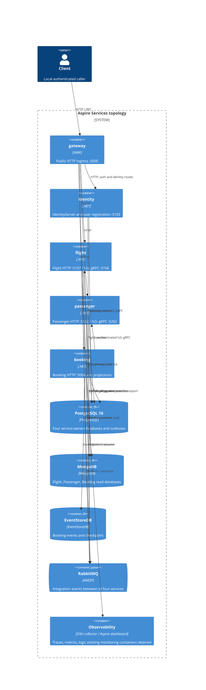

# 0497. Aspire AppHost microservices topology

- **Status:** Proposed
- **Date:** 2026-10-29
- **ARB ticket:** TO BE CREATED
- **Authors:** Devin (AB-497)
- **Owning team:** Booking platform team
- **Related ADRs:** [0001](0001-yarp-api-gateway-single-ingress.md), [0002](0002-per-service-data-ownership.md), [0103](0103-shared-grpc-contracts-and-service-addressing.md), [0496](0496-standalone-booking-service-host.md)

## Context

The standalone service hosts exist, but AppHost previously composed one `api` process referencing every store.
Developers need to exercise the real gateway, messaging, database ownership, and cross-process gRPC boundaries locally.
The monolith remains useful as an explicit compatibility topology, not a second set of workers in the same run.

### Architecture review triage

**ARB_REQUIRED** — AppHost's Docker Compose publisher now emits four service deployables and their data stores,
changing deployment, data-ownership, and network boundaries. This ADR is proposed; ARB approval is required before merge.

### Container view

## Decision

1. **Explicit topologies.** `AppHost:Topology=Services` is the default: exactly `gateway`, `identity`, `flight`,
   `passenger`, `booking`; no `api`. `Monolith` registers only `api` and `gateway`, with all gateway clusters pointing
   to `api`. Unknown or empty values fail configuration.
2. **Per-service resources.** Database resources are created only inside the selected branch. Services use the table
   below; Monolith creates `identity-db`, `flight-db`, `passenger-db`, `booking-db` with physical database names
   `identity`, `flight`, `passenger`, `booking`. Monolith does not share the service databases.

   | Host | PostgreSQL resource / physical database | Mongo read database | EventStoreDB | RabbitMQ |
   |---|---|---|---|---|
   | identity | identity-service-db / identity_service | None | None | Yes |
   | flight | flight-service-db / flight_service | flight_service_read | None | Yes |
   | passenger | passenger-service-db / passenger_service | passenger_service_read | None | Yes |
   | booking | booking-service-db / booking_service | booking_service_read | Booking events / checkpoint | Yes |

   Each service receives `ConnectionStrings:<service>` and `ConnectionStrings:<service>-persist-message`, plus
   `PostgresOptions:ConnectionString:<Module>`, targeting its own database for writes, outbox, and health checks.
   Mongo consumers also receive the root `MongoOptions:ConnectionString`; Booking receives the root EventStore
   connection. References and `WaitFor` gates represent only each host's actual dependencies.
3. **Endpoint-based discovery.** Booking receives `services__flight__grpc__0` and `services__passenger__grpc__0` from
   Aspire `Grpc` endpoints. Logical addresses remain `http://_grpc.flight` and `http://_grpc.passenger`.
   `Grpc.Net.Client` cannot consume the composite `https+http://` scheme; explicit HTTP/h2c endpoint references avoid it.
   Disable launch profiles on child projects and replace inferred endpoint annotations with only the listeners each
   host actually binds. Flight and Passenger gRPC endpoints are HTTP/2-only.
4. **Gateway and identity.** Gateway cluster destinations use each host's HTTP endpoint expression, never literal
   loopback service addresses. Services-mode `monolith` fallback points to Identity. The issuer and JWT authority
   remain the public gateway URL `http://localhost:5000`; metadata is derived from Identity's endpoint plus
   `/.well-known/openid-configuration`. Audience stays `booking-modular-monolith`.
5. **Observability and health.** Keep the existing monitoring containers and per-host health probes. The named
   `aspire` OTLP exporter for traces, metrics, and logs honors `OTEL_EXPORTER_OTLP_ENDPOINT`, falling back to
   `AspireDashboardOTLPOptions:OTLPGrpcExporterEndpoint` only when the environment variable is absent. Naming avoids
   collision with the separately configured collector exporter. AppHost supplies per-project service names and
   collector endpoints; container network aliases resolve collector destinations. Grafana uses port 3005 in Monolith
   only, avoiding the API HTTPS listener on 3000; it stays on 3000 in Services.
6. **Compatible infrastructure.** Pin PostgreSQL to `postgres:16` with `max_prepared_transactions=100` and Tempo to
   `grafana/tempo:2.6.1`, verified with `deployments/configs/tempo.yaml`. This avoids PostgreSQL 18 image layout changes
   and incompatible Tempo configuration changes in newer images.

## Alternatives considered

- Keep one `api` project: simplest startup, but does not exercise microservice boundaries or database ownership.
- Run monolith and services together: risks duplicate outbox/subscription processing and requires explicit cutover controls.
- Hard-code service addresses or use `https+http://`: fragile under orchestration, and the composite scheme is not accepted
  by the gRPC client.
- Share the monolith databases: hides ownership violations and conflates compatibility data with service-owned data.

## Consequences

- Services mode has no monolith, so it does not create a competing monolith `BackgroundProcessing` worker set.
- Cross-process networking and asynchronous projection delays become visible during local development.
- Data is **not migrated** between topologies. Migration/rebuild and cutover remain **AB-505** work.
- Internal gRPC remains unauthenticated per the shared decision; this change does not introduce service identity or mTLS.
- More processes and containers require more local memory. HTTP readiness and Docker-free model tests detect wiring drift.

## Non-functional requirements

This is local-development orchestration, not a production availability design. Availability and RPO targets are N/A
locally; local run-mode stores are disposable. Passenger PII resides in `passenger_service` and its read model; Booking
stores contain passenger names and itineraries. Identity stores also contain account/profile information. Use synthetic data.

## Security

PostgreSQL, MongoDB, and RabbitMQ development credentials are Aspire secret parameters with local defaults, not production
credentials. EventStoreDB is insecure locally. HTTP APIs validate gateway-issued tokens; issuer is the gateway URL.
Internal gRPC is unauthenticated h2c per the shared decision and must remain on a trusted development network.
This runbook does not authorize exposing these listeners or default credentials to a public network.

## Cost

No new cloud cost: containers and projects run locally. CPU, memory, and disk usage are borne by the developer machine.

## Ownership and operations

Booking platform team owns AppHost wiring and model tests; service owners retain their persistence/health contracts.
Startup, smoke verification, troubleshooting, and cleanup: [Aspire local runbook](../runbooks/aspire-local.md).
