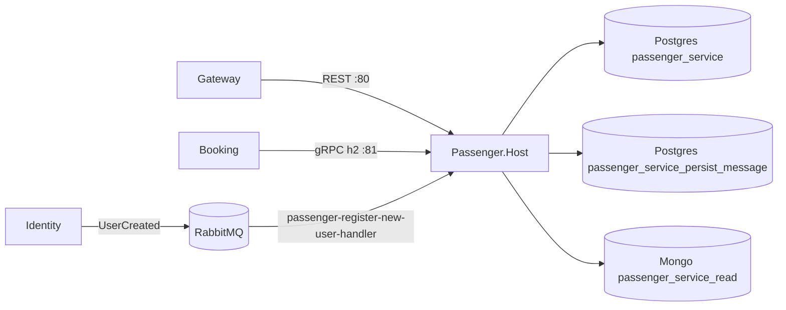

# 0498. Standalone Passenger service host

- **Status:** Proposed
- **Date:** 2026-10-13
- **ARB ticket:** TO BE CREATED
- **Authors:** Devin (AB-498)
- **Owning team:** TBD — owner to confirm before ARB
- **Related ADRs:** 0002 (strangler fig), 0003 (inter-service communication), 0004 (database per
  service), 0005 (background-processing switch), 0007 (unauthenticated internal gRPC), 0008 (service
  host layout and ports), 0501 (RabbitMQ transport)

## Context

Epic AB-488 extracts each module of the modular monolith into its own deployable. Passenger has REST
endpoints, a gRPC server used by Booking (`GetById`), a Mongo read model, and a MassTransit consumer
for Identity's `UserCreated`. Until now it only ran inside `src/Api`.

ARB triggers: T1 (new deployable service and container image), T2 (new service-owned databases
`passenger_service`, `passenger_service_persist_message`, Mongo `passenger_service_read`; no new data
classification — the same passenger name/passport data the monolith already stores).

## Decision

Add `src/Services/Passenger.Host` (`Passenger.Host.csproj`, image `booking-passenger`), which composes
the unchanged Passenger module (`AddPassengerModules` / `UsePassengerModules`) on top of focused
BuildingBlocks projects, `Contracts.Grpc` and `Contracts.Messages`:

- Kestrel `Http` endpoint 5300 (container 80, HTTP/1.1+2) for REST and probes, and a dedicated
  `Grpc` endpoint 5301 (container 81, HTTP/2 only) for `passenger.PassengerGrpcService`.
- RabbitMQ transport with `MessageBroker:ServiceName = passenger`, so the consumer listens on its own
  queue `passenger-register-new-user-handler`, behind the inbox (`MessageBroker:UseInbox = true`).
- Own Postgres write DB, own outbox/inbox DB and own Mongo read DB (ADR 0004); no data migration from
  the monolith DBs here (deferred to cut-over).
- Service defaults (OpenTelemetry, service discovery, resilience), `/health/live`, `/health/ready`
  (Postgres, outbox DB, Mongo, MassTransit bus) and `grpc.health.v1`.
- JWT bearer auth on REST exactly as in the monolith; gRPC stays unauthenticated (ADR 0007).

## Alternatives considered

- **Keep Passenger in the monolith only** — blocks independent deployment and scaling.
- **Share the monolith's databases** — couples schemas and violates ADR 0004.
- **Serve gRPC on the REST port** — Kestrel cannot negotiate h2c on a plain-HTTP `Http1AndHttp2`
  endpoint, so cross-process gRPC needs a dedicated HTTP/2 port.

## Consequences

- When the host runs beside the monolith, set `Modules:Passenger:BackgroundProcessingEnabled=false`
  in the monolith so only one process consumes `UserCreated` and drains the Passenger outbox.
- Compose, Aspire, gateway routing and Booking's `Grpc:PassengerAddress` are wired by later tickets.

## Non-functional requirements

- Availability: same target as the monolith during migration; stateless, horizontally scalable
  (competing consumers on one queue, inbox deduplication on MassTransit `MessageId`).
- Data classification: unchanged (PII: passenger name and passport number).
- Expected load: Passenger slice of current monolith traffic.

## Security

- REST requires the existing `ApiScope` JWT policy; tokens come from the existing Identity issuer.
- gRPC is unauthenticated service-to-service (accepted risk, ADR 0007); expose port 81 only on the
  internal network.
- Secrets (DB/RabbitMQ credentials) come from configuration/environment, none committed.

## Cost and ownership

- One extra container plus three logical databases on existing Postgres/Mongo servers; no new vendor.
- On-call/runbook ownership: TBD with the Passenger owning team.

## Diagram

